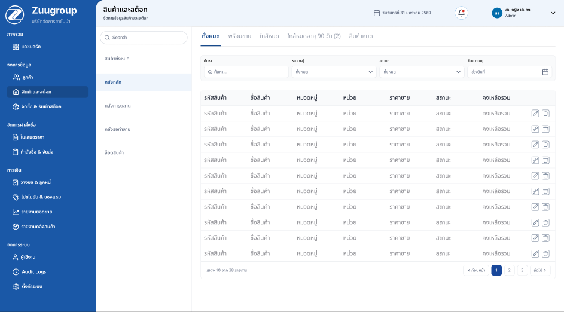

# Design หน้าสินค้าและสต็อก

สถานะ: ร่างสำหรับตรวจตำแหน่งก่อนแก้หน้าเว็บ — TASK-095

## 1. ภาพอ้างอิง



ต้นฉบับ: codex-clipboard-5e5617da-de8c-4cc3-a86e-b859a92f6724.png ที่เจ้าของส่งในบทสนทนา.

ภาพกำหนดโครงหน้าและสไตล์. ข้อความ/ข้อมูลตัวอย่างในภาพไม่แทนกฎธุรกิจที่ยืนยันไว้. หากข้อมูลจริงต้องการพื้นที่เพิ่มที่ภาพไม่มี ให้ถามเจ้าของก่อนเลือกตำแหน่ง.

## 2. ผังหลักบนคอมพิวเตอร์

```text
┌──────────────────┬───────────────────────────────────────────────────┐
│ Main Sidebar     │ Topbar: ชื่อโมดูล | วันที่ | แจ้งเตือน | บัญชี     │
│ โลโก้/ชื่อบริษัท  ├────────────────┬──────────────────────────────────┤
│                  │ ช่องค้นหาเมนู  │ Tabs                   ปุ่มขวาสุด │
│ หมวดเมนูหลัก     │                ├──────────────────────────────────┤
│                  │ สินค้าทั้งหมด  │ ตัวกรองของหน้านั้น               │
│ สินค้าและสต็อก   │ คลังหลัก       ├──────────────────────────────────┤
│                  │ คลังการตลาด    │ ตารางรายการ                      │
│                  │ คลังรอทำลาย    │                                  │
│                  │ ล็อตสินค้า     ├──────────────────────────────────┤
│                  │                │ จำนวนรายการ         เปลี่ยนหน้า  │
│                  │                └──────────────────────────────────┤
│                  │                      พื้นที่ว่างสีขาว             │
└──────────────────┴───────────────────────────────────────────────────┘
```

### ตำแหน่งและสัดส่วน

| พื้นที่ | ตำแหน่ง | รูปลักษณ์ตามภาพ |
| --- | --- | --- |
| Main Sidebar | ซ้ายสุด เต็มความสูง | พื้นสีน้ำเงินเดิม โลโก้และบริษัทด้านบน เมนูพร้อมไอคอน; รายการสินค้าที่เลือกมีพื้นเข้ม |
| Topbar | ด้านบนของพื้นที่ขวา ครอบทั้งเมนูย่อยและเนื้อหา | สีฟ้าอ่อน ชื่อโมดูลซ้าย วันที่/แจ้งเตือน/บัญชีขวา; ไม่ล็อกHeaderตอนเลื่อนตามคำสั่งเดิม |
| Secondary Sidebar | ถัดจากเมนูหลัก เริ่มใต้Topbar | พื้นขาว เส้นแบ่งบาง ช่องSearchทรงมนด้านบน เมนูเรียงแนวตั้ง; รายการเลือกพื้นฟ้าอ่อน |
| เนื้อหา | ขวาของเมนูย่อย | พื้นขาว ระยะขอบพอดี แถวTabsก่อนตัวกรอง ตามด้วยตาราง |
| Tabs | แถวแรกของเนื้อหา | ตัวอักษรเล็ก เรียงแนวนอน แท็บเลือกสีน้ำเงินพร้อมขีดใต้; ไม่ใช้ปุ่มพื้นทึบทุกแท็บ |
| ปุ่มหลัก | ขวาสุดแถวTabs | เพิ่มสินค้าหรือรับสินค้าเข้าตามหน้า ไม่เพิ่มแถวหัวเรื่องเหนือTabs |
| ตัวกรอง | ใต้Tabs เหนือตาราง | พื้นเทา/ฟ้าอ่อนจาง ขอบบาง มุมมนเล็ก ป้ายชื่อเหนือช่อง ช่องสูงเท่ากัน |
| ตาราง | ใต้ตัวกรอง | ขอบบาง มุมมนเล็ก แถวกระชับ เส้นแบ่งแนวนอน สีหัวตารางอ่อน; ไม่ทำเป็นการ์ดแยกแต่ละรายการ |
| Footer ตาราง | ภายในขอบตาราง แถวล่างสุด | จำนวนที่แสดงซ้าย ปุ่มก่อนหน้า/เลขหน้า/ถัดไปขวา |

ภาพตัวอย่างมีความกว้างประมาณ943px: Main Sidebarประมาณ160px, Secondary Sidebarประมาณ160px, เนื้อหาประมาณ623px; Topbarสูงประมาณ44px. ตัวเลขนี้เป็นสัดส่วนสำหรับเทียบภาพ ไม่ใช่คำสั่งเปลี่ยนdesign tokensทั้งระบบหรือกำหนดขนาดคงที่ทุกหน้าจอ. ขนาดจริงที่จะใช้ต้องคงความอ่านง่ายและเทียบภาพก่อนตรวจรับ.

## 3. เมนูย่อย

เรียงตามนี้ทุกหน้าของโมดูล:

1. สินค้าทั้งหมด
2. คลังหลัก
3. คลังการตลาด
4. คลังรอทำลาย
5. ล็อตสินค้า

ย่อMain Sidebarแล้วSecondary Sidebarยังแสดง. เมนูย่อยไม่ซ้อนในแถบสีน้ำเงิน. ช่องSearchด้านบนเมนูย่อยในภาพแยกจากช่องค้นหาข้อมูลในแถวFilter: ห้ามผูกสองช่องให้ค้นข้อมูลเดียวกันโดยเดา. พฤติกรรมช่องSearchเมนูยังเป็นOPEN.

## 4. ตำแหน่งของแต่ละหน้า

**ข้อยืนยันเพิ่มเติม:** หน้าที่มีแท็บเพียงหนึ่งรายการไม่แสดงแท็บหรือแถวTabs และไม่เพิ่มหัวเรื่องทดแทน; เริ่มที่ตัวกรองได้เลย. หากหน้านั้นมีปุ่มหลัก ให้คงปุ่มด้านขวาบนของเนื้อหาก่อนตัวกรอง. หน้าที่มีหลายแท็บยังใช้แถวTabsตามภาพ. กฎนี้ใช้กับทุกหน้าในเอกสาร.

| หน้า | ข้อมูล | Tabs | ปุ่มขวาสุด | ตัวกรอง |
| --- | --- | --- | --- | --- |
| สินค้าทั้งหมด | หนึ่งแถวต่อสินค้า รวมทุกคลัง สินค้าไม่มีล็อตแสดง0 | มีทั้งหมด; การจัดแท็บจำนวน/พร้อมขาย/ลบแล้วตามภาพกับระบบจริงต้องตรวจรายการให้ตรงก่อนแก้ | เพิ่มสินค้า | ค้นหา หมวดหมู่ สถานะ; ช่องวันหมดอายุในภาพต้องยืนยันขอบเขตการกรอง |
| คลังหลัก | เฉพาะสินค้าในMAIN | ใช้สไตล์Tabsเดียวกัน; รายการแท็บของหน้าคลังยังต้องยืนยัน | ไม่มีปุ่มสร้างสินค้า/รับเข้าเพิ่มเอง | ค้นหา หมวดหมู่ สถานะ/อายุที่เกี่ยวข้อง |
| คลังการตลาด | เฉพาะสินค้าในMARKETING | เช่นเดียวกับหน้าคลังหลัก | เช่นเดียวกับหน้าคลังหลัก | กรองเฉพาะคลังนี้ |
| คลังรอทำลาย | เฉพาะสินค้าในDISPOSAL | เช่นเดียวกับหน้าคลังหลัก | เช่นเดียวกับหน้าคลังหลัก | กรองเฉพาะคลังนี้ |
| ล็อตสินค้า | หนึ่งแถวต่อLot ID | ทั้งหมด / ใกล้หมดอายุ / หมดอายุ ตามข้อยืนยันล่าสุด | รับสินค้าเข้า | ค้นหา สินค้า คลัง วันหมดอายุ |

ภาพมีแท็บหลายสถานะ แต่เจ้าของยืนยันใหม่เฉพาะ3แท็บหน้าล็อต. ไม่คัดทุกข้อความในภาพไปใช้กับทุกหน้าโดยอัตโนมัติ. คำเตือนจำนวนต่ำกว่า50อิงยอดพร้อมขายMAINเท่านั้น; อายุใกล้หมดใช้policyเริ่มต้น90วัน แยกกัน.

## 5. ตารางและการกดแถว

### ตารางสินค้าตามภาพ

ลำดับคอลัมน์ต้นแบบ:

`รหัสสินค้า | ชื่อสินค้า | หมวดหมู่ | หน่วย | ราคาขาย | สถานะ | คงเหลือรวม | เครื่องมือ`

- คอลัมน์สถานะใช้StatusBadgeกลางและหัวชื่อ “สถานะ”.
- กดข้อมูลส่วนใดของแถวก็เปิดรายละเอียดได้; ไม่บังคับกดชื่อหรือรหัส.
- ปุ่มเครื่องมือที่ท้ายแถวทำเฉพาะคำสั่งของปุ่ม และไม่เปิดรายละเอียดซ้ำ.
- ภาพมีไอคอนแก้ไข/ลบทางขวา; ตำแหน่งใช้ตามภาพเมื่อมีสิทธิ์ โดยยังใช้ยืนยัน/เหตุผล/การกู้คืนเดิม.
- หน้าคลังใช้ยอดเฉพาะคลังที่เลือก และเปลี่ยนชื่อหัวคอลัมน์เป็น “คงเหลือ” ให้สื่อความหมายจริง.
- จุดวางยอดจอง/พร้อมขายและคำเตือนต่ำกว่า50ยังเป็นOPEN; ไม่เพิ่มคอลัมน์จนตารางกว้างขึ้นโดยไม่ถาม.

### ตารางล็อต

ภาพยังไม่มีตัวอย่างตารางล็อตโดยเฉพาะ จึงไม่ถือว่าจัดคอลัมน์หรือหน้ารายละเอียดล็อตเสร็จแล้ว. ต้องยืนยันลำดับคอลัมน์/ตำแหน่งต้นทุน/วันที่และข้อมูลแยกคลังก่อนแก้. ต้นทุนยังเห็นเฉพาะAdmin/CFOตามกฎเดิม.

## 6. สี ฟอนต์ และรายละเอียดการแสดงผล

- ใช้สีหลักเดิมและค่าสีhexที่เจ้าของกำหนด ไม่เปลี่ยนเป็นเฉดใหม่ทั้งระบบ.
- ตัวแปรสีมาตรฐานแปลงเป็นTailwindตามคำสั่งเดิม เช่น border-blue-100; ไม่แปลงค่าhexที่กำหนดไว้เฉพาะ.
- ใช้Poppinsผ่านคลาสที่มีในระบบ เช่น poppins-regular/poppins-medium/poppins-semibold; คงฟอนต์ภาษาไทยพื้นฐานเดิม.
- ไม่มีหัวเรื่องใหญ่ซ้ำใต้Topbar หรือข้อความอธิบายลอยที่เจ้าของเคยให้ลบ.
- ไม่เพิ่มกล่องสรุปยอด แถวปุ่มประวัติ หรือส่วนตั้งค่าใต้ตารางโดยไม่กำหนดตำแหน่งไว้ก่อน.
- Loadingระหว่างค้นหา/กรอง/แบ่งหน้าอยู่ในพื้นที่ข้อมูล ช่องค้นหาและตัวกรองยังใช้งานได้. ใช้โลโก้Loadingและวงกลมที่ยืนยันไว้เดิม.
- ข้อมูลว่างใช้ `-` ตามความหมายเดิม; จำนวนจริงที่ไม่มีstockแสดง0.
- วันที่ภาษาไทย พ.ศ. และเวลาAsia/Bangkok.
- แถว ตาราง ปุ่ม และFooterใช้รายละเอียด/ระยะห่างเดียวกันทั้ง5หน้า.

## 7. มือถือ — ต้องยืนยันก่อนเปลี่ยนรูปแบบ

ภาพอ้างอิงเป็นdesktop. การเลื่อนเมนูแนวนอน/ตารางแนวนอนในโค้ดปัจจุบันเป็นการจัดจากimplementation ไม่ใช่designมือถือที่เจ้าของตรวจแล้ว. ต้องตกลงว่าต้องการเมนูย่อยแบบแถบเลื่อนหรือdropdown, การเรียงFilter และรูปแบบรายละเอียดก่อนแก้ส่วนนี้. คงการเข้าถึงด้วยคีย์บอร์ดและปุ่มสัมผัสที่ใช้งานได้.

## 8. จุดที่รอคำตอบ (OPEN)

| จุด | คำถาม | สถานะ |
| --- | --- | --- |
| ยอดจอง/พร้อมขาย | แสดงในรายละเอียด หรือเพิ่มคอลัมน์แยก? | ถามเจ้าของแล้ว รอคำตอบ |
| รายละเอียดล็อต/รับเข้า | แผงขวา หน้าแยก กล่องกลาง หรือขยายแถว? | ถามเจ้าของแล้ว รอคำตอบ |
| ประวัติ/เกณฑ์อายุ | อยู่ในรายละเอียด/หน้าตั้งค่า หรือเมนูเพิ่มเติม? | ถามเจ้าของแล้ว รอคำตอบ |
| Tabsสินค้า/คลัง | ต้องการรายการแท็บใดบ้างจากภาพ? วางรายการลบแล้วตรงไหน? | รอสรุปรอบถัดไป ไม่เพิ่มเอง |
| ช่องSearchเมนู | ค้นชื่อเมนูย่อยตามภาพ หรือใช้หน้าที่อื่น? | รอสรุปรอบถัดไป |
| คำเตือนจำนวน | แสดงในคอลัมน์สถานะเดียวกัน จุดข้างยอด หรือแท็บพร้อมจำนวน? | ขึ้นกับคำตอบเรื่องตาราง |
| ตารางล็อต | คอลัมน์และลำดับใดจำเป็นต้องเห็นทันที? | จัดร่างหลังคำตอบเรื่องรายละเอียด |
| มือถือ | เมนู/Filter/รายละเอียดวางอย่างไร? | ยังไม่มีภาพอ้างอิงหรือคำยืนยัน |

ยังไม่ใช้ข้อเสนอในOPENเป็นข้อกำหนดที่อนุมัติ. หากยังตอบไม่ครบ งานส่วนที่ยืนยันแล้วสามารถเตรียมแผนได้ แต่ห้ามเลือกตำแหน่งที่ค้างเอง.

## 9. ข้อแตกต่างของTASK094ที่ต้องแก้หลังยืนยันเอกสาร

- มีเพียงเมนูย่อย แต่ไม่มีช่องSearchด้านบนตามภาพ.
- เพิ่มคอลัมน์จอง/พร้อมใช้/พร้อมขายคลังหลัก โดยยังไม่ยืนยันตำแหน่งกับเจ้าของ.
- ตำแหน่งและขนาดคอลัมน์ต่างจากลำดับตามภาพ; เครื่องมือท้ายแถวสินค้ายังไม่ตรงภาพ.
- หน้าล็อตเพิ่มแถวประวัติและส่วนเกณฑ์อายุที่ภาพไม่ได้กำหนด.
- เลือกรายละเอียดล็อตแบบขยายใต้แถวและเปิดฟอร์มรับเข้าในหน้ารายการ โดยยังไม่กำหนดdesignร่วมกัน.
- สัดส่วน ความสูงแถว ระยะขอบ และขนาดตัวอักษรยังไม่ได้ตรวจเทียบภาพจริง.

ข้อแตกต่างนี้เป็นงานค้างด้านDesign ไม่ใช่ปัญหาที่การทดสอบข้อมูล18/18ยืนยันว่าแก้แล้ว.

## 10. แผนแก้หลังเจ้าของยืนยัน

1. อัปเดตOPENและSpecs/Planตามคำตอบก่อนแก้ไฟล์เว็บ.
2. จัดโครงMain Sidebar/Topbar/Secondary Sidebarและขนาดเทียบภาพ.
3. จัดTabs/ปุ่ม/Filter/คอลัมน์/Footerตามตำแหน่งที่ยืนยัน โดยคงการอ่านยอดและกฎธุรกิจ.
4. จัดรายละเอียด/ฟอร์ม/ประวัติ/ตั้งค่าตามตำแหน่งที่ตกลง.
5. ตรวจภาพหน้าdesktopและmobileพร้อมข้อมูลจริงหลังlogin แล้วส่งให้เจ้าของตรวจครั้งเดียว.

## 11. เกณฑ์ตรวจเอกสารและหน้าเว็บรอบถัดไป

- ทุกข้อมูลหรือเครื่องมือมีตำแหน่งที่ยืนยัน หรือถูกระบุOPEN.
- ทั้ง5หน้าใช้กรอบเดียวกับภาพ ไม่มีส่วนเพิ่มเติมที่ไม่มีตำแหน่งในเอกสาร.
- เทียบสัดส่วนเมนู/Header/Filter/ตาราง/Footerและลำดับคอลัมน์กับภาพก่อนรายงานว่าDesignตรง.
- รายงานผลตรวจข้อมูลและผลตรวจหน้าจอแยกกัน.
- รอบเอกสารนี้ยังไม่แก้หน้าเว็บและยังไม่commit.
