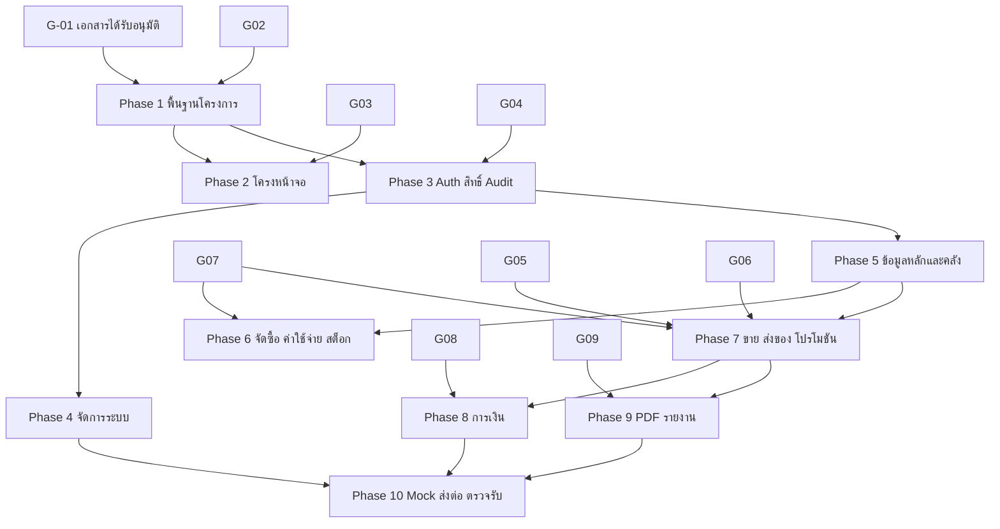

# ZUUGROUP — Project Plan

## TASK-138 — Checkpoint ก่อนพัก

ตรวจงานปัจจุบัน → บันทึก checkpoint/HANDOFF และงานค้าง → lint/diff → local commit AI → ตรวจสถานะ Git. [แผนย่อย](../../tasks/TASK-138-checkpoint.md). ไม่ push/deploy/รันธุรกรรมใหม่.

## TASK-137 — ปุ่มและ Alert หน้าเพิ่มสินค้า

ACTIVE/Specs/Task → เพิ่มแถวปุ่มขวาล่างพร้อมคำอธิบายและ state เลือก SuccessAlertComponent → lint/render/diff → ตรวจรับคลิกทั้งสองและปิด Alert. [แผนย่อย](../../tasks/TASK-137-product-action-alerts.md). คง preview ไม่เชื่อม DB.

## TASK-136 — บริษัทผู้ผลิตข้างหน่วยสินค้า

ACTIVE/Specs/Task → ย้าย field บริษัทผู้ผลิตถัดจากหน่วยสินค้าใน product-create-preview.tsx → ตรวจลำดับ/ESLint/diff. ใช้ flex เดิม. [แผนย่อย](../../tasks/TASK-136-manufacturer-beside-unit.md).

## TASK-135 — ย้าย3labelเป็นplaceholder

ACTIVE/Specs/Task → previewถอน3labelเหนือช่อง ตั้งplaceholder/aria-label → lint/diff. [แผนย่อย](../../tasks/TASK-135-product-placeholder-labels.md). ไม่เปลี่ยนพฤติกรรม/API/DB.

## TASK-134 — ถอนคำอธิบายหมวดสินค้า

ACTIVE/Specs/Task → product-create-preview.tsx ถอนdescriptionทั้ง5หมวดและrender → lint/diff. [แผนย่อย](../../tasks/TASK-134-remove-product-section-descriptions.md). คงช่องและคำอธิบายรายช่อง.

## TASK-133 — แนบหลายไฟล์และpreview

ACTIVE/Specs/Task → product-attachment-field.tsx รูป/เอกสาร multiple เพิ่มสะสม thumbnail/ชื่อ/จำนวน/นำออก คืนobjectURL → previewแทนtextarea2ช่อง → lint/render/diff. ไม่upload/API/DB. [แผนย่อย](../../tasks/TASK-133-product-attachments.md).

## TASK-132 — ราคาขาย/ภาษี/สถานะและถอนแจ้งเตือน

ACTIVE/Specs/Task → preview labels/required metadata → ภาษี number เริ่ม7พร้อม%แก้ได้ และสถานะ select เริ่มเปิดขาย → ถอนแจ้งเตือน2ช่องปรับหมวดการจัดเก็บ → lint/render/diff. [แผนย่อย](../../tasks/TASK-132-product-price-tax-status.md). ไม่เปลี่ยน API/DB/สูตรธุรกิจ.

## TASK-131 — ถอนหมวดหน่วยและย้ายหน่วยสินค้า

ACTIVE/Specs/Task → product-create-preview.tsx ย้ายหน่วยขายหลักเป็นหน่วยสินค้าในข้อมูลทั่วไปและคงCombobox/ดาว → ถอนหมวดหน่วยพร้อม metadata ช่องที่ถอด → lint/diff. [แผนย่อย](../../tasks/TASK-131-product-unit-general.md). ไม่เปลี่ยน API/DB/ธุรกรรม.

## TASK-130 — ถอนบริษัทเจ้าของสิทธิ์

ACTIVE/Specs/Task → product-create-preview.tsx ถอน field/Combobox metadata → lint/diff. [แผนย่อย](../../tasks/TASK-130-remove-rights-company.md). ไม่แก้บริษัทผู้ผลิต/ยี่ห้อ/API/DB.

## TASK-129 — จำผู้ผลิต

ACTIVE/Specs/Task → component จำชื่อรองรับชนิด brand/manufacturer และ storage แยก → preview ใช้กับบริษัทผู้ผลิต → lint/ตรวจ key isolation/dedupe/render/diff. คง key ยี่ห้อเดิมและไม่เชื่อม DB. [แผนย่อย](../../tasks/TASK-129-remember-manufacturers.md).

## TASK-128 — ยี่ห้อเพิ่มและจำในเบราว์เซอร์

ACTIVE/Specs/Task → product-brand-combobox.tsx ค้นหา/เลือก/เพิ่มด้วยคีย์บอร์ดและคลิก จำชื่อที่เพิ่มใน localStorage ไม่มี seed → product-create-preview.tsx ใช้แทน Combobox ว่างเฉพาะยี่ห้อ → lint/render/diff. ไม่เชื่อม DB/บันทึกสินค้าและระบุขอบเขตเบราว์เซอร์เดียว. [แผนย่อย](../../tasks/TASK-128-remember-product-brands.md).

## TASK-127 — ช่องชื่อเต็มสองภาษา

ACTIVE/Specs/Task → product-create-preview.tsx กลุ่มชื่อเต็มมี text ไทย/อังกฤษ แยก 2 ช่อง ใช้ flex ตามพื้นที่ ดาวกลุ่ม/คำอธิบายอย่างน้อยหนึ่งภาษา → lint/render/diff → ยกตัวอย่างชื่อเต็มกับชื่อการค้า. [แผนย่อย](../../tasks/TASK-127-product-bilingual-name.md).

## TASK-126 — ช่องรหัสสินค้าแยกท่อน

ACTIVE/Specs/Task → product-create-preview.tsx ส่วนรหัสเต็มแถวมี Combobox กลุ่มรหัส/รูปแบบว่าง เลขลำดับแก้เองได้ รหัสเต็ม read-only → lint/render/diff. งานเชื่อมต่อถัดไปต้องทำ master กลุ่มรหัส, ผูกรูปแบบเดียวกับข้อมูลยา, next sequence และ unique transaction ของคู่กลุ่ม/รูปแบบ แทน category เดิม ก่อนเปิดบันทึก. [แผนย่อย](../../tasks/TASK-126-product-code-fields.md).

## TASK-125 — Flex และความกว้างฟอร์มสินค้า

ACTIVE/Specs/Task → product-create-preview.tsx ถอน max-width และใช้ flex-wrap/basis จัดเต็มพื้นที่ → lint/diff → เจ้าของตรวจขยาย/ย่อ Side. [แผนย่อย](../../tasks/TASK-125-product-flex-layout.md).

## TASK-124 — เครื่องหมายช่องบังคับ

ACTIVE/Specs/Task → product-create-preview.tsx ชุด 9 ช่องบังคับทั่วไป → label ดาวแดง/aria-required จากข้อมูลชุดเดียว → lint/render/diff. ไม่เปลี่ยน Combobox ว่างหรือเพิ่ม validation/DB. [แผนย่อย](../../tasks/TASK-124-product-required-markers.md).

## TASK-123 — ลบหัวข้อเกริ่นหน้าเพิ่มสินค้า

บันทึก ACTIVE/Specs/Task → product-create-preview.tsx ลบ header ภายในฟอร์ม → scoped lint/diff. [แผนย่อย](../../tasks/TASK-123-remove-product-intro.md). ไม่มีเปลี่ยนพฤติกรรมกรอก/API/DB.

## TASK-122 — Combobox ว่าง

ACTIVE/Specs/Task → แยกชื่อการค้ากับยี่ห้อ → product-create-preview.tsx ใช้ Combobox ว่าง 13 ช่องที่เลือกข้อมูลกลาง พร้อม label/help/เปิดปิดด้วยคีย์บอร์ด → lint/render/routes/diff. ไม่แตะ SearchCombobox ของฟอร์มธุรกรรมเดิม ไม่โหลดหรือบันทึกข้อมูล. [แผนย่อย](../../tasks/TASK-122-empty-product-combobox.md).

## TASK-121 — ช่องกรอกแบบกล่อง

บันทึก ACTIVE/Specs/Task → product-create-preview.tsx เปลี่ยนรายการข้อความเป็น input text/textarea มี label/help และ focus → ตรวจ scoped lint/render/routes/diff → เจ้าของลองพิมพ์คอม/มือถือ. ไม่มีการบันทึก/API/DB และคงแผน Combobox ภายหลัง. [แผนย่อย](../../tasks/TASK-121-product-input-boxes.md).

## TASK-120 — Preview หน้าเพิ่มสินค้า

ACTIVE/Specs/Task → จัดข้อมูลที่คุยไว้เป็นข้อความตามหมวด → เพิ่ม product-create-preview.tsx → AdminShell แสดงเฉพาะ /products/create แทน NavigationOnlyTabs → ตรวจ lint/routes/diff และผู้ใช้ตรวจหน้า. คงฟอร์ม/API เดิมไว้ไม่ mount ไม่เพิ่มพฤติกรรมบันทึก. [แผนย่อย](../../tasks/TASK-120-product-create-text-preview.md).

## TASK-119 — แผนข้อมูลอ้างอิงสินค้าและ Combobox

ตรวจ SearchCombobox เดิม → บันทึกคำยืนยันชุดรหัส/หมวดหมู่จัดการในตั้งค่า → เสนอรายการที่เลือกจากข้อมูลกลางและกฎค้นหา/รายการซ้ำ/ปิดใช้ → สรุปช่อง/สิทธิ์/รหัสและกฎ OPEN ก่อนจัดงาน implementation. ขอบเขตเอกสารเท่านั้น; คง navigation-only เดิม. [แผนย่อย](../../tasks/TASK-119-product-master-combobox-plan.md).

## TASK-118 — แยกสต็อกสินค้าเป็นเมนูหลัก

บันทึก ACTIVE/Specs/Task → ย้าย registry /products/stock ต่อจากโปรโมชัน เปลี่ยนชื่อสต็อกสินค้า และ /purchases/receipts เป็นเพิ่มสต็อกสินค้า parent สต็อก → เพิ่ม StockSecondarySidebar → AdminShell แยก stockSection จาก page registry เพื่อไม่ทับคลังเดิม → lint/routes/diff และตรวจรับเมนู. [แผนย่อย](../../tasks/TASK-118-stock-main-navigation.md).

## TASK-117 — ล้างรายการ Postman ที่เลิกใช้

ดำเนินการแล้ว: Cloud/local 115 คำขอ/21 โฟลเดอร์; ลบ 18 เป้าหมายครบ ตรวจอ่านกลับรายการอื่นคงเดิม (Postman ปรับเวลาโฟลเดอร์ orders เท่านั้น). Backup ก่อนแก้เก็บใน local-backups. รอเจ้าของ Refresh ตรวจรายการตาม TASK-117.

ตรวจ Cloud Collection/ไฟล์ local เทียบ Specs และ handlers → สำรองทั้งสองใน local-backups → ลบ 18 requests (customer-groups/billing อย่างละ 8, orders deleted/restore 2) ด้วย ID เฉพาะ → ตรวจ readback ว่ารายการอื่น/variables/auth/scripts คงเดิม → ปรับ README/คู่มือชื่อ. ไม่ส่งคำขอธุรกิจ ไม่เปลี่ยน backend/DB. [แผนย่อย](../../tasks/TASK-117-postman-cleanup.md).

## TASK-116 — ล้าง DB ยกเว้นผู้ใช้ (เจ้าของสั่ง 5 ตุลาคม 2569)

ดำเนินการแล้ว: ล้าง 30 ตารางธุรกิจ ตรวจ readback เป็นศูนย์ทั้งหมด ผู้ใช้ 5 คนและ hash ตารางที่เก็บคงเดิม; มี backup ก่อนล้างและผล verified=true ใน local-backups ตาม TASK-116. รอเจ้าของทดสอบล็อกอินด้วยบัญชีเดิม.

1. ตรวจ DB ปัจจุบันแบบ read-only: รายการตาราง จำนวนแถว FK และตารางที่ต้องเก็บเพื่อให้ user ใช้งานได้.
2. สร้างสคริปต์ตรวจ/ล้างที่ระบุ target fingerprint และรายการตารางจาก inspection; ห้ามล้างตารางนอก public/ตารางที่เก็บหรือใช้ CASCADE.
3. ล็อกตารางใน transaction สำรองข้อมูล public รวมตารางที่เก็บลง local-backups ตรวจไฟล์/hash แล้วล้างเฉพาะธุรกิจ.
4. ตรวจทุกตารางเป้าหมายเป็นศูนย์และ hash ตารางผู้ใช้/สิทธิ์คงเดิมก่อน commit; rollback หากผิดเงื่อนไข.
5. ตรวจ readback หลัง commit และบันทึกผล/ตำแหน่ง backup โดยไม่เผย credential/ข้อมูลส่วนตัว. ไม่ seed/เปลี่ยน schema/commit Git/deploy.

[แผนย่อย](../../tasks/TASK-116-reset-business-data.md).

## TASK-115 — Topbar คอมรวม 82px (อนุมัติ 5 ตุลาคม 2569)

บันทึก Specs/ACTIVE/Task → admin-shell.tsx header md:min-h-18 และระยะเนื้อหาคอมลบ 82px → secondary-sidebar-frame.tsx fallback topbar 82px → ตรวจ lint/diff และเจ้าของตรวจคอม/มือถือ. [แผนย่อย](../../tasks/TASK-115-topbar-height.md).

## TASK-114 — เหลือเมนูและ Tab (อนุมัติ 5 ตุลาคม 2569)

1. บันทึกข้อยืนยันและขอบเขตใน Specs/ACTIVE/Task ตรวจ Tab เดิมของหน้ารายการและล็อต.
2. navigation-only-tabs.tsx แสดง Tab เดิมตาม route/สิทธิ์และซ่อน Tab เดียว; ไม่มีเนื้อหา/ฟอร์ม/API/ธุรกรรม.
3. AdminShell ใช้หน้าว่างพร้อม Tab แทน children ทุกหน้าหลัง login; login คง children เดิม. เมนูและสิทธิ์ server เดิมยังอยู่.
4. ตรวจ lint/types/routes/diff และตรวจหน้าแทนหลายชนิด; สรุป Topbar ตามคำตอบเจ้าของก่อนจบรอบ.

[แผนย่อย](../../tasks/TASK-114-navigation-only-pages.md). ไม่ลบข้อมูล/API/โค้ดธุรกิจ ไม่ commit/deploy.

## TASK-113 — ย้ายเขตเป็น Side หลัก (อนุมัติ 5 ตุลาคม 2569)

บันทึกข้อยืนยันแทน TASK-107 → navigation.ts ย้ายเขตไปต่อจากโปรโมชันและผูกเพิ่มเขตกับหมวดเขต → territory-secondary-sidebar.tsx รายงานเขต/เพิ่มเขต → AdminShell แยก Header/หมวด และ Sidebar เลือกหมวดตรงจาก registry ป้องกันลูกค้าถูกเลือกซ้ำ → UserSecondarySidebar เหลือรายชื่อ/เพิ่ม → ตรวจ lint/types/routes/diff. [แผนย่อย](../../tasks/TASK-113-territory-main-navigation.md). คงรายการเขตเดิม ไม่ทำยอดรายงานใหม่.

## TASK-112 — Side รองใบเสนอราคา/คำสั่งซื้อ (อนุมัติ 5 ตุลาคม 2569)

บันทึก Specs/ACTIVE/Task → navigation.ts เพิ่มรายการสร้างของแต่ละหมวด → sales-document-secondary-sidebar.tsx ใช้กรอบ sticky กลางและสิทธิ์สร้างเดิม → AdminShell ติดตั้งสองหมวดและ Header → ตรวจ lint/types/routes/diff → เจ้าของตรวจรายการ/สร้าง/รายละเอียดคอมและมือถือ. คง filter/ตาราง/ฟอร์ม/ธุรกรรม; Tabsรายละเอียดและการชำระแยกงานถัดไป. [แผนย่อย](../../tasks/TASK-112-sales-document-sidebar.md).

## TASK-111 — ชื่อเมนูคำสั่งซื้อ (อนุมัติ 5 ตุลาคม 2569)

บันทึก Specs/ACTIVE/Task → navigation.ts เปลี่ยน label /orders เป็นคำสั่งซื้อ → ตรวจ lint/diff → เจ้าของตรวจเมนู/Header. [แผนย่อย](../../tasks/TASK-111-order-menu-label.md).

## TASK-110 — โลโก้คอม 60px (อนุมัติ 5 ตุลาคม 2569)

บันทึก Specs/ACTIVE/Task → sidebar.tsx เปลี่ยนคลาสโลโก้คอมเป็น md:h-15/md:w-15 และ Image width/height 60 → ตรวจ lint/diff → เจ้าของตรวจคอมขยาย/ย่อและมือถือ. [แผนย่อย](../../tasks/TASK-110-sidebar-logo-size.md).

## TASK-109 — ชื่อบริษัท 2xl (อนุมัติ 5 ตุลาคม 2569)

บันทึก Specs/ACTIVE/Task → sidebar.tsx เปลี่ยน md:text-3xl เป็น md:text-2xl เฉพาะชื่อบริษัท → ตรวจ lint/diff → เจ้าของตรวจคอม/มือถือ. [แผนย่อย](../../tasks/TASK-109-sidebar-brand-size.md).

## TASK-108 — Side หลักขยาย 275px (อนุมัติ 5 ตุลาคม 2569)

คำสั่งล่าสุดเปลี่ยน expanded เป็น 275px แทน 250px; ใช้ลำดับและขอบเขตเดิมด้านล่างกับค่าล่าสุด.

บันทึก Specs/ACTIVE/Task → เปลี่ยน --expanded-sidebar-width ใน src/app/globals.css เป็น 250px → ตรวจผู้ใช้ token ใน Sidebar/AdminShell และ diff → เจ้าของตรวจขยาย/ย่อ/มือถือ. [แผนย่อย](../../tasks/TASK-108-sidebar-width.md).

## TASK-107 — เพิ่มเขตใน Side รองผู้ใช้งาน (อนุมัติ 5 ตุลาคม 2569)

บันทึก Specs/ACTIVE/Task → navigation.ts ผูกหน้าเขตและเพิ่มเขตเดิมกับ /users → AdminShell แยกหมวดตาม parentHref → UserSecondarySidebar เลือกหน้ารายชื่อ/เขต/สร้างถูกต้อง → ตรวจ lint/types/routes/diff และเจ้าของตรวจคอม/มือถือ. คงข้อมูล/ฟอร์ม/filter/ตาราง/สิทธิ์เดิม. [แผนย่อย](../../tasks/TASK-107-user-territory-navigation.md).

## TASK-106 — ล็อก Topbar (อนุมัติ 5 ตุลาคม 2569)

บันทึกข้อยืนยันแทนกฎไม่ล็อก → admin-shell.tsx เพิ่ม sticky ให้กรอบ Topbar และวัดความสูงด้วย ResizeObserver → secondary-sidebar-frame.tsx ใช้ระยะใต้ Topbar/Side หลักมือถือ และหักความสูง Topbar จาก viewport คอม → ตรวจ lint/types/routes/diff → เจ้าของตรวจเลื่อน/ย่อขยาย/มือถือ. [แผนย่อย](../../tasks/TASK-106-sticky-topbar.md). คงขนาด/สี/ข้อมูลเดิม.

## TASK-105 — ตรึง Side รอง (อนุมัติ 5 ตุลาคม 2569)

บันทึก Specs/ACTIVE/Task → สร้างกรอบกลาง sticky สำหรับ Side รองทั้ง 5 component → AdminShell วัดความสูง Side หลักจริงสำหรับระยะบนมือถือ → ตรวจ lint/types/routes/diff → เจ้าของตรวจหน้าเลื่อนยาว คอม/มือถือ/ย่อขยาย. คง Header และเนื้อหาเดิม. [แผนย่อย](../../tasks/TASK-105-sticky-secondary-sidebar.md).

## TASK-104 — Side รองรายงาน (อนุมัติ 5 ตุลาคม 2569)

1. บันทึก Side รอง 5 รายการต่อหมวดและขอบเขต UI เท่านั้นใน Specs/ACTIVE/Task.
2. เก็บหน้ารายงานเดิมและ filter/ตารางที่ legacy; หน้าแรกของสองหมวดเปิดสรุปใหม่ซึ่งแจ้งรอข้อกำหนด/ข้อมูล และมีทางเปิดข้อมูลเดิม.
3. เพิ่มหน้ารองและ Sidebar พร้อม Header หมวด/สถานะที่เลือก/มือถือ; ไม่มี Tab หรือเพิ่มรายงาน.
4. ตรวจ ESLint/types/routes/diff; เจ้าของตรวจ navigation. สรุปกฎ/แผน API/ข้อมูลและสิทธิ์ก่อนทำเนื้อหารายงานจริง.

ไฟล์และเกณฑ์ตรวจรับ: [TASK-104](../../tasks/TASK-104-report-secondary-sidebar.md).

## TASK-103 — ถอดเมนูวางบิลและวางแผนชำระในเอกสารขาย (5 ตุลาคม 2569)

คำสั่งล่าสุด: เจ้าของให้เก็บเรื่องชำระไว้ก่อน ค่อยทำอีกครั้ง; ขั้นตอน 3–4 พักตามเจ้าของจนมีคำสั่งต่อ.

1. บันทึกข้อยืนยันทั้งหมด/ผ่อน พร้อมจำนวนเดือนและยอดต่อเดือน และ OPEN สูตร/กำหนดงวด/เอกสาร/สิทธิ์ใน Specs.
2. ซ่อน /billing จาก Side หลักใน navigation.ts โดยคงข้อมูล/route/API เดิม; ตรวจ ESLint/diff และเจ้าของตรวจเมนู.
3. รับคำตอบ OPEN แล้วจัดแผนย่อยฟอร์มขาย ระบุช่อง/validation/แผนงวด/การส่งต่อระหว่างเอกสารและผลต่อหนี้/รับชำระ ก่อนแก้โค้ดหรือฐานข้อมูล.
4. ส่งแผนฟอร์มที่ครบให้เจ้าของตรวจอนุมัติก่อน implementation. แยกการกำหนดเงื่อนไขชำระออกจากการบันทึกรับเงินจริง.

ไฟล์และตรวจรับ: [TASK-103](../../tasks/TASK-103-payment-navigation-plan.md).

## TASK-102 — Side รองโปรโมชันและของแถม (อนุมัติ 5 ตุลาคม 2569)

1. บันทึกข้อยืนยันเมนูรายการโปรโมชัน/เพิ่มโปรโมชันใน Specs/ACTIVE/Task.
2. เพิ่ม Side รองใต้ Header เชื่อมหน้ารายการ/สร้างเดิม พร้อมสถานะหน้ารายการ/สร้าง/รายละเอียด และชื่อหมวดคงเดิม.
3. แสดงเพิ่มโปรโมชันเฉพาะ Admin ตาม guard เดิม; คง filter/ตาราง/ฟอร์ม/รายละเอียด/API/DB. ไม่ตัดสิน OPEN-01.
4. ตรวจ lint/types/routes/diff และเจ้าของตรวจคอม/มือถือ. Tab ข้อมูลและเงื่อนไข/ของแถมอยู่ในแผนรายละเอียดภายหลังสรุป OPEN.

ไฟล์และตรวจรับ: [TASK-102](../../tasks/TASK-102-promotion-secondary-sidebar.md).

## TASK-101 — ย้ายโปรโมชันไปจัดการข้อมูล (อนุมัติ 5 ตุลาคม 2569)

บันทึกข้อยืนยันใน Specs/ACTIVE/Task → เปลี่ยน section ของ /promotions ใน src/config/navigation.ts เป็นจัดการข้อมูล → ตรวจ ESLint/diff และเจ้าของตรวจเมนู. [แผนย่อย](../../tasks/TASK-101-promotions-navigation.md). ไม่แก้หน้าเว็บหรือกฎธุรกิจ.

## TASK-100 — Side รองผู้ใช้งาน (อนุมัติ 5 ตุลาคม 2569)

1. บันทึกข้อยืนยันรายชื่อผู้ใช้งาน/เพิ่มผู้ใช้งานล่างสุดใน Specs/ACTIVE/Task.
2. เพิ่ม Side รองใต้ Header เชื่อม /users และ /users/create เดิม; หน้ารายละเอียดเลือกเมนูรายชื่อ.
3. ติดตั้งใน AdminShell เฉพาะหมวดผู้ใช้งานสำหรับ Admin คงตำแหน่ง Side หลักจาก TASK-099.
4. ตรวจ ESLint/types/routes/diff และให้เจ้าของตรวจคอม/มือถือ; คง filter/ตาราง/ฟอร์ม/รายละเอียด/API/DB ไม่เพิ่มประวัติ.

ไฟล์และตรวจรับ: [TASK-100](../../tasks/TASK-100-user-secondary-sidebar.md).

## TASK-098 — เพิ่มเมนูรับสินค้าเข้า/เพิ่มสินค้า (อนุมัติ 5 ตุลาคม 2569)

1. บันทึกโครง 7 รายการและความแตกต่างข้อมูลหลัก/รับของ/ยอดรวม/ล็อตใน Specs/ACTIVE/Task.
2. ผูกหน้ารับเข้าเดิม /purchases/receipts กับหมวดสินค้า และเพิ่ม /products/create เป็นเมนูล่างสุดตามสิทธิ์ Admin.
3. ปรับ Side รอง/Header/สถานะ Side หลักให้เลือกถูกหน้า รวมหน้ารับเข้าซึ่งใช้ URL เดิมนอก /products.
4. ตรวจ ESLint, TypeScript, routes และ whitespace; เจ้าของตรวจคอม/มือถือ. คง filter/ตาราง/ฟอร์ม/API/DB และ OPEN Design.

ไฟล์และตรวจรับ: [TASK-098](../../tasks/TASK-098-product-secondary-sidebar.md).

## TASK-097 — แผนย่อย Side รองลูกค้า (อนุมัติ 5 ตุลาคม 2569)

1. บันทึกข้อยืนยัน Side หลัก > Side รอง > Tab และขอบเขตทดลองเฉพาะเมนูใน Specs/ACTIVE/แผนย่อย.
2. เพิ่ม Side รองรายชื่อลูกค้า → เพิ่มลูกค้าใต้ Header; ใช้ /customers และ /customers/create เดิม. เพิ่มลูกค้าเป็นรายการสุดท้ายและแสดงตามสิทธิ์ Admin เดิม.
3. ให้ Header แสดงหมวดลูกค้าและสถานะเมนูตรงกับหน้ารายชื่อ/รายละเอียดหรือหน้าสร้าง; ไม่แสดงเมนูเขต/เอกสาร/ภาพรวม.
4. ตรวจ ESLint เฉพาะไฟล์, TypeScript, route checks และ diff; เจ้าของตรวจคอม/มือถือและการย่อ Side หลัก.

ไฟล์/เกณฑ์ตรวจรับ: [TASK-097](../../tasks/TASK-097-customer-secondary-sidebar.md). ไม่แก้ filter/ตาราง/CRUD/API/DB; การกด ID และจัดเอกสารในรายละเอียดเก็บไว้รอบถัดไป.

## TASK-095 — แผนย่อยเอกสาร Design ก่อนแก้เว็บ

ในการแก้เว็บรอบถัดไปให้ตรวจจำนวนTabsของแต่ละหน้า: ถ้ามีเพียง1รายการให้ซ่อนแถวTabsและเริ่มFilter; ปุ่มหลักถ้ามียังคงขวาบนเนื้อหา. ไม่เพิ่มชื่อหัวเรื่องแทนTabที่ซ่อน.

1. อ่านภาพและnavigation/UI specs; บันทึกdesignใน docs/designs/stock-screen-design.md พร้อมสำเนาภาพในassets เพื่อใช้ตรวจซ้ำได้.
2. ระบุMain Sidebar/Topbar/Secondary Sidebar/Tabs/actions/filters/table/footer และขนาดสัดส่วนตามภาพ แยกกติกาธุรกิจจากรูปแบบหน้าจอ.
3. จัดรายการOPEN: ตำแหน่งจอง/พร้อมขาย, รายละเอียดล็อต/ฟอร์มรับเข้า, ประวัติ/เกณฑ์อายุ และการจัดบนมือถือ. ถามเจ้าของก่อนเลือกหรือเขียนโค้ดส่วนที่ภาพไม่ได้บอก.
4. ตรวจเอกสารว่าทุกพื้นที่มีตำแหน่งหรือOPENและส่งให้เจ้าของอ่าน. เมื่อได้ข้อสรุปจึงปรับSpecs/Plan/Taskและแก้เว็บตามเอกสารที่ยืนยัน. ไม่commit/deployรอบนี้.

## TASK-094 — แผนหน้าจอสินค้าและคลังตามภาพ (อนุมัติให้ลองทำ)

สถานะ IMPLEMENTED / WAITING_FOR_UAT: เมนู/ตาราง/ตัวกรองตามแผนแล้ว; TypeScript/ESLint/route62และDB18/18ผ่าน. เจ้าของตรวจหน้าจอคอม/มือถือก่อนcommitรวม ตาม tasks/TASK-094-stock-screen-plan.md.

ลงมือเฉพาะอ่านข้อมูลและเว็บ: inventory GET เพิ่ม views products/lots ด้วย pagination/filter ฝั่ง server; ไม่เปลี่ยนคำสั่งเขียนหรือ schema. คงหน้าสร้าง/รายละเอียดสินค้าและแบบรับเข้า/จัดการล็อตเดิม. ตรวจ lint/typegen/types, route guards และ integration ของยอดรวม/MAIN-only/หนึ่งLotต่อแถว/ตัวกรองก่อนส่งเจ้าของดูหน้าจอ.

1. คืนSidebarหลักเป็นหมวดหลัก และวางSecondarySidebarสีอ่อนในbodyใต้Topbar สำหรับ5หน้า; บนมือถือเป็นแถบแนวนอน. ไฟล์คาดว่าจะเปลี่ยน src/components/layout/sidebar.tsx, admin-shell.tsx และ src/config/navigation.ts.
2. สินค้าทั้งหมดและ3หน้าคลังเสนอหนึ่งแถวต่อสินค้า; หน้าล็อตหนึ่งแถวต่อLot ID โดยแสดงการกระจายคลังในรายละเอียด. ยอดรวมทุกคลังแสดงในสินค้าทั้งหมด แต่คำเตือนต่ำกว่า50อิงMAINเท่านั้น. ทบทวน API read projections ก่อนเพิ่มให้ตรงรูปแบบข้อมูล ไม่เปลี่ยนยอดจริง. ไฟล์คาดว่าจะเปลี่ยน pages products/stock และ src/server/operations/*, src/types/api/operations.ts.
3. แถวTabsด้านบนของข้อมูลตามภาพ มีปุ่มเพิ่มสินค้าขวาสุดเฉพาะสินค้าทั้งหมด และรับสินค้าเข้าเฉพาะล็อต. หน้าล็อตใช้ทั้งหมด/ใกล้หมดอายุ/หมดอายุ. ไฟล์คาดว่าจะเปลี่ยน src/app/products/page.tsx และ src/components/operations/inventory-workspace.tsx หรือแยก componentเฉพาะแต่ละหน้า.
4. Filterเสนอ: สินค้าทั้งหมด=ค้นหา/หมวด/สถานะ; หน้าคลัง=ค้นหา/หมวด/สถานะอายุ; ล็อต=สินค้า/คลัง/วันหมดอายุ. สรุป contractตัวกรองก่อน implementation; ไม่สร้างrouteแยกสำหรับFilter.
5. เมื่อลงมือแล้วตรวจ: ปุ่มถูกหน้า, รวมยอดสินค้าทุกคลัง, หน้าคลังไม่ปน, คำเตือนต่ำกว่า50ไม่ถูกคลังอื่นเพิ่มยอด, Tabsกรองวันหมดอายุแยกจากจำนวน, แถวเปิดรายละเอียด, Loadingไม่บังทั้งหน้า และคอม/มือถือ. ไม่ใช่ผลทดสอบปัจจุบัน.

## TASK-093 — แผนย่อย Sidebar สินค้าและสต็อก

1. เพิ่ม parent ของ4รายการใน src/config/navigation.ts และปุ่มเปิด/ปิดใน src/components/layout/sidebar.tsx; คงรูปแบบสี/ฟอนต์เดิม.
2. เพิ่ม src/app/products/stock/[warehouse]/page.tsx สำหรับ main/marketing/disposal; ใช้ InventoryWorkspace กรองคลังที่กำหนดรอ optionsก่อนอ่านข้อมูล. หน้า /products/stock เป็นล็อตสินค้าแยกเมนู.
3. ตรวจ lint/typegen/typecheck และลิงก์ route; ส่ง UAT: เปิดสินค้าและสต็อกแล้วเห็น4เมนู เลือกแต่ละคลังเห็นข้อมูลเฉพาะคลัง ล็อตสินค้าเห็นล็อตทุกคลัง ย่อ/ขยายเมนูและเลือกบนมือถือได้.

## งานที่อนุมัติล่าสุด — TASK-092

ใช้ [แผนย่อยเชื่อมข้อมูลและเว็บ](2026-10-03-linked-operations-plan.md) และ [Specs](../specs/2026-10-03-linked-operations.md). เตรียมทดสอบรวมแล้วค่อย commit ตามคำสั่งเจ้าของ; ยังพัก Deploy.

## แผนจองสินค้าเมื่อสร้าง Order

1. ตรวจยอดพร้อมขายของคลังหลักก่อนสร้าง Order; สร้างสำเร็จพร้อมจองจำนวนทันที เพื่อให้ Order ถัดไปใช้ได้เฉพาะจำนวนที่ยังไม่จอง.
2. Manager ตรวจ/ปรับ/อนุมัติตามลำดับเดิม โดยยังไม่ตัดของ; Admin จัดและยืนยันเสร็จสิ้นจึงตัดยอดและปิดจองที่เกี่ยวข้องอย่างสอดคล้อง.
3. ตกลงการคืน/ปรับจองกรณีส่งกลับแก้หรือยกเลิก และวิธีจัดล็อตก่อน implementation.
4. ตรวจรับเมื่อ implement: มี 10 ชิ้น สร้าง Order 10 สำเร็จแล้ว Order ใหม่ต้องถูกปฏิเสธ; แม้สร้างพร้อมกันต้องไม่จองเกิน 10; เมื่อ Admin ยืนยันต้องไม่หักทั้งจองและจ่ายซ้ำ.

รอบนี้ ACTIVE/Specs/Plan เท่านั้น ข้อนี้แทนข้อเสนอจองหลังอนุมัติ ยังไม่แก้ระบบหรือยอดจริง.

## แผนสถานะงานขายที่ยืนยันล่าสุด

1. Sales สร้างได้เมื่อของพร้อมขายเพียงพอ; ปฏิเสธสร้างเมื่อไม่พอ.
2. Manager ตรวจ/ปรับ/อนุมัติเป็น “อนุมัติ” โดยยังไม่ตัดของ.
3. Manager/Admin ส่งกลับให้ Sales แก้ได้; สรุปเส้นทางอนุมัติใหม่ก่อน implement.
4. Admin ตรวจและจัดของ กดยืนยัน → “เสร็จสิ้น” พร้อมตัดคลังหลักและบันทึกล็อต/จำนวนที่ใช้. ไม่เพิ่มขั้นตัดของแยกหลังเสร็จสิ้น.
5. เกณฑ์ตรวจรับเมื่อ implement: ของไม่พอสร้างไม่ได้; Manager อนุมัติยังไม่ลดคลัง; Admin ยืนยันลดคลังพร้อมเสร็จสิ้น; ยืนยันซ้ำไม่ตัดซ้ำ; จำนวนเปลี่ยนระหว่างทางไม่ทำให้ยอดติดลบหรือสถานะสำเร็จโดยตัดไม่ครบ.

ขอบเขตรอบนี้ ACTIVE/Specs/Plan เท่านั้น ยังไม่ implement. รอยืนยัน FEFO/จอง/อนุมัติหลังแก้และเกณฑ์อายุ.

## แผนงานขายตามลำดับที่ยืนยัน

1. Sales สร้างเอกสารของลูกค้า → Manager ตรวจ/ปรับ/อนุมัติ → Admin ตรวจคำสั่งซื้อและจัดของ → ตัดสินค้าจากคลังหลัก. เจ้าของยืนยันว่าการจัดของอยู่ในขั้น Admin.
2. สรุปสถานะเอกสารและรายละเอียดที่ปรับได้ในแต่ละขั้นก่อน implement; ห้ามอนุมาน Manager เปลี่ยนราคาสินค้าหลักที่ Admin กำหนด.
3. รับรายละเอียดการจอง/เลือกลอตอัตโนมัติ/จุดยืนยันตัดของ/ยอดไม่พอ/ส่งบางส่วนและการส่งกลับแก้ไข. ไม่ใช้ขั้นตอนข้อเสนอเดิมแทนคำยืนยันล่าสุด.
4. เมื่อพร้อม จัดแผนไฟล์และเกณฑ์ตรวจรับ: Sales สร้างยังไม่ตัด, Manager อนุมัติยังไม่ตัด, Admin จัดและยืนยันตามกฎแล้วจึงตัด พร้อมอ้างเอกสารและ Lot ID ตรวจย้อนหลังได้.

รอบนี้ ACTIVE/Specs/Plan เท่านั้น; ไม่มีเปลี่ยนระบบ/สิทธิ์/DB/ยอดจริง.

## แผนสนทนาขายและเลือกลอตอัตโนมัติ

1. อธิบายผู้บันทึกคำสั่งซื้อ/ลูกค้าที่เลือก และการดึงเขตกับผู้รับผิดชอบ; ไม่เพิ่มขอบเขตสิทธิ์โดยสมมติ.
2. เสนอ FEFO อัตโนมัติหลังค้น Microsoft/SAP: เรียงล็อตหมดอายุก่อนในคลังที่ถูกต้องและยังใช้ได้ ผู้ใช้เลือกสินค้า/จำนวน ระบบจัดล็อตและแสดงให้หยิบตรง.
3. อธิบายยืนยันคำสั่งขายเทียบกับอนุมัติพิเศษ และจองสินค้าต่างจากตัดจำนวนออกจริง ด้วยตัวเลขก่อน/หลัง.
4. รับคำยืนยันขั้นตอนและข้อยกเว้นก่อนจัด implementation/test ของจอง/หลายล็อต/ยอดไม่พอ/ยกเลิก/ส่งบางส่วน.

รอบนี้ ACTIVE/Specs/Plan เท่านั้น ผลลัพธ์ข้อเสนอพร้อมแหล่งทางการและตัวอย่างเพื่อเจ้าของตัดสินใจ ยังไม่แก้ระบบ/DB/สิทธิ์หรือยอดจริง.

## แผนยืนยันการแก้ข้อมูลรับเข้า

1. ใช้การยกเลิกรายการผิดพร้อมเหตุผลและรายการแก้ไขเชื่อมต้นฉบับ ภายในช่วง 7 วันที่ตกลง; แยกจากคืนของและรับของใหม่.
2. ออกแบบการรักษาความสัมพันธ์ล็อต/ขาย/โอนและประวัติให้ย้อนตรวจได้ พร้อมจัดการผลต่างจำนวนและต้นทุนโดยไม่รับซ้ำ.
3. ตกลงกรณีแก้จำนวนต่ำกว่าที่จ่ายไปและผลต่อต้นทุนรายการเดิมก่อน implement.
4. ตรวจรับเมื่อ implement: รับจริง 1000 แต่กรอก 1200 แล้วแก้เป็น 1000 ต้องไม่กลายเป็นรับสะสม 2200; ประวัติเดิม/ใหม่และรายการขาย/โอนยังอ้างอิงตรวจได้.

รอบนี้ ACTIVE/Specs/Plan เท่านั้น ไม่เปลี่ยนโค้ด/DB/ยอดจริง.

## แผนต่อ — ราคา คลัง และเกณฑ์อายุ

1. ใช้คลังหลักสำหรับขายและคลังการตลาดสำหรับแจกตามข้อยืนยัน; แยกการเลือกคลังออกจากวิธีเลือกล็อต.
2. รักษาราคาขายที่ Admin กำหนด ไม่เปลี่ยนตามต้นทุนใหม่อัตโนมัติ; เก็บคำถามราคาประวัติเอกสารไว้คุยภายหลัง.
3. อธิบายการยกเลิกรับเข้าที่มีการขาย/โอนแล้วด้วยตัวเลข และรับกฎผลย้อนรายการก่อน implement.
4. สรุปเกณฑ์อายุเป็นค่าชัดเจนก่อนวางคำสั่งย้าย/งดขาย/บริจาค/รอทำลาย รวมขอบเขตวันที่และผู้รับบริจาค; ไม่ตั้งอัตโนมัติจากข้อความช่วงเวลา.

รอบนี้ ACTIVE/Specs/Plan เท่านั้น ยังไม่แก้แอป/DB/ยอดคลังหรือเริ่มธุรกรรมจริง.

## อัปเดตแผนรับเข้า — ต้นทุนต่อล็อตและยกเลิก

1. เก็บต้นทุนต่อล็อตตามคำยืนยัน (ร่างใช้ยอดรวมล็อตและคำนวณต้นทุนต่อหน่วยจากจำนวนรับเข้า); ลงล็อตใหม่หลังของมาถึงและตรวจแล้ว.
2. ให้ยกเลิกภายใน 7 วันจากเวลาลงล็อตใหม่ และอนุญาตแม้ขาย/โอนแล้วตามเจ้าของ; กำหนดผลย้อนรายการและข้อมูลอ้างอิงก่อนเขียนโค้ด ไม่ใช้ข้อจำกัดล็อตยังไม่ใช้ที่เคยเสนอ.
3. แยกรายการปรับยอดพร้อมเหตุผลและผู้ทำจากรับเข้า/โอน/ผลตรวจนับ; ตกลงรายละเอียดจำนวนและที่มาให้ตรวจสอบย้อนหลังได้.
4. ตรวจรับเมื่อ implement ตามกฎที่พร้อม: ต้นทุนล็อตตรวจย้อนหลังได้, เงื่อนไขเวลา 7 วันถูกต้อง, ยกเลิกล็อตที่มีรายการต่อเนื่องไม่ทำให้ยอด/เอกสารขัดกัน, ปรับยอดมีเหตุผล/ผู้ทำและไม่เกิดจากผลตรวจนับอัตโนมัติ.

ขอบเขตรอบนี้ ACTIVE/Specs/Plan เท่านั้น รอคุยภาพรวมและผลการยกเลิกต่อข้อมูลที่เชื่อมกันก่อนลงมือ.

## แผนรับเข้ารอบล่าสุด — ต้นทุน/คลัง/ยกเลิก

1. รับข้อยืนยันต้นทุนต่อ Lot เฉพาะ Admin/CFO และราคาขายสินค้าโดย Admin; รับหนึ่งครั้งหลายล็อตแต่ไม่เติมล็อตเดิม; ไม่มีขั้นอนุมัติรับเข้าแยก; ยกเลิกภายใน 7 วัน.
2. เสนอคลังหลักเป็นค่าเริ่มต้นของใหม่, แจ้งใกล้หมดอายุและให้ Admin ยืนยันย้ายหลังย้ายจริง, คลังรอทำลายกันออกจากขายตามกฎเดิม. เก็บเกณฑ์และวิธีย้ายเป็น OPEN จนเจ้าของยืนยัน.
3. สรุปต้นทุนต่อหน่วยหรือรวม, วันเริ่มนับ 7 วัน, การยกเลิกล็อตที่ใช้แล้ว, และกระบวนการปรับยอดต่างจากการรับเข้า. พักรายละเอียดแหล่งที่มาตามเจ้าของ.
4. หลังแผนพร้อม ค่อยจัดไฟล์/API/DB/transaction/audit/สิทธิ์ต้นทุนและเกณฑ์ตรวจรับ รวมป้องกันต้นทุนรั่วผ่าน API/รายงาน/ส่งออก และป้องกันยอดเสียจากยกเลิกหรือรับซ้ำ.

รอบนี้ ACTIVE/Specs/Plan เท่านั้น. ไม่มีเปลี่ยนยอดจริง/DB/สิทธิ์หรือเริ่ม Ledger; ตรวจรับโดยเจ้าของอ่านข้อยืนยันและข้อเสนอ.

## แผนการตรวจสอบที่มาของข้อมูล

1. กำหนด ID เฉพาะของล็อต และแยกจากเลขล็อตที่ผู้ใช้เห็น; วางความสัมพันธ์กับสินค้าและรายการรับเข้า.
2. ระบุข้อมูลต้นทางและเอกสารอ้างอิงของแต่ละรายการ พร้อมผู้ทำ/วันเวลา/ประวัติแก้ไข เพื่อย้อนตรวจข้อมูลได้.
3. เมื่อรับกฎธุรกรรมแล้ว วาง validation และความสัมพันธ์เพื่อป้องกันอ้างอิงผิดสินค้า/ล็อต/คลัง; ตกลงวิธีแก้หรือยกเลิกโดยรักษาประวัติก่อน implement.
4. เกณฑ์ตรวจรับใน implementation: เปิดรายการที่เกี่ยวข้องแล้วตามถึงต้นทางได้ และข้อมูลอ้างอิงผิดต้องถูกปฏิเสธตามข้อกำหนดที่ยืนยัน.

ไฟล์รอบนี้ ACTIVE/Specs/Plan เท่านั้น; ไม่เริ่มสร้างล็อต/DB/Ledger หรือเดากฎธุรกรรม.

## แผนสนทนาสินค้าและการเติมของ

1. แยกข้อมูลหลักสินค้าออกจากรายการเติมสินค้าแต่ละครั้ง; เลือกสินค้าเดิมในการบันทึกของเข้า.
2. สรุปข้อมูลรายการเติมตามคำอธิบาย: แหล่งที่มา จำนวน ต้นทุน วันผลิต วันหมดอายุ.
3. ยืนยันรูปแบบต้นทุน แหล่งที่มา เลขล็อต และคลังรับเข้า; ไม่สมมติว่าหนึ่งครั้งรับเข้าเท่ากับหนึ่งล็อตเสมอ.
4. หลังภาพรวมพร้อมจัดแผนย่อยเชื่อมสินค้า/ผู้จำหน่าย/รายการรับเข้า/Lot/คลัง พร้อมไฟล์ที่จะเปลี่ยนและเกณฑ์ตรวจรับ ตามกฎธุรกรรมที่เจ้าของยืนยัน.

รอบนี้ปรับ ACTIVE/Specs/Plan เท่านั้น ตรวจรับโดยอ่านสรุป ไม่เขียนโค้ด/เพิ่มข้อมูล/แก้ DB หรือ Ledger.

> หัวข้อที่เจ้าของเลือกคุยต่อ: ตรวจความพร้อมข้อมูลหลักสินค้า/คลัง → รับคำอธิบายรูปแบบเติมของและความหมายระยะเวลาสินค้า → สรุปความสัมพันธ์สินค้า/รายการรับเข้า/Lot/คลังและจุด OPEN → จัดแผนย่อยหลังรายละเอียดพร้อม. ยังไม่เริ่มรับเข้า/ยอดคงเหลือ/Ledger หรือเปลี่ยน DB.

## แผนภาพรวม — เชื่อมข้อมูลหลักก่อนรายละเอียด

1. จัดรายการโมดูลหลักและความสัมพันธ์ที่เจ้าของยืนยัน เทียบกับของเดิม และแยกส่วนที่ยังเป็นข้อเสนอ.
2. คุยโครงสร้างเขต/ผู้ใช้งาน/ลูกค้า/กลุ่มลูกค้าช่องเดียวก่อน แล้วต่อสินค้า/คลัง, เอกสารขาย, คู่ค้า/เอกสารซื้อ และโมดูลประกอบตามเจ้าของให้รายละเอียด.
3. สรุปว่ารายการแต่ละชนิดอ้างอิงอะไร แสดงชื่อใด และผลเมื่อแก้/ย้าย/ปิดข้อมูลหลัก; เก็บกฎที่ไม่พร้อมเป็น OPEN.
4. เมื่อภาพรวมได้รับการยืนยัน จัดแผนย่อยระบุไฟล์/API/ความสัมพันธ์/การรักษาข้อมูลเดิม/ตรวจรับ ก่อนเริ่มเชื่อมระบบจริง. ตรวจรับโดยข้อมูลที่เลือกเชื่อมถึงกันและหน้ารายละเอียดแสดงชื่อถูกต้องตามกฎที่ยืนยัน.
5. เพิ่มช่องข้อมูลย่อยภายหลังตามลำดับที่เจ้าของกำหนด; ไม่เริ่มกฎ Ledger/ยอดเงิน/สิทธิ์หรือ Dashboard ที่ยังพักไว้.

รอบนี้เปลี่ยนเฉพาะ ACTIVE/Specs/Plan; ผลลัพธ์ภาพรวมสำหรับคุยต่อ ไม่ใช่ implementation ทั้งระบบที่อนุมัติแล้ว.

## ปรับแผนกลุ่มลูกค้าตามคำยืนยันล่าสุด — 2026-10-03

1. ใช้ข้อมูลจัดประเภทลูกค้าเพียงช่องเดียวชื่อ “กลุ่มลูกค้า” โดยเปลี่ยนจากประเภทลูกค้าเดิม และเอาส่วนกลุ่มลูกค้าที่แยกไว้ออกตามคำขอ.
2. รอรายละเอียดชื่อกลุ่ม/การกำหนดตัวเลือก ก่อนสรุปฟอร์มและตัวกรอง.
3. เมื่อได้รับคำสั่งเริ่ม implementation ตรวจการใช้ category/groupId/customer-groups และจัดแผนเปลี่ยนทุกผู้เรียกพร้อมรักษาข้อมูลเดิมก่อนแก้จริง.

รอบนี้แก้ ACTIVE/Specs/Plan เท่านั้น ผลลัพธ์แผนมีช่องกลุ่มลูกค้าเดียว; ตรวจรับโดยเจ้าของอ่านสรุป ไม่มีการเปลี่ยนระบบหรือฐานข้อมูล.

## แผนย่อยรับกติกาเขตขาย — 2026-10-03

1. ตรวจโมดูลเขตขาย/ลูกค้าและความสัมพันธ์ที่มีอยู่.
2. บันทึกข้อยืนยัน: Admin สร้างเขตก่อนจัดคน; Manager 1 คนและ Sales 1 คนต่อเขต; คนหนึ่งอยู่เขตเดียว; ลูกค้าอยู่เขตเดียวเลือก/เปลี่ยนตอนสร้างและแสดงชื่อเขต; เขตเริ่มต้น เหนือ/ออก/ตก/ใต้.
3. ร่างหน้ารายการเขต/รายละเอียดเขต (ผู้รับผิดชอบและลูกค้าในเขต) และการเลือกเขตในฟอร์มลูกค้า เพื่อคุยแผนก่อน; ไม่เริ่ม implementation.
4. ลูกค้าเปลี่ยนเขตหลังบันทึกได้ตามเจ้าของยืนยัน. จำจุดค้างเรื่องย้ายคน/บังคับเลือกเขต/ปิดหรือลบเขต/ผลต่อเอกสารขายเดิมไว้ก่อน รอคำอธิบายต่อ; ยังไม่แยกสิทธิ์ปัจจุบัน. อธิบายกลุ่มลูกค้าที่มีอยู่ตามคำถาม แต่ไม่นำมาเป็นเงื่อนไขเขตขายและยังไม่แก้หรือลบโมดูล.
5. หลังแผนพร้อมและเจ้าของให้เริ่ม จัดแผน implementation ระบุ API/ฟอร์ม/ฐานข้อมูลและวิธีตรวจรับก่อนลงมือ.

คำยืนยันเพิ่มเติม: เก็บกลุ่มลูกค้าเพื่อกรองร่วมกับเขตขาย. ขั้นสนทนาถัดไปตรวจช่องข้อมูลลูกค้าปัจจุบัน → แยกข้อเสนอเพิ่มเติมจากข้อมูลที่มี → รับรายละเอียดก่อนจัดแผนแก้ฟอร์ม/DB; ยังไม่ implement.

ไฟล์รอบนี้: tasks/ACTIVE.md, Specs และ Plan หลัก. ผลลัพธ์: ข้อกำหนดที่ยืนยันแยกจาก OPEN; ตรวจรับโดยเจ้าของอ่านสรุปและตอบจุดค้าง. ยังไม่แก้ระบบหรือสิทธิ์ และไม่ commit แยก.

> ลำดับที่เจ้าของเลือก 2026-10-03: เตรียมลูกค้า/เขตขาย/ผู้ใช้งาน โดยเริ่มเก็บข้อกำหนดเขตขายก่อน. รอเจ้าของอธิบาย → เทียบโมดูลเดิม → ลง Specs/แผนย่อยเฉพาะเรื่อง → ลงมือเมื่อรายละเอียดพร้อม. คงสิทธิ์เดิม ยังไม่แยกสิทธิ์เพิ่มเติม; ฟอร์มยุติการปรับตามเจ้าของยืนยันแล้ว.

> [TASK-091 แผนฟอร์ม](2026-10-03-requirements-form-plan.md): ฟอร์ม standalone → บันทึก/export/import/print → browserตรวจรับ → commitรวมหลังownerรับ.

> [TASK-090 แผนเตรียมรวม](2026-10-03-preparation-pack-plan.md): แบบฟอร์มทุกโมดูล → คู่มือจริง → UAT ชุดเดียว → ตรวจเอกสาร → owner ตรวจรับ → commit รวมครั้งเดียว.

> งานต่อที่อนุมัติ: [TASK-089 flow tests](2026-10-03-record-flow-tests-plan.md) fixture → handler/service integration → CRUD/search/page/guards/rollback → verify 10 ขั้นตอน.

> งานเตรียมที่อนุมัติแล้ว: [TASK-087 project verify](2026-10-03-project-verify-plan.md) บันทึกแผน → runner/fail-fast → คำสั่ง/คู่มือ → รันครบและตรวจ failure behavior. Dashboard ยังพัก.

> ร่างงานถัดไป: [TASK-086 Dashboard GET API](2026-10-03-dashboard-read-api-plan.md) วาง contract → ยืนยันข้อมูล/สิทธิ์ → แยก service/types → GET/หน้า Dashboard → ตรวจรับ. รอบนี้เฉพาะเอกสาร ยังไม่เริ่ม implementation.

> ตรวจรับ 2026-10-03 และ checkpoint รอบล่าสุดตาม [TASK-085](../../tasks/TASK-085-checkpoint-commit.md): เจ้าของยืนยันรายการ UI และ flow แล้ว. งานต่อรอรายละเอียดธุรกิจจริง; Deploy ยังพัก.

> งาน UI 2026-10-03: [TASK-084 เครื่องหมายเมื่อไม่มีข้อมูล](2026-10-03-empty-display-plan.md) อนุมัติจากคำขอโดยตรง: ตรวจ display fallback → ปรับเครื่องหมาย → ตรวจโค้ดและส่งตรวจรับ.

> งาน UI 2026-10-03: [TASK-083 มาตรฐานสี Tailwind และ Poppins](2026-10-03-tailwind-colors-poppins-plan.md) อนุมัติจากคำขอโดยตรง: บันทึกกติกา → แปลงทุกหน้า/component → ตรวจรูปแบบตกค้างและ build → เจ้าของตรวจภาพ.

> งาน UI 2026-10-03: [แผนย่อย TASK-082 ล็อกแถบสีและ Header](2026-10-03-sticky-header-plan.md) ทำตามคำขอที่อนุมัติแล้ว: บันทึกข้อกำหนด → sticky wrapper → ตรวจและส่งตรวจรับ.

> ตรวจชื่อ field ตามเจ้าของแล้ว 2026-10-02: [ผลตรวจและลำดับแก้](../API-FIELD-NAMING-REVIEW.md) พบ aliases ที่มีอยู่เดิม การแก้จริงต้องอนุมัติ contract/types/consumer/Postman migration ก่อน รอบนี้เฉพาะรายงาน ไม่แก้ DB/โค้ด

> เกณฑ์งาน API ถัดไป 2026-10-02: ตรวจชื่อ field จาก response จริงก่อนต่อ types/UI/form ใช้ชื่อเดิมตรงกัน ไม่สร้างชื่อ field ใหม่จาก product.name เอง หากต้องแก้ contract ให้เสนอ Specs/Plan ก่อน งานเอกสารรอบนี้ไม่แก้โค้ด/DB

> งานถัดไป 2026-10-02: [TASK-074 รวม API ตามโมดูล](2026-10-02-resource-api-plan.md) ตรวจและจัด Specs/Plan/Task แล้ว เจ้าของอนุมัติแล้ว ทำครบตามแผนย่อย ตรวจ static/build/offline ผ่าน รอUAT งาน Deploy ยังพักไว้

> ลำดับต่อ 2026-10-02: สิทธิ์4Roleเจ้าของยืนยันใช้ได้แล้ว รายละเอียดใหม่รอข้อมูลจริง [TASK-073 types/validation/Postman](2026-10-02-api-contracts-plan.md) อนุมัติและทำครบแล้ว รอUAT ไม่เปลี่ยนสิทธิ์หรือฟิลเตอร์รอบนี้ พักDeployตามเจ้าของ

> TASK-072: [แผนเก็บกวาดโค้ด](2026-10-02-code-cleanup-plan.md) เจ้าของอนุมัติแล้ว ทำตามแผนครบ รอเจ้าของตรวจหน้าเว็บ ไม่มีการลบข้อมูล DB

> งานเพิ่มเติม POST เข้าสู่ระบบใน Postman: [แผนย่อย TASK-048](2026-10-01-postman-login-plan.md); เจ้าของโครงการยืนยันให้เพิ่ม API พร้อมบัญชีทดสอบแล้ว; implementation และ Collection สร้างแล้ว รอตรวจรับเมื่อเชื่อมต่อ DB ได้

> **สถานะ: รุ่น 0.2 APPROVED — เจ้าของโครงการอนุมัติข้อแก้ไขเมื่อ 2026-09-24**
> แผนนี้ใช้เฉพาะข้อกำหนดที่ยืนยันใน `SPEC-PROJECT-001` รุ่น 0.3 และไม่เปลี่ยนประเด็น `OPEN` ให้เป็นกฎธุรกิจ
>
> รายการที่ขอให้ตรวจรอบนี้สรุปไว้ใน [ข้อแก้ไขสั้น — Sidebar และวิธีทำงาน](../specs/2026-09-24-sidebar-amendment.md)
> งานแยกหน้าเพิ่มรายการตัวอย่าง: [แผนย่อย TASK-038](2026-09-30-create-pages-plan.md); ไม่เปลี่ยนกฎธุรกิจที่ยัง OPEN
> งานจำกัดสิทธิ์ฟังก์ชัน RLS event trigger: [แผนย่อย TASK-039](2026-09-30-rls-function-execute-plan.md)
> แผนย้าย Mock เป็นข้อมูล DB ทดสอบจริง (2026-10-01): [แผน DB-first](2026-10-01-db-first-plan.md); งานแรก [ข้อมูลหลักสินค้า TASK-042](2026-10-01-product-master-plan.md) อยู่ระหว่างยืนยันรายละเอียดก่อน migration

| รายการ | ข้อมูล |
|---|---|
| รหัสเอกสาร | PLAN-PROJECT-001 |
| รุ่น | 0.2 |
| สร้างเมื่อ | 2026-09-23 16:35 น. — Asia/Bangkok |
| สถานะ | รุ่น 0.2 APPROVED |
| เจ้าของโครงการและผู้ตรวจรับ | ผู้ใช้ |
| ผู้จัดทำ | AI ผู้จัดทำ Project Plan |
| เอกสารต้นทาง | [SPEC-PROJECT-001 รุ่น 0.3](../specs/2026-09-23-1550-project-specs.md) |
| ขอบเขต | ลำดับการพัฒนาเว็บ, ฐานข้อมูล, เอกสาร และการส่งต่อสำหรับรุ่นแรก |
| สิ่งที่ทำในเอกสารนี้ | วาง Phase, งานย่อย, ผลลัพธ์, ไฟล์ที่คาดว่าจะสร้าง และรายการตรวจโดยผู้ใช้ |
| สิ่งที่ยังไม่ทำ | เขียนโค้ด, สร้างฐานข้อมูล, สร้าง Migration, Seed, Docker, PDF, Figma หรือ Push Git |

## 1. หลักการใช้แผน

1. เริ่มพัฒนาได้หลังผู้ใช้ตรวจและอนุมัติ Project Specs กับ Project Plan รุ่นที่อ้างอิงกัน
2. ทำตามลำดับ Phase และ Gate ที่ระบุ แต่ไม่ต้องรอ Phase ทั้งหมดหาก Task ย่อยไม่พึ่งข้อมูลที่ยังไม่สรุป
3. งานที่ติด `OPEN` หยุดเฉพาะคำสั่ง/กติกาที่ต้องใช้คำตอบนั้น ห้ามแทนด้วยกฎสมมติหรือ Mock Data
4. ทุก Task ระบุผู้รับผิดชอบ ไฟล์/ตาราง/API ที่กระทบ สถานะ และ Commit ตั้งต้นก่อนเริ่ม เพื่อป้องกัน AI หลายตัวแก้งานชนกัน
5. ผู้ใช้เป็นผู้ทดสอบพฤติกรรมของระบบ AI ตรวจ Build, Lint, Type/Schema และความครบถ้วนของเอกสารตามส่วนที่เปลี่ยน
6. สถานะ `READY_FOR_USER_TEST` หมายถึงพร้อมให้ตรวจ ยังไม่ใช่ `Done`; ย้าย `Main` เมื่อผู้ใช้ตรวจรับตามขอบเขตแล้ว
7. ใช้ Branch `AI`, `Dev`, `Main` เท่านั้น ห้ามสร้าง Branch ย่อยและห้าม Force Push

## 2. ขอบเขตที่แผนนี้ยึด

### 2.1 ข้อกำหนดที่นำมาวางแผน

- Next.js App Router ทำเว็บและ API ในโครงการเดียว พร้อม TypeScript, Tailwind CSS และ HeroUI
- Supabase PostgreSQL, Prisma, Supabase Auth แบบอีเมล/รหัสผ่าน และ Supabase Storage ผ่านชั้นบริการ
- Mock Data อยู่ในฐานข้อมูลจริง และต้องสร้างซ้ำได้โดยไม่ทับข้อมูลที่ผู้ใช้กรอก
- มี 4 Roles: Admin, Sales, Manager, Accounting & CFO; ไม่มี Role หรือบัญชี `Inventory`
- ผู้ตรวจนับนับของด้วยมือภายนอกระบบ Admin คีย์เพื่อเทียบยอดเท่านั้น โดยไม่ปรับยอดหรือสร้าง Ledger อัตโนมัติ
- สินค้าเป็นจำนวนเต็ม หน่วยประจำคงที่ ไม่มีการแปลงหน่วย; เงินใช้ Decimal และหน้าจอภาษาไทย/พ.ศ./Asia Bangkok
- คลังหลัก คลังการตลาด และคลังรอทำลายแยกยอดและ Ledger; สินค้าขายกับค่าใช้จ่ายแยกข้อมูล
- ลูกค้า เอกสารแนบ ใบเสนอราคา คำสั่งซื้อ/ส่งของ การเงิน/รับบางส่วน โปรโมชัน/ของแถม PDF 5 ชนิด และรายงานตาม Specs
- Audit ครอบคลุมตารางที่แอปดูแล, Soft Delete สำหรับข้อมูลหลัก, ยกเลิก/กลับรายการสำหรับธุรกรรม
- Admin แก้เลขเอกสารแบบแสดงข้อมูลเดิม/ใหม่และยืนยันบันทึก โดยไม่ต้องระบุเหตุผล
- รูปแบบ UI ใช้ Figma, Component, Icon, Logo และสีของผู้ใช้; Side Main → Topbar → Side Secondary เมื่อจำเป็น → Tabs → Filter → ข้อมูล

### 2.2 ขอบเขตที่ไม่เริ่มจากแผนนี้

- นำเข้าข้อมูลจริงจากเว็บเก่า, Deploy Production, แผนที่, หลายภาษา, ระบบแปลงหน่วย และเอกสารภาษีที่ยังไม่ระบุ
- กติกาจอง/ตัดสต็อก, เลือก Lot, ปรับยอดจากผลตรวจนับ, สูตรเงิน/ภาษี/ต้นทุน, เงื่อนไขอนุมัติ และรายละเอียด PDF ที่อยู่ใน `OPEN`
- การเลือก Asset, Component, สี หรือ Icon ใหม่เมื่อ Figma/ทรัพยากรเดิมไม่มี

## 3. Gate ก่อนเริ่มแต่ละกลุ่มงาน

| Gate | ต้องมีคำตอบ/สิ่งส่งมอบ | Phase ที่เริ่มได้เมื่อผ่าน |
|---|---|---|
| G-01 | ผู้ใช้อนุมัติ Specs และ Plan รุ่นที่ใช้งานกับ Task นั้น | ทุก Phase พัฒนา |
| G-02 | Repository/Remote, Package Manager, รุ่นเครื่องมือ และ Supabase Mock เป็น Cloud หรือ Local | Phase 1 ขึ้นไป |
| G-03 | Figma/Asset/Component ที่ใช้จริงพร้อมตำแหน่งเข้าถึง | Phase 2 และงาน UI รายหน้า |
| G-04 | วิธีสร้างบัญชี/ตั้งรหัสผ่าน, หนึ่ง Role ต่อคน, การป้องกัน Admin คนสุดท้าย และการกู้คืนโดยเจ้าของโครงการ | Phase 3 Auth/RBAC/ผู้ใช้งาน; ผ่านเมื่อ 2026-09-30 |
| G-05 | รูปแบบเลขเอกสารและสิ่งที่แก้ได้หลังเอกสารถูกปิด | Phase 7, 8 และ 9 PDF |
| G-06 | เกณฑ์ส่วนลดพิเศษ, ขอบเขต Manager/Admin และการอนุมัติรายการตนเอง | Phase 7 โปรโมชัน/อนุมัติ |
| G-07 | จังหวะจอง/ตัดสต็อก, Lot, สินค้าหมดอายุ, คืน/ทำลาย และปรับยอดจากตรวจนับ | Phase 6 งานที่เปลี่ยนยอด และ Phase 7 จัดส่ง |
| G-08 | สูตรภาษี/ส่วนลด/ปัดเศษ/ต้นทุน/เครดิต/อายุหนี้ | Phase 8 การเงินและกำไร |
| G-09 | แบบ PDF, ข้อความบริษัท, ลายเซ็น/ตรา และป้ายข้อมูลจำลอง | Phase 9 PDF |
| G-10 | กติกาไฟล์แนบ, อายุ Audit/Archive และข้อมูลเก่าเมื่อเริ่มย้าย | Phase 3 Storage/Audit ขั้นสุดท้าย และ Phase 10 |

**สถานะ Gate หลังได้รับคำตอบเบื้องต้น 2026-09-25:** G-04 และ G-10 ยังไม่ผ่าน; รายละเอียดที่ยังไม่ชัดและขอบเขตที่ห้ามอนุมานบันทึกใน [ข้อบันทึกเบื้องต้น OPEN-10/14](../specs/2026-09-25-open10-open14-preliminary-amendment.md). ใช้ [แผนย่อย TASK-026](2026-09-25-open10-open14-preliminary-plan.md) เพื่อซิงก์เอกสารเท่านั้น.

**สถานะ Gate ล่าสุด 2026-09-30:** G-04 ผ่านหลังยืนยันการจัดการบัญชี/Role, การป้องกัน Admin คนสุดท้าย และคู่มือกู้คืนโดยเจ้าของโครงการ; ดู [ข้อแก้ไขวงจร Admin](../specs/2026-09-30-admin-lifecycle-amendment.md), [คู่มือกู้คืน](../runbooks/admin-account-recovery.md) และ [TASK-036](../../tasks/TASK-036-admin-lifecycle-and-recovery.md). G-10 ยังไม่ผ่าน; จำกัดงาน Storage/Audit/Archive ที่พึ่งข้อกำหนดเหล่านั้น.

**ยืนยันเพิ่มเติม 2026-09-25:** Audit Log เก็บ 5 ปี; G-10 ยังไม่ผ่านเพราะรายละเอียดไฟล์แนบและ Archive อื่นยังเปิดอยู่. บันทึกเอกสารตาม [TASK-027](2026-09-25-audit-retention-confirmation-plan.md).

**คำตอบและข้อมูลค้นเพิ่มเติม 2026-09-25:** เลือกเพดาน 20 MiB ต่อไฟล์ตามที่มอบหมาย; 1 ผู้ใช้ต่อ 1 Role. มีข้อเสนอรายการเอกสารยา/ลูกค้าจากหน่วยงานทางการ แต่ยังไม่เป็นรายการบังคับ; ดู [ข้อบันทึก OPEN-10/14](../specs/2026-09-25-open10-open14-preliminary-amendment.md) และ [TASK-028](2026-09-25-document-requirements-research-plan.md). G-04/G-10 ยังคงไม่ผ่าน.

**แนวทางล่าสุด 2026-09-25:** เจ้าของโครงการอนุมัติให้ทำเว็บ Mock ครบทุกเมนูเพื่อนำเสนอไปก่อน แม้รายละเอียดจริงยังไม่ครบ; อนุญาตเฉพาะ UI และข้อมูลสมมุติ/การโต้ตอบสาธิต ไม่ผูก Auth, Database, Storage, Validation หรือ Permission จริง; Gate G-04/G-10 ยังคงเป็นข้อบังคับก่อนงานระบบจริง. รายละเอียดใน [Specs §22.4](../specs/2026-09-23-1550-project-specs.md) และ [TASK-029](../../tasks/TASK-029-users-management-mock.md).

**ปรับหน้าลูกค้า Mock 2026-09-25:** ถอด Sidebar ย่อยออกก่อน ให้รายการลูกค้าใช้พื้นที่หลักเต็ม; เก็บ route ย่อยเดิมไว้ชั่วคราวโดยไม่แสดงใน UI แล้วค่อยวางโครงสร้างใหม่เมื่อเจ้าของโครงการระบุ ตาม Specs §22.6 และแผนย่อย TASK-029.



## 4. ภาพรวม Phase

| Phase | หัวข้อ | ผลลัพธ์ปลาย Phase | สถานะเริ่มต้น |
|---|---|---|---|
| 0 | เตรียมงานและตัดสินใจ | เอกสารทำงาน, Task register, Gate ที่ต้องตอบ | รออนุมัติ |
| 1 | พื้นฐานโครงการ | โครง Next.js/Docker/Prisma/Supabase ที่เปิดซ้ำได้ | รอ G-01, G-02 |
| 2 | โครงหน้าจอและ Design foundation | Layout, Design tokens และ Component ตาม Figma | รอ G-03 |
| 3 | ความปลอดภัยและข้อมูลร่วม | Auth, RBAC, Audit, Soft Delete, Storage service | Auth/RBAC เริ่มได้หลัง G-04 ผ่าน; Storage/Audit รอ G-10 |
| 4 | จัดการระบบ | ผู้ใช้งาน, Audit Logs, ตั้งค่าระบบ | รอ Phase 3 |
| 5 | ข้อมูลหลักและคลัง | ลูกค้า, สินค้า, 3 คลัง, Lot, ตรวจนับ Manual | รอ Phase 3 |
| 6 | จัดซื้อ ค่าใช้จ่าย และสต็อก | ผู้ขาย, PO, รับเข้า, โอนคลัง, Ledger, ค่าใช้จ่าย | รอ G-07 ตามคำสั่ง |
| 7 | การขาย การส่งของ และโปรโมชัน | ใบเสนอราคา, อนุมัติ, Order, Delivery, ของแถม | รอ G-05 ถึง G-07 |
| 8 | การเงิน | ตั้งหนี้, วางบิล, รับชำระบางส่วน, Aging | รอ G-05, G-08 |
| 9 | PDF Dashboard รายงาน ส่งออก | PDF 5 ชนิด, Dashboard, รายงาน/Export ตามสิทธิ์ | รอ G-09 และข้อมูลจาก Phase ก่อนหน้า |
| 10 | Mock Data การส่งต่อ และตรวจรับ | Seed ซ้ำได้, เอกสารเริ่มงาน, UAT, สถานะส่งมอบ | รอ Phase ที่เกี่ยวข้อง |

## 5. Phase 0 — เตรียมงานและตัดสินใจ

### 5.1 งานย่อย

1. บันทึกการอนุมัติ Project Specs และ Project Plan พร้อมรุ่น/วันที่/ผู้ตรวจ
2. สร้างทะเบียน Task, สถานะงาน, ผู้ถือครองไฟล์ และกติกาแก้ไฟล์กลางสำหรับ AI หลายตัว
3. ย้าย OPEN-01 ถึง OPEN-15 เป็นรายการตัดสินใจที่เชื่อมกับ Gate และไม่เปิด Task เขียนโค้ดที่ต้องเดา
4. ยืนยันตำแหน่ง Repository, Remote, Branch เริ่มต้น, Package Manager, Supabase Mock และวิธีส่ง Asset
5. ระบุลำดับทำงานจากหน้า “จัดการระบบ” ก่อน ตามข้อตกลงเดิม: ผู้ใช้งาน → Audit Logs → ตั้งค่าระบบ

### 5.2 ผลลัพธ์

- เอกสารอนุมัติ/สถานะของ Specs และ Plan
- Task register ที่บอกผู้รับผิดชอบและขอบเขตไฟล์ก่อนเริ่ม
- Decision register สำหรับ OPEN พร้อม Gate ที่ถูกต้อง
- ข้อตกลงการใช้ `AI` / `Dev` / `Main` ที่ทุกผู้ทำอ่านจาก Repository เดียวกัน

### 5.3 ไฟล์ที่คาดว่าจะสร้าง

```text
AGENTS.md
README.md
docs/DECISIONS.md
docs/HANDOFF.md
tasks/ACTIVE.md
tasks/BLOCKED.md
tasks/COMPLETED.md
tasks/TASK-001-project-setup.md
skills/README.md
skills/plan.md
skills/code.md
skills/database.md
skills/handoff.md
```

### 5.4 ⚠️ ต้องทดสอบโดยคุณ

- ตรวจว่าเอกสารอ้าง Specs รุ่นล่าสุดที่อนุมัติ และไม่เปลี่ยน OPEN เป็นข้อสรุป
- ตรวจว่า Task หนึ่งมีผู้รับผิดชอบหลักคนหรือ AI เดียว และไม่เกิด Branch นอก `AI` / `Dev` / `Main`
- ตรวจว่าไฟล์ Handoff ระบุสิ่งที่คนใหม่ต้องอ่านก่อนเริ่มงานได้ครบ

## 6. Phase 1 — พื้นฐานโครงการ

### 6.1 งานย่อย

1. สร้างโครง Next.js App Router, TypeScript, Tailwind CSS และ HeroUI ตาม Code Style ที่ผู้ใช้ส่ง
2. ตั้งค่า Alias `@/`, Prettier, Lint, โครง Config, Error handling และชั้น `src/service/http.ts`
3. เตรียม Prisma Schema, Prisma Migration workflow และจุดเชื่อม Supabase PostgreSQL โดยยังไม่ใส่กฎธุรกิจที่เป็น OPEN
4. เตรียม Docker สำหรับการเปิดระบบซ้ำ, `.env.example`, และ README เริ่มงานโดยไม่เก็บ Secret
5. วางโครง API/service/repository ให้ Browser ไม่เข้าถึง Prisma หรือ Server Secret
6. บันทึกเวอร์ชันเครื่องมือที่เลือกจริง และวิธีใช้งาน Supabase Auth แบบ Server-side

### 6.2 ผลลัพธ์

- แอปเริ่มต้นได้จากขั้นตอนใน README
- โครงเว็บ, API, DB, Environment และ Docker แยกหน้าที่ชัดเจน
- ไม่มี Secret ใน Git/Client Bundle และไม่มี Mock Data ที่ฝังในหน้าจอ
- แพตเทิร์นสำหรับ Migration, Seed, Config และการจัดการ Error พร้อมใช้กับ Phase ต่อไป

### 6.3 ไฟล์ที่คาดว่าจะสร้าง

```text
package.json
next.config.*
tsconfig.json
tailwind.config.*
postcss.config.*
prettier.config.*
eslint.config.*
Dockerfile
docker-compose.yml
.env.example
prisma/schema.prisma
prisma/migrations/...
src/app/layout.tsx
src/app/page.tsx
src/config/app.ts
src/service/http.ts
src/server/...
src/lib/...
README.md
```

### 6.4 ⚠️ ต้องทดสอบโดยคุณ

- ทำตาม README บนเครื่องใหม่: ตั้งค่า Environment, เปิด Docker, เชื่อมฐานข้อมูลจำลอง และเปิดหน้าเว็บได้
- ตรวจว่าไม่มีค่า Secret ในไฟล์ที่ Commit และไม่มีค่า Server Key บน Browser
- ตรวจว่าโครงสร้างโฟลเดอร์อ่านแล้วรู้ตำแหน่งหน้าเว็บ, API, Server service, Prisma และเอกสาร

## 7. Phase 2 — โครงหน้าจอและ Design foundation

### 7.1 งานย่อย

1. นำ Design/Asset ที่ผู้ใช้ส่งมาใช้ตาม Figma โดยไม่เลือก Component, Icon, Logo หรือชุดสีใหม่เอง
2. สร้าง App Shell: Side Main สีน้ำเงิน `#1A58A7`, Topbar, พื้นที่ Side Secondary เมื่อจำเป็น, Tab bar, Filter bar และพื้นที่ข้อมูล
3. สร้าง Component มาตรฐานตามแบบ: Table, Filter, Search, Pagination, Export, Form field, Status, Empty/Error/Loading state, Confirm dialog และเอกสารแนบ
4. ทำ Header & Detail สำหรับเพิ่ม/แก้/ดู พร้อม Validation, เก็บข้อมูลกรอกเมื่อบันทึกไม่ผ่าน และป้องกันออกจากหน้าที่มีข้อมูลยังไม่บันทึก
5. ทำ Responsive ตาม Breakpoint ที่กำหนด และให้ตารางใช้ทางเลื่อนอย่างอ่านได้
6. วางมาตรฐาน Section name เช่น `Admin / จัดการระบบ / ผู้ใช้งาน` สำหรับทุก Specs รายหน้า

### 7.1.1 ลำดับย่อยสำหรับ Sidebar ตามข้อมูลที่ได้รับ 2026-09-24

ทุกครั้งที่เริ่มงานย่อยใน Phase 2 ให้ทำตามลำดับนี้ แม้ Task ใหญ่จะได้รับอนุมัติแล้ว:

1. แจ้งแก่เจ้าของโครงการว่าจะแก้ส่วนใด, ขอบเขต, ลำดับ, ผลลัพธ์, ไฟล์ที่คาดว่าจะแก้ และวิธีตรวจรับ
2. อ่าน `tasks/ACTIVE.md`; เพิ่ม/ปรับ Task และระบุไฟล์ที่เป็นขอบเขตเพื่อกันงานชน
3. ตรวจข้อมูลล่าสุดกับ Specs รุ่น 0.3 และ Plan; ถ้ามีข้อมูลใหม่หรือขัดกัน ให้บันทึก Specs และปรับ Plan ก่อนลงมือ
4. ใช้กลุ่ม/เมนู/SVG ตามตารางใน Specs §6.5; ห้ามเพิ่ม asset, โลโก้ หรือรายการ Sidebar ที่ไม่ได้รับ
5. เชื่อมเมนูที่ยืนยันแล้วกับ placeholder route ที่มีอยู่ โดยไม่เพิ่มพฤติกรรมหรือกฎธุรกิจ
6. เมื่องานพัฒนาได้รับอนุมัติแล้ว ให้ตรวจ lint/type-check/build และภาพ Sidebar ทั้งสถานะย่อ/ขยาย; รายงานผลและส่งรายการตรวจให้เจ้าของโครงการ

ไฟล์ขอบเขตปัจจุบันของงาน Sidebar: `public/icons/*.svg`, `src/config/navigation.ts`, `src/components/layout/sidebar.tsx` และ CSS ที่จำเป็นใน `src/app/globals.css`; แก้ไฟล์อื่นต้องบันทึกเหตุผลและปรับ Task ก่อน

### 7.1.2 Logo และโปรไฟล์ Sidebar

งานย่อย TASK-010 ใช้ [แผนสั้นสำหรับ Logo และโปรไฟล์ Sidebar](2026-09-24-sidebar-logo-plan.md) หลังข้อกำหนดที่เจ้าของโครงการส่งเมื่อ 2026-09-24

### 7.1.3 แถบสีเหนือพื้นที่เนื้อหา

งานย่อย TASK-011 ใช้ [แผนสั้นสำหรับแถบสีเหนือพื้นที่เนื้อหา](2026-09-24-top-accent-plan.md) ตามภาพที่เจ้าของโครงการส่งเมื่อ 2026-09-24

### 7.1.4 Typography ของ Sidebar

งานย่อย TASK-012 ใช้ [แผนสั้นสำหรับ Typography ของ Sidebar](2026-09-24-sidebar-typography-plan.md) ตามรูปแบบการเขียนที่เจ้าของโครงการระบุเมื่อ 2026-09-24

### 7.1.5 โลโก้ควบคุม Sidebar และชื่อเมนู

งานย่อย TASK-014 ใช้ [แผนสั้นสำหรับโลโก้และน้ำหนักเมนู](2026-09-24-sidebar-logo-toggle-regular-plan.md) ตามคำขอเจ้าของโครงการ 2026-09-24

### 7.1.6 ลำดับชั้นหน้าจอ

TASK-015 ใช้ [แผนสั้นสำหรับลำดับชั้นหน้าจอ](2026-09-24-navigation-hierarchy-plan.md) เพื่อเก็บคำอธิบาย Sidebar หลัก, Top bar, เมนูย่อยใน body, tab และ filter ก่อนออกแบบรายละเอียดรายหน้า

### 7.1.7 แก้การย่อ Sidebar หลัก

TASK-016 ใช้ [แผนสั้นแก้การย่อ Sidebar หลัก](2026-09-24-main-sidebar-collapse-fix-plan.md) และ [ข้อกำหนดลำดับชั้นหน้าจอ](../specs/2026-09-24-navigation-hierarchy.md)

### 7.2 ผลลัพธ์

- หน้าพื้นฐานตรงโครงที่ผู้ใช้สร้างไว้และพร้อมเปลี่ยนเนื้อหาตามโมดูล
- Filter/Tab/Side Secondary มีหน้าที่ต่างกัน ไม่ซ้ำซ้อน
- Component ซ้ำใช้ร่วมกันได้โดยยังแก้ให้ตรง Figma ได้

### 7.3 ไฟล์ที่คาดว่าจะสร้าง

```text
src/app/(backoffice)/layout.tsx
src/components/layout/SidebarComponent.tsx
src/components/layout/TopbarComponent.tsx
src/components/layout/SecondarySidebarComponent.tsx
src/components/common/DataTableComponent.tsx
src/components/common/FilterBarComponent.tsx
src/components/common/PageTabsComponent.tsx
src/components/common/FormFieldComponent.tsx
src/components/common/ConfirmDialogComponent.tsx
src/components/common/FileUploadComponent.tsx
src/app/globals.css
src/config/navigation.ts
docs/DESIGN-USAGE.md
```

### 7.4 ⚠️ ต้องทดสอบโดยคุณ

- เปิดบน Mobile, Tablet, Laptop และ Desktop แล้วตรวจ Side Main, Topbar, Tabs, Filter และตารางตาม Figma
- ตรวจว่าค้นหาอยู่ใน Filter ของ Tab นั้น และไม่มี Filter สถานะซ้ำกับ Tab
- เปิดหน้าเพิ่ม/แก้/ดูตัวอย่าง ตรวจปุ่มบันทึก/ยกเลิก, ข้อผิดพลาดในช่อง, Loading, Empty และ No permission

## 8. Phase 3 — ความปลอดภัยและข้อมูลร่วม

### 8.1 งานย่อย

1. เชื่อม Supabase Auth อีเมล/รหัสผ่านแบบ Server-side และแยก `auth_accounts` จาก `users` ในฐานข้อมูลธุรกิจ
2. สร้าง Role/Permission สำหรับ Admin, Sales, Manager และ Accounting & CFO; Server ตรวจทั้งสิทธิ์คำสั่งและขอบเขตข้อมูล
3. จำกัด Sales ด้วยผู้ดูแลลูกค้า/เจ้าของเอกสารทุกชั้น: หน้าเว็บ, API, Export, PDF และยอดรวม
4. สร้าง Soft Delete/Restore สำหรับข้อมูลหลัก และรูปแบบยกเลิก/กลับรายการสำหรับธุรกรรม โดยไม่ใช้ลบแถวธุรกรรมทิ้ง
5. สร้าง Audit แบบเพิ่มรายการสำหรับข้อมูลที่แอปดูแล เก็บผู้ทำ เวลา Request ID ค่าก่อน/หลังเฉพาะช่องที่เปลี่ยน และ Snapshot สำหรับเหตุการณ์สำคัญ
6. สร้าง Storage service, File metadata และการตรวจสิทธิ์ดาวน์โหลด โดยไม่เปิด Bucket/ลิงก์ไฟล์กว้างเกินสิทธิ์
7. สร้างกติกาแปลง UTC ↔ Asia/Bangkok, การแสดง พ.ศ., Decimal เงิน และจำนวนเต็มสินค้าแบบใช้ร่วมกัน

### 8.2 ผลลัพธ์

- การเข้าสู่ระบบและ Role ทำงานจากฐานข้อมูลธุรกิจ ไม่เชื่อสิทธิ์ที่ Browser ส่งมา
- Sales ไม่ได้รับข้อมูลต้นทุนแม้เรียก API โดยตรง
- การแก้ข้อมูลหลักและเหตุการณ์ธุรกิจมีประวัติอ่านย้อนหลังได้ โดยไม่บันทึก Password, Token หรือ Secret
- ไฟล์ลูกค้าอ่านได้เฉพาะผู้มีสิทธิ์

### 8.3 ไฟล์ที่คาดว่าจะสร้าง

```text
prisma/schema.prisma
prisma/migrations/...-auth-rbac-audit/
src/server/auth/...
src/server/permissions/...
src/server/audit/...
src/server/storage/...
src/server/database/...
src/lib/dateTime.ts
src/lib/money.ts
src/lib/quantity.ts
src/app/api/auth/...
src/app/api/files/...
src/app/api/.../route.ts
docs/PERMISSIONS.md
docs/DATABASE.md
docs/SECURITY.md
```

### 8.4 ⚠️ ต้องทดสอบโดยคุณ

- เข้าสู่ระบบด้วย 4 Roles และบัญชีระงับ: เห็นเฉพาะเมนู/ข้อมูล/คำสั่งที่สิทธิ์อนุญาต
- ใช้ Sales คนที่ 1 เปิด URL/API/Export ของ Sales คนที่ 2: ต้องไม่เห็นข้อมูลและต้นทุน
- แก้ข้อมูลและเปิด Audit: ต้องเห็นผู้ทำ เวลา ก่อน/หลังเฉพาะที่เปลี่ยน โดยไม่มีข้อมูลลับ
- เปิดไฟล์ลูกค้าด้วยผู้ไม่มีสิทธิ์: ต้องดาวน์โหลดหรืออ่านไม่ได้

## 9. Phase 4 — จัดการระบบ

### 9.1 งานย่อย

1. ทำโมดูล `Admin / จัดการระบบ / ผู้ใช้งาน`: รายการ, เพิ่ม, ดู, แก้, ระงับ, เปิดใช้งาน, เปลี่ยนสิทธิ์, กู้คืน และส่งออกตามสิทธิ์
2. ทำ Tab ทั้งหมด/ใช้งานอยู่/ระงับการใช้งาน และ Filter ค้นหาชื่อ รหัส อีเมล บทบาท รวมถึงทีม/เขตเมื่อมีข้อมูลใช้งานจริง
3. ทำโมดูล `Admin / จัดการระบบ / Audit Logs`: รายการ, Filter, ดูรายละเอียดก่อน/หลัง, Export และไม่มีปุ่มแก้/ลบ
4. ทำโมดูล `Admin / จัดการระบบ / ตั้งค่าระบบ`: บริษัท, เอกสาร, เงื่อนไขชำระเงิน, ข้อมูลอ้างอิง และการแจ้งเตือนแบบ typed settings
5. ทำกติกาค่าตั้งต้น/วันที่มีผล เพื่อไม่ให้การแก้ค่ากลางเปลี่ยนเอกสารเก่าโดยเงียบ ๆ

### 9.2 ผลลัพธ์

- หน้าจัดการระบบครบสามหน้าแรกตามลำดับที่ผู้ใช้ต้องการ
- ผู้ใช้จัดการบัญชีโดยไม่เห็น Password/Hash, ตรวจ Audit ได้ และแก้ค่าระบบผ่านฟอร์มที่ตรวจข้อมูล
- ไม่มีช่องกรอก Key/SQL/JSON อิสระบนหน้าตั้งค่า

### 9.3 ไฟล์ที่คาดว่าจะสร้าง

```text
src/app/(backoffice)/system/users/page.tsx
src/app/(backoffice)/system/users/[id]/page.tsx
src/app/(backoffice)/system/audit-logs/page.tsx
src/app/(backoffice)/system/audit-logs/[id]/page.tsx
src/app/(backoffice)/system/settings/page.tsx
src/features/users/...
src/features/auditLogs/...
src/features/systemSettings/...
src/app/api/users/...
src/app/api/audit-logs/...
src/app/api/system-settings/...
docs/specs/system/...
```

### 9.4 ⚠️ ต้องทดสอบโดยคุณ

- Admin เพิ่ม/ระงับ/เปิดใช้งานผู้ใช้ แล้วตรวจว่า Session เก่าถูกปฏิเสธตามกติกา
- ตรวจ Filter, Tab, Pagination และ Export ว่าไม่ส่งข้อมูลเกินสิทธิ์
- เปิด Audit Log และรายละเอียดก่อน/หลังจากการแก้ผู้ใช้/การตั้งค่า
- เปลี่ยนเงื่อนไขชำระเงินหรือค่ากลาง แล้วตรวจว่าเอกสารเก่าไม่เปลี่ยนย้อนหลัง

## 10. Phase 5 — ข้อมูลหลักและคลัง

### 10.1 งานย่อย

1. ทำลูกค้า: รหัสอัตโนมัติ, ข้อมูลบริษัท/ผู้ติดต่อ/ที่อยู่, เอกสารใบอนุญาต/หนังสือรับรอง, วันหมดอายุ, เงื่อนไขชำระเงิน และพนักงานขายผู้ดูแล
2. ทำประวัติการเปลี่ยนผู้ดูแลลูกค้า เพื่อไม่เขียนทับเจ้าของเอกสาร/ยอดเก่า
3. ทำสินค้า: รหัส, ชื่อ, หมวด, หน่วยประจำ, ราคาขาย, ต้นทุนตามสิทธิ์, รูป และสถานะ
4. ทำคลังหลัก/การตลาด/รอทำลาย, Lot, วันหมดอายุ, ยอดแยกคลัง และหน้าดู Stock Ledger
5. ทำการสร้างสินค้าโดยเลือกคลัง/ยอดเริ่มต้น; ยอดเริ่มต้นที่ยืนยันต้องสร้างรายการตั้งต้นและ Ledger
6. ทำคำสั่งโอนคลังในหน้าแก้สินค้าโดยใช้ Transaction เดียว ห้ามย้ายด้วยการแก้ `warehouse_id`
7. ทำแจ้งล็อตใกล้หมดอายุ 90 วันโดยยังไม่ย้ายคลังอัตโนมัติ
8. ทำรอบตรวจนับสินค้า Manual: Admin คีย์ยอดนับจริงแยกคลัง/Lot, ระบบแสดงยอดระบบและผลต่าง, ไม่มีผลต่อยอดหรือ Ledger

### 10.2 ผลลัพธ์

- ลูกค้าและเอกสารใช้กับการขาย/การเงินใน Phase ถัดไปได้
- สินค้าขายไม่ปะปนกับค่าใช้จ่ายและยอดสามคลังไม่ปะปนกัน
- การรับยอดเริ่มต้น/โอนคลังมีประวัติและป้องกันยอดติดลบ
- ผลตรวจนับเป็นเพียงรายงานเปรียบเทียบที่ Admin บันทึก ไม่มี Role Inventory

### 10.3 ไฟล์ที่คาดว่าจะสร้าง

```text
prisma/migrations/...-customers-products-inventory/
src/app/(backoffice)/customers/...
src/app/(backoffice)/products/...
src/app/(backoffice)/inventory/...
src/features/customers/...
src/features/products/...
src/features/inventory/...
src/app/api/customers/...
src/app/api/products/...
src/app/api/inventory/...
src/server/inventory/...
docs/specs/customers/...
docs/specs/inventory/...
```

### 10.4 ⚠️ ต้องทดสอบโดยคุณ

- เพิ่มลูกค้าพร้อมเอกสาร แล้วตรวจรหัสลูกค้า, วันหมดอายุเอกสาร และสิทธิ์ Sales ต่อข้อมูลลูกค้าตนเอง
- สร้างสินค้า/ยอดเริ่มต้น แล้วตรวจว่า Ledger เกิดเฉพาะเมื่อมีจำนวนเริ่มต้นจริง
- โอนบางส่วนระหว่างสามคลัง: ต้นทางลด ปลายทางเพิ่ม Lot เดิม และยอดรวมพร้อมขายไม่ปะปนกับคลังอื่น
- ลองจำนวน `1.5`, `0`, และค่าติดลบ: ระบบต้องไม่ยอมรับ
- Admin คีย์ผลตรวจนับที่ต่างจากยอดระบบ: ต้องเห็นผลต่าง แต่ยอดและ Ledger ห้ามเปลี่ยน

## 11. Phase 6 — จัดซื้อ ค่าใช้จ่าย และการเคลื่อนไหวสต็อก

### 11.1 งานย่อย

1. ทำผู้ขาย, ใบสั่งซื้อ, รายการสั่งซื้อ และรับสินค้าโดยเก็บคลังปลายทาง, Lot, วันหมดอายุ, จำนวนเต็ม และต้นทุนตามสิทธิ์
2. ทำสถานะร่าง/ยืนยันรับเข้า: ร่างไม่เพิ่มสต็อก; ยืนยันรับเข้าจึงบันทึกยอดและ Ledger ใน Transaction เดียว
3. ทำมุมมองยอดสั่ง/รับแล้ว/ค้างรับสำหรับการรับบางส่วน โดยไม่เปิดกรณีรับเกินหรือแก้หลังรับจนกว่าจะสรุป
4. ทำค่าใช้จ่ายบริษัทแยก `company_expenses`/หมวดค่าใช้จ่ายจากสินค้าและ Ledger อย่างเด็ดขาด
5. ทำ Filter ค้นหา ช่วงเวลา ผู้ขาย สถานะ คลัง และเอกสารอ้างอิงตามหน้าที่ใช้
6. ทำข้อจำกัดการเขียนยอดพร้อมกันและการกดยืนยันซ้ำในคำสั่งรับเข้า/โอนคลังที่กฎยืนยันแล้ว

### 11.2 ผลลัพธ์

- รับสินค้าและโอนคลังที่อยู่ในกฎยืนยันมี Ledger/Audit ครบและยอดไม่ติดลบ
- ค่าใช้จ่ายเพิ่ม/แก้/ค้นหา/แนบเอกสารได้โดยไม่สร้างสินค้าเทียมหรือเปลี่ยนสต็อก
- งานที่ต้องตัดสินเรื่อง Lot, จอง, รับเกิน, คืน และทำลายถูกกันไว้ตาม G-07

### 11.3 ไฟล์ที่คาดว่าจะสร้าง

```text
prisma/migrations/...-purchasing-expenses/
src/app/(backoffice)/purchases/...
src/app/(backoffice)/expenses/...
src/features/purchases/...
src/features/expenses/...
src/app/api/purchase-orders/...
src/app/api/goods-receipts/...
src/app/api/expenses/...
src/server/purchasing/...
src/server/expenses/...
docs/specs/purchasing/...
docs/specs/expenses/...
```

### 11.4 ⚠️ ต้องทดสอบโดยคุณ

- บันทึกร่างรับสินค้า: ยอดและ Ledger ต้องไม่เปลี่ยน; ยืนยันรับเข้า: ยอด/ล็อต/Ledger/Audit ต้องครบ
- รับบางส่วน: ยอดสั่ง, รับแล้ว และค้างรับต้องตรงกัน
- เพิ่มค่าใช้จ่ายพร้อมเอกสาร: ไม่ปรากฏเป็นสินค้าและไม่ทำให้ยอดคลังเปลี่ยน
- เปิดพร้อมกันสองหน้าต่างเพื่อรับ/โอน: ต้องไม่สร้างยอดติดลบหรือบันทึกซ้ำ

## 12. Phase 7 — ใบเสนอราคา คำสั่งซื้อ การส่งของ และโปรโมชัน

### 12.1 งานย่อย

1. ทำใบเสนอราคา: หัวเอกสาร, รายการสินค้า, จำนวน, ราคา, ส่วนลด, ภาษี, ของแถม, เงื่อนไขชำระเงิน, สถานะ และรุ่นข้อมูล
2. ทำ Workflow ส่วนลดพิเศษเฉพาะหลัง G-06: Sales ส่งขอ, Manager พิจารณา, เก็บผู้ขอ/ผู้พิจารณา/เวลา/ผล และยกเลิกผลเดิมเมื่อแก้ข้อมูลสำคัญ
3. ทำโปรโมชัน/ของแถมหลัง G-06: Manager กำหนดและอนุมัติ, Sales เลือกใช้เฉพาะที่อนุมัติ, ระบบเก็บรุ่นเงื่อนไขที่ใช้
4. ทำคำสั่งซื้อจากใบเสนอราคาหรือสร้างตามสิทธิ์, แยกรายการขาย/ของแถม, และเก็บยอดสั่ง/ส่งแล้ว/ค้างส่ง
5. ทำจัดส่งบางส่วน/ใบส่งของเมื่อ G-07 กำหนดจังหวะจ่ายและ Lot; การยืนยันจ่ายต้องอยู่ใน Transaction เดียวกับ Ledger/ยอด
6. แสดงของแถมเป็นชื่อ/จำนวน/หน่วย ไม่มีราคาในเอกสารลูกค้า และตัดสต็อกครั้งเดียว
7. แยกสถานะคำสั่งซื้อ, การส่ง และการชำระเงิน ไม่รวมในช่องเดียว
8. ทำคำสั่งยกเลิกเฉพาะเมื่อมีข้อตกลงผลต่อสต็อก/การเงินตามสถานะแล้ว

### 12.2 ผลลัพธ์

- Sales ทำงานเฉพาะลูกค้าในความรับผิดชอบ โดยไม่เห็นต้นทุน
- ส่วนลดพิเศษและโปรโมชันอ้างรุ่นข้อมูลจริงและป้องกันอนุมัติคนละข้อมูล
- Order/Delivery รองรับส่งบางส่วนและไม่ตัดสต็อกของแถมซ้ำ

### 12.3 ไฟล์ที่คาดว่าจะสร้าง

```text
prisma/migrations/...-quotations-orders-promotions/
src/app/(backoffice)/quotations/...
src/app/(backoffice)/orders/...
src/app/(backoffice)/promotions/...
src/features/quotations/...
src/features/orders/...
src/features/promotions/...
src/app/api/quotations/...
src/app/api/orders/...
src/app/api/deliveries/...
src/app/api/promotions/...
src/server/quotations/...
src/server/orders/...
src/server/promotions/...
docs/specs/quotations/...
docs/specs/orders/...
docs/specs/promotions/...
```

### 12.4 ⚠️ ต้องทดสอบโดยคุณ

- Sales สร้างใบเสนอราคาเฉพาะลูกค้าตนเองและไม่เห็นต้นทุนในหน้า/API/Export
- ส่งขอส่วนลด อนุมัติ แล้วแก้ราคา/จำนวน/ส่วนลด/เงื่อนไข: ผลอนุมัติเดิมต้องใช้ต่อไม่ได้
- Sales ใช้โปรโมชันแล้วพยายามเพิ่ม/แก้ของแถม: ต้องทำไม่ได้เกินเงื่อนไขที่อนุมัติ
- ส่งของบางส่วน: ยอดส่งและค้างส่งถูกต้อง; ของแถมตัดสต็อกครั้งเดียวและไม่มีราคาในใบส่งของ

## 13. Phase 8 — การเงิน

### 13.1 งานย่อย

1. ทำเอกสารตั้งหนี้และรายการหนี้แยกจากใบวางบิล เพื่อไม่สร้างหนี้ซ้ำจากการพิมพ์หรือรวมบิล
2. ทำใบวางบิลที่รวม Invoice และแสดงวันออก, ครบกำหนด, ยอดตั้งหนี้, รับแล้ว และคงค้าง
3. ทำรับชำระและ `payment_allocations` เพื่อรองรับรับบางส่วน หลายครั้ง และหนึ่งยอดรับตัดได้หลายบิล
4. ป้องกันยอดจัดสรรเกินยอดรับ/ยอดหนี้ และป้องกันการกดยืนยันรับเงินซ้ำ
5. ทำ Aging/แถบหรือ Tab สีแดงสำหรับหนี้เกินกำหนด 90/120 วัน หลัง G-08 กำหนดสูตรวันและการคำนวณยอด
6. ทำสิทธิ์ Accounting & CFO ต่อการเงิน/ต้นทุน และป้องกัน Sales อ่านต้นทุน/กำไร
7. ทำ Audit/การยกเลิกหรือกลับรายการการเงินตามกติกาที่ได้รับคำตอบแล้วเท่านั้น

### 13.2 ผลลัพธ์

- ยอดหนี้คำนวณจาก Invoice และการจัดสรรจริง ไม่กรอก Aging ด้วยมือ
- รองรับรับชำระบางส่วน/หลายบิลโดยไม่ทำยอดติดลบ
- ข้อมูลการเงินใช้ Decimal, ภาษาไทย, พ.ศ. และเวลา Asia/Bangkok ตามมาตรฐานกลาง

### 13.3 ไฟล์ที่คาดว่าจะสร้าง

```text
prisma/migrations/...-finance/
src/app/(backoffice)/finance/invoices/...
src/app/(backoffice)/finance/billing/...
src/app/(backoffice)/finance/payments/...
src/app/(backoffice)/finance/receivables/...
src/features/finance/...
src/app/api/invoices/...
src/app/api/billing-notes/...
src/app/api/payments/...
src/app/api/receivables/...
src/server/finance/...
docs/specs/finance/...
```

### 13.4 ⚠️ ต้องทดสอบโดยคุณ

- ตั้งหนี้และออกใบวางบิลจากหนี้เดิม: การพิมพ์/รวมบิลต้องไม่เพิ่มหนี้ซ้ำ
- รับ 400 จากหนี้ 1,000 แล้วรับ 600: ยอดคงค้างและสถานะต้องเปลี่ยนถูกต้อง
- รับเงินหนึ่งรายการตัดหลายบิล: ยอดจัดสรรรวมต้องไม่เกินยอดรับและไม่เกินหนี้
- ตรวจหนี้ที่ขอบเขต 90/120 วันตามสูตรที่ผู้ใช้อนุมัติ: แถบแดง/Tab/Filter และยอดต้องตรงกันทุกหน้า

## 14. Phase 9 — PDF Dashboard รายงาน และ Export

### 14.1 งานย่อย

1. ทำตัวสร้างเลขเอกสารกลาง, ID ภายในคงเดิม, เลขที่เอกสารแสดงแยก, ประวัติเลขที่ใช้แล้ว และการกันเลขซ้ำตาม G-05
2. ทำการแก้เลขเอกสารโดย Admin: กดบันทึก → แสดงเดิม/ใหม่และข้อมูลอ้างอิง → ยืนยันบันทึก → ตรวจสิทธิ์/เลขซ้ำ/รุ่นข้อมูลอีกครั้ง → Audit โดยไม่มีช่องเหตุผล
3. ทำ `document_versions` และ Snapshot ข้อมูล/Template เพื่อให้ PDF ที่ออกแล้วไม่เปลี่ยนย้อนหลัง
4. ทำ PDF 5 ชนิดหลัง G-09: ใบเสนอราคา, ใบยืนยันคำสั่งซื้อ, ใบส่งของ, ใบวางบิล, ใบรับชำระเงิน
5. ทำ Dashboard หลักตามสิทธิ์และข้อมูลที่มีแล้ว: Sales เห็นของตน, Manager ภาพรวมตามขอบเขตที่อนุมัติ, Accounting & CFO การเงิน/ต้นทุน, Admin รวมข้อมูลคลังและผลตรวจนับ
6. ทำรายงานยอดขาย, คลัง/ความเคลื่อนไหว และการเงิน พร้อมกำหนดแหล่งข้อมูล/วันตัดยอด/การจัดการรายการยกเลิก
7. ทำ Export ที่ใช้ Filter และสิทธิ์ชุดเดียวกับหน้าจอ ไม่หลุดยอดรวม/จำนวนรายการ/ต้นทุนข้าม Sales

### 14.2 ผลลัพธ์

- PDF มีข้อมูลตามรุ่นที่ออก, ภาษาไทย/พ.ศ., รองรับหลายหน้า และแสดงข้อมูลจำลองตามแบบที่อนุมัติ
- การแก้เลขเอกสารไม่กระทบ ID ภายในหรือ PDF เก่า และไม่สร้างเอกสาร/ประวัติซ้ำเมื่อกดยืนยันซ้ำ
- Dashboard/Report/Export เคารพสิทธิ์และแสดงนิยามข้อมูลที่ตรวจสอบได้

### 14.3 ไฟล์ที่คาดว่าจะสร้าง

```text
prisma/migrations/...-documents-reports/
src/app/(backoffice)/dashboard/page.tsx
src/app/(backoffice)/reports/...
src/features/documents/...
src/features/dashboard/...
src/features/reports/...
src/app/api/documents/...
src/app/api/reports/...
src/app/api/exports/...
src/server/documents/...
src/server/reports/...
src/server/exports/...
src/templates/pdf/...
docs/specs/documents/...
docs/specs/reports/...
```

### 14.4 ⚠️ ต้องทดสอบโดยคุณ

- Admin แก้เลขเอกสาร: ต้องเห็นเดิม/ใหม่ก่อนยืนยัน, ไม่มีช่องเหตุผล, เลขซ้ำหรือข้อมูลถูกแก้ระหว่างยืนยันต้องบันทึกไม่ได้
- เปิด PDF ทั้ง 5 ชนิดหลายหน้าและแก้ข้อมูลต้นทางภายหลัง: PDF รุ่นเก่าต้องไม่เปลี่ยน
- ตรวจของแถมใน PDF: มีชื่อ/จำนวน/หน่วย แต่ไม่มีราคา `0.00`
- เปรียบ Dashboard/Report/Export ของ Sales สองคน: ต้องเห็นเฉพาะขอบเขตตนและ Filter เดียวกับหน้าจอ

## 15. Phase 10 — Mock Data การส่งต่อ และตรวจรับ

### 15.1 งานย่อย

1. ออกแบบ Seed Data ที่สร้างซ้ำได้โดยไม่ลบข้อมูลผู้ใช้ และรองรับ 4 Roles, ลูกค้า, เอกสาร, สินค้า, Lot, สามคลัง, PO, Expense, Quote, Promotion, Order, Delivery, Invoice, Payment และ Audit
2. ใส่กรณีข้อมูลจำลองที่ใช้ตรวจ: ยอดเริ่มต้น, โอนคลัง, ใกล้หมดอายุ, ของแถม, ส่วนลดรออนุมัติ, ส่งบางส่วน, รับบางส่วน, หนี้เกิน 90/120 วัน, Soft Delete/Restore และตรวจนับที่เกิดผลต่าง
3. ทำเอกสารเริ่มงานและ Handoff: README, Database, Permissions, API/Module Specs, Migration/Seed, Environment, Docker และสถานะ Task ล่าสุด
4. ตรวจความครบถ้วนของทุก Task ต่อ Specs/Plan, รายงานสิ่งที่ยังไม่ทำและเหตุผล, เตรียมรายการ UAT ระดับ Task
5. จัดรอบให้ผู้ใช้ตรวจตาม Scenario โดยไม่รายงานว่า Done ก่อนผู้ใช้ตรวจรับ
6. เก็บข้อมูลสำหรับการนำเข้าระบบเก่าเป็น Mapping template เท่านั้น ไม่ย้ายข้อมูลจริงก่อน OPEN-13

### 15.2 ผลลัพธ์

- ระบบรุ่น Mock ใช้ทดสอบ Flow สำคัญได้ด้วยข้อมูลจริงในฐานข้อมูลจำลอง
- คนหรือ AI เครื่องใหม่ Clone แล้วอ่านเอกสารและเริ่มงานต่อได้
- สถานะงานแยกเสร็จทางเทคนิค, พร้อมให้ผู้ใช้ทดสอบ และ Done ชัดเจน

### 15.3 ไฟล์ที่คาดว่าจะสร้าง

```text
prisma/seed.ts
prisma/seed-data/...
docs/DATABASE.md
docs/PERMISSIONS.md
docs/API.md
docs/HANDOFF.md
docs/CHANGELOG.md
docs/sources/legacy-import-template.md
tasks/ACTIVE.md
tasks/COMPLETED.md
tasks/BLOCKED.md
tasks/TASK-xxx.md
```

### 15.4 ⚠️ ต้องทดสอบโดยคุณ

- Clone Repository ใหม่แล้วทำตาม README: เปิดระบบ, เตรียม Environment, Migration, Seed และเข้าใช้ด้วยบัญชี Mock ได้
- ตรวจ Scenario สำคัญที่ Phase 3–9 ส่งไว้ พร้อมบันทึกผลผ่าน/ติดปัญหาใน Task
- ตรวจว่า Mock Seed รันซ้ำแล้วไม่ลบ/ทับข้อมูลที่ผู้ใช้เพิ่งกรอก
- ตรวจว่าเอกสารบอกไฟล์ที่แก้, Commit ล่าสุด, งานค้าง, เหตุผล และรายการที่ต้องทำต่อได้จริง

## 16. แผนการจัดทำ Specs รายโมดูลก่อนเขียนงานเสี่ยง

| ลำดับ | Specs รายโมดูล | ต้องยืนยันก่อน | ใช้กับ Phase |
|---|---|---|---|
| 1 | ระบบ / ผู้ใช้งาน | G-04 ผ่าน; รออนุมัติ Specs รายโมดูลและ OPEN-17 | 3, 4 |
| 2 | ระบบ / Audit Logs และตั้งค่าระบบ | อายุ Audit/Archive และค่าตั้งต้นที่มีผล | 3, 4 |
| 3 | ลูกค้า | รหัส, เอกสารบังคับ, การเปลี่ยนผู้ดูแลต่อเอกสารเก่า | 5 |
| 4 | สินค้าและคลัง | OPEN-03, OPEN-06, OPEN-11, OPEN-15 | 5, 6, 7 |
| 5 | จัดซื้อและค่าใช้จ่าย | รับเกิน/แก้หลังรับ | 6 |
| 6 | ใบเสนอราคา/โปรโมชัน | OPEN-01, OPEN-02, OPEN-05 | 7 |
| 7 | คำสั่งซื้อและจัดส่ง | OPEN-02, OPEN-03, OPEN-11 | 7 |
| 8 | การเงิน | OPEN-04, OPEN-05, OPEN-06, OPEN-11 | 8 |
| 9 | PDF และเลขเอกสาร | OPEN-04, OPEN-07 | 9 |
| 10 | Dashboard/รายงาน/Export | นิยามยอดขาย, ต้นทุน, วันตัดยอด | 9 |

**แผน Auth/RBAC/ผู้ใช้ 2026-09-30:** G-04 ผ่าน; [Specs รายโมดูล](../specs/modules/2026-09-30-auth-rbac-user-management.md) และ [TASK-037](../../tasks/TASK-037-auth-rbac-user-management.md) รอเจ้าของโครงการอนุมัติและตัดสิน OPEN-17 ก่อนเริ่มโค้ด. งาน Storage/Audit/Archive แยกติด G-10.

## 17. กติกาการแตก Task หลังอนุมัติ Plan

ทุก Task ต้องมี:

- รหัส Task, Phase/หัวข้อย่อย, ผู้รับผิดชอบ, Specs/Plan รุ่นที่อ้าง และ Commit ตั้งต้น
- ขอบเขตที่ทำ/ไม่ทำ, ไฟล์/โฟลเดอร์, ตาราง, API, Component และ Asset ที่ได้รับผลกระทบ
- เงื่อนไข Gate/OPEN ที่ต้องผ่านก่อนเริ่ม และผลกระทบต่อ Task อื่น
- Definition of Ready, ผลลัพธ์ที่ต้องส่ง, การตรวจพื้นฐาน AI และหัวข้อ **⚠️ ต้องทดสอบโดยคุณ**
- สถานะ `NOT_STARTED`, `IN_PROGRESS`, `BLOCKED`, `READY_FOR_USER_TEST`, `DONE` พร้อมเหตุผลเมื่อ Blocked
- Commit ภาษาไทยรูปแบบ `เพิ่ม: [TASK-xxx] ...` หรือ `แก้ไข: [TASK-xxx] ...`

ตัวอย่างขนาด Task ที่เหมาะสม:

| Task | ขอบเขตที่ถือเป็นหนึ่งงาน |
|---|---|
| TASK-010 | โครงผู้ใช้งาน: schema, API, รายการ, form, permission และ UAT เฉพาะผู้ใช้งาน |
| TASK-020 | ลูกค้า: schema, API, list/detail/form, เอกสารแนบ, Sales scope และ UAT ลูกค้า |
| TASK-030 | โอนคลัง: service, transaction, ledger, UI ในหน้าสินค้า และ UAT โอน |
| TASK-040 | รับชำระบางส่วน: schema, allocation service, form/list และ UAT ยอดคงค้าง |

## 18. เกณฑ์ส่งมอบต่อ Phase

แต่ละ Phase ส่งได้เมื่อ:

1. งานย่อยใน Phase ที่ไม่ติด Gate เสร็จตาม Specs/Plan รุ่นที่อ้าง
2. ไม่มีการเพิ่มกฎธุรกิจนอก Specs; สิ่งที่ยังต้องตอบถูกใส่ใน `BLOCKED`/Decision register
3. AI ตรวจ Build, Lint, Type/Schema และ Migration/Seed ตามงานที่เปลี่ยน พร้อมรายงานสิ่งที่ไม่ได้ตรวจ
4. มีรายการ **⚠️ ต้องทดสอบโดยคุณ** พร้อมบัญชี Role, ข้อมูลตัวอย่าง, วิธีทำ และผลที่ต้องเห็น
5. ผู้ใช้ตรวจแล้วจึงเปลี่ยน Task เป็น `DONE`; ระหว่างรอผลใช้ `READY_FOR_USER_TEST`
6. อัปเดต Handoff, Task status และ Commit/Push ก่อนส่งต่อคนหรือ AI อื่น

## 19. รายการตรวจรับ Project Plan

- [ ] Phase ครอบคลุมระบบและฐานข้อมูลตาม `SPEC-PROJECT-001` รุ่นล่าสุดที่อนุมัติ
- [ ] ระบุ Admin, Sales, Manager, Accounting & CFO เท่านั้น ไม่มี Role Inventory
- [ ] ระบุว่าผลตรวจนับ Manual ไม่ปรับยอด/สร้าง Ledger อัตโนมัติ
- [ ] แยกงานที่ต้องรอ OPEN ออกจากงานที่ทำได้โดยไม่เดากฎ
- [ ] ทุก Phase มีงานย่อย ผลลัพธ์ ไฟล์ที่คาดว่าจะสร้าง และรายการให้ผู้ใช้ทดสอบ
- [ ] ไม่มีการเริ่มโค้ด/DB/Seed/Docker/PDF/Figma ในการจัดทำแผนนี้
- [ ] Git ใช้ `AI` / `Dev` / `Main` เท่านั้น และ Task ป้องกันงานชนกัน
- [ ] ผู้ใช้ตรวจ Specs/Plan ก่อนเริ่มพัฒนา และผู้ใช้ตรวจพฤติกรรมก่อนสถานะ Done

## 20. ประวัติเอกสาร

| รุ่น | วันที่ | รายละเอียด |
|---|---|---|
| 0.1 | 2026-09-23 | จัดทำ Project Plan จากข้อกำหนดที่ยืนยันใน SPEC-PROJECT-001 รุ่น 0.2; ไม่มีการเริ่มพัฒนา |
| 0.2 | 2026-09-24 | อ้าง Specs รุ่น 0.3; เพิ่มขั้นตอนย่อยบังคับสำหรับงาน Sidebar และกำหนดให้ทุกงานย่อยต้องแจ้งแผน, ตรวจ ACTIVE, อัปเดต Specs/Plan ก่อนแก้โค้ด |

**การตัดสินใจของผู้ตรวจ:** อนุมัติรุ่น 0.2
**วันที่อนุมัติ:** 2026-09-24
**ขั้นตอนหลังอนุมัติ:** ลงทะเบียน Task ของ Phase 0 และตอบ Gate ที่ต้องใช้กับงานแรก

**งาน UI เพิ่มเติม 2026-09-24:** [แผนย้ายสไตล์ component ไป Tailwind `className`](2026-09-24-ui-inline-utilities-plan.md) (TASK-013)

**งาน Responsive UI 2026-09-25:** [แผนย่อยตรวจ Responsive ของ App Shell](2026-09-25-responsive-shell-plan.md) (TASK-025); จำกัดการปรับตาม responsive patterns ปัจจุบัน ระหว่างที่รูปแบบ Responsive เพิ่มเติมยังเป็น OPEN-08.

**บันทึกคำตอบเบื้องต้น 2026-09-25:** [OPEN-10/OPEN-14](../specs/2026-09-25-open10-open14-preliminary-amendment.md), [TASK-026](2026-09-25-open10-open14-preliminary-plan.md), [TASK-027](2026-09-25-audit-retention-confirmation-plan.md) และการค้นเอกสารตาม [TASK-028](2026-09-25-document-requirements-research-plan.md); 20 MiB/ไฟล์เหมาะกับข้อจำกัด Supabase ที่ตรวจ ณ วันดังกล่าว; รายการเอกสารยังเป็นข้อเสนอรอเจ้าของ/ผู้เชี่ยวชาญทบทวน. ไม่ถือว่า Gate G-04/G-10 ผ่านและไม่อนุญาตเริ่มโค้ดที่พึ่งคำตอบเหล่านี้.

**คำยืนยันเรื่องรหัสผ่าน 2026-09-30 (ก่อนปิด G-04):** Admin ตั้งรหัสผ่านเริ่มต้นและรหัสใหม่เอง; ไม่ส่งอีเมลหรือลิงก์เชิญ/รีเซ็ต. วงจรบัญชี Admin และการกู้คืนสรุปภายหลังตาม [TASK-036](../../tasks/TASK-036-admin-lifecycle-and-recovery.md); G-04 ผ่าน.

**งาน UI เพิ่มเติม 2026-09-25:** [TASK-030 จัดหน้าใน App และปรับขนาดเนื้อหา](2026-09-25-page-structure-and-sizing-plan.md) ตาม Specs §22.9; งานนี้ต่อยอด Mock สำหรับนำเสนอและคงสี/พฤติกรรมเดิม.

**งาน UI ปรับระยะ 2026-09-25:** [TASK-031 ปรับ padding กรอบเนื้อหาหลัก](2026-09-25-main-content-padding-plan.md) ตาม Specs §22.10.

**งาน UI ตาราง 2026-09-25:** [TASK-032 ลบเส้นแนวตั้งของตาราง](2026-09-25-table-horizontal-lines-plan.md) ตาม Specs §22.11.

**งาน UI ข้อความตาราง 2026-09-25:** [TASK-033 แสดงข้อมูลเต็มในตาราง](2026-09-25-table-full-text-plan.md) ตาม Specs §22.12.

**งานย้าย data.ts 2026-10-01:** [TASK-051](2026-10-01-data-ts-db-api-plan.md) อนุมัติแล้ว: ย้าย 19 ชุดเป็นข้อมูลตัวอย่างใน DB พร้อม GET list/getbyid/config/filters และ pagination 10; UI อ่าน API โดยคงกฎ OPEN และแผน DB-first เดิม

**GET สาธารณะและ Postman 2026-10-01:** [TASK-050](2026-10-01-public-get-preview-plan.md) อนุมัติแล้ว; เพิ่ม API list/getbyid แบบเลือกฟิลด์สาธารณะและจัด Collection Zuugroup ตามตัวอย่าง Restful API. ไม่เปลี่ยน DB/RLS; ผู้ใช้ตรวจ GET จริงภายหลังตามคำสั่งงดทดสอบ

**งาน Postman Data API 2026-10-01:** [แผนย่อย TASK-049](2026-10-01-postman-supabase-data-api-plan.md) เพิ่มคำขออ่าน Supabase โดยตรงด้วย publishable key; ไม่แก้ DB และงดส่งคำขอทดสอบตามเจ้าของโครงการ. การกำหนด GRANT/RLS เป็น Task แยกก่อนใช้งาน Data API จริง.


**TASK-051 อนุมัติ 2026-10-01:** ใช้ข้อมูลต้นฉบับที่มีและข้อหลักก่อน ย้าย 19 ชุด/57 แถวเป็นชุดตัวอย่างใน DB พร้อม GET/config/filters/pagination 10 และ UI อ่าน API; หน้าเพิ่มตัวอย่างหยุดบันทึก sessionStorage รอกฎรายโมดูล ไม่เปลี่ยนกฎ OPEN เงินหรือสต็อก

**ขอบเขตใหม่แทน TASK-051:** เจ้าของอนุมัติ [แผน TASK-052](2026-10-01-operational-data-plan.md) เมื่อ 2026-10-01. ลงตารางจริง 14 โมดูล, CRUD/API/Postman และรายงานจากต้นทางแล้ว; ย้ายข้อมูลเดิมครบก่อนถอนตารางเดิม. เติมข้อมูลให้มี 15 รายการต่อโมดูลและสินค้า; รอตรวจรับพฤติกรรมจริงจากเจ้าของ.

**ชั้นเรียก API ฝั่ง Client:** เจ้าของอนุมัติ [แผน TASK-053](2026-10-01-client-api-layer-plan.md) เมื่อ 2026-10-01; ทำ service Axios ส่วนกลางและย้าย Client Component ที่เรียก fetch ตรง โดยคง route.ts และ URL เดิม.

**ค่า Supabase ในเครื่อง:** เจ้าของให้ค่าการเชื่อมต่อสำหรับ [แผน TASK-054](2026-10-01-local-env-connection-plan.md) เมื่อ 2026-10-01; ตรวจและปรับ `.env.local` โดยไม่บันทึก credential ใน Git หรือเปลี่ยนรหัสผ่านฐานข้อมูลของเจ้าของ.

**ตัดข้อความประกอบ UI:** เจ้าของให้ทำ [แผน TASK-055](2026-10-01-remove-floating-ui-text-plan.md) เมื่อ 2026-10-01; ปรับเฉพาะ component/header/footer ที่แสดง caption ซ้ำหรือไม่ช่วยใช้งาน.

**คอมโพเนนต์สถานะ UI:** เจ้าของให้ทำ [แผน TASK-056](2026-10-01-feedback-components-plan.md) เมื่อ 2026-10-01; สร้างไอคอนและคอมโพเนนต์กลางก่อนเชื่อมสถานะโหลด/ว่าง/สำเร็จ แล้วตรวจ lint/type-check/build และให้เจ้าของทดสอบหน้าเว็บ.

**เปิดรายละเอียดจากทั้งแถวตาราง:** เจ้าของให้ทำ [แผน TASK-057](2026-10-01-clickable-table-rows-plan.md) เมื่อ 2026-10-01; ปรับรายการโมดูล สินค้า และผู้ใช้งานที่มีหน้ารายละเอียด พร้อมการใช้คีย์บอร์ด แล้วตรวจ lint/type-check/build.

**คู่มือชื่อ API:** เจ้าของให้ทำ [แผน TASK-058](2026-10-01-api-name-guide-plan.md) เมื่อ 2026-10-01; ตรวจ Collection/route ก่อนเขียนตารางชื่อไทย/อังกฤษและหน้าที่ครบทุกกลุ่ม แล้วเชื่อมจาก Postman README.

**Loading เต็มหน้าจอ:** เจ้าของให้ทำ [แผน TASK-059](2026-10-01-fullscreen-loading-plan.md) เมื่อ 2026-10-01; ปรับ Loading/Icon กลาง เพิ่ม Next.js route fallback และเชื่อมจุด GET ข้อมูลหลัก ก่อนตรวจ static/build/หน้าจอ.

**SuccessAlert หลัง checkpoint:** หลัง commit `f25284d` เจ้าของให้เติม [แผน TASK-061](2026-10-01-success-alert-completion-plan.md) สำหรับ flow สำเร็จที่ยังไม่แสดง alert ก่อนนำทาง; ตรวจ static/build และให้เจ้าของ UAT.

**SuccessAlert/Confirmation:** เจ้าของอนุมัติ [แผน TASK-063](2026-10-02-success-alert-coverage-plan.md) เมื่อ 2026-10-02; custom dialog ยืนยันลบรายการ/สินค้า/ผู้ใช้, เก็บ coverage และกันกดซ้ำในทุก mutation UI ที่มีจริง, ตรวจ static และ UAT ตาม docs/TEST-SUCCESS-ALERT.md.

**ป้ายสถานะ:** เจ้าของยืนยัน [แผน TASK-065](2026-10-02-status-badge-plan.md) เมื่อ 2026-10-02; componentกลางใช้ bg50/text600 จุดสีและข้อความเดิมใน sharedlist/detail/users/products/Dashboard; ไม่กระทบTASK-064 paginationที่ยังรออนุมัติ.

**Filter สีขาว (TASK-067):** เจ้าของขอ 2026-10-02 ตรวจพื้นหลัง shared list/users/products/audit → เปลี่ยนเฉพาะแถบ filter ที่มีพื้นเทาเป็น bg-white → ตรวจ lint/diff → เจ้าของตรวจ desktop/mobile ตาม tasks/TASK-067-filter-background.md

**Combobox (TASK-068):** ตรวจ RelationPicker → เปลี่ยนช่องค้นหาและ select เป็น input/dropdown ช่องเดียว รองรับ keyboard และ options pagination เดิม → type-check/lint/diff → เจ้าของทดสอบเพิ่ม/แก้ไข ตาม tasks/TASK-068-relation-combobox.md

**ตรวจฟอร์ม (TASK-069):** ตรวจ field.required และข้อจำกัดเดิม → noValidate/ข้อความไทยสีแดงใต้ช่องพร้อม focus/ARIA → * สีแดง → type-check/lint/diff และเจ้าของตรวจตาม tasks/TASK-069-inline-form-validation.md

**สถานะ Combobox (TASK-070):** ตรวจ filters statuses → ใช้ picker ช่องเดียวสำหรับ status พร้อมค่าปัจจุบันและค่าเริ่มต้นเดิม → required กำหนดข้อความเลือก → lint/type-check/diff และเจ้าของตรวจตาม tasks/TASK-070-status-combobox.md


## ตัวหนังสือปุ่มเพิ่มข้อมูล — 2026-10-02 (TASK-066)

เจ้าของขอข้อความสีขาว ปรับ text-white! ในปุ่มเพิ่ม shared list/users/products และพื้นน้ำเงินข้อความขาวในปุ่มเพิ่มรายการแม่แล้ว lint/diff ผ่าน รอเจ้าของตรวจหน้าจอ ปลายทางและพฤติกรรมเดิม


## Pagination ผ่าน API — TASK-064 (อนุมัติ 2026-10-02)

**แยกรายหน้า — TASK-071:** อนุมัติแล้วและทำครบตาม [แผนย่อย](2026-10-02-route-owned-pages-plan.md): ย้ายโค้ดหน้า → แยก create/detail/edit และ API functions → คงสิทธิ์ใน layout → ลบ components/pages → ตรวจ TypeScript/lint/build และชุดตรวจออฟไลน์ ผ่านแล้ว สถานะ READY_FOR_USER_TEST ตาม [คู่มือ](../ROUTE-PAGES-GUIDE.md)

เจ้าของอนุมัติให้ทำหลังตรวจหน้าที่ตกหล่น สินค้า/ผู้ใช้/ประวัติใช้ API default10 แยก filters/CSV และ shared lists ป้องกันหน้าค้างเมื่อจำนวนลด ทำแล้วรอ UAT ตาม [Specs](../specs/2026-10-02-api-pagination.md), [Plan](../plans/2026-10-02-api-pagination-plan.md) และ docs/TEST-API-PAGINATION.md


## TASK-075 — 2026-10-02

เริ่ม TASK-075 ตามแผนย่อย 2026-10-02-api-field-names-plan.md อนุมัติ “ok ปรับ”


## TASK-076 — 2026-10-02

จัด [แผนย่อย TASK-076](2026-10-02-realistic-data-plan.md) แทนชื่อรันเลข seed ด้วยชื่อสมจริง คงรหัส/ID/ข้อมูลผู้ใช้แก้ไว้ รออนุมัติเอกสารก่อน implementation


### ผล TASK-076 — 2026-10-02

เจ้าของอนุมัติ “ทำได้เลย” แล้ว ลง DB ชื่อสมจริง240แถวไม่ซ้ำครบ14โมดูลและสินค้า/คลัง คงรหัส/ID/สถานะ/ข้อมูลผู้ใช้เดิม ตรวจreadback/SQLdryrollback/offline/lintผ่าน รอUAT ดู [ผล TASK-076](../REALISTIC-DATA-RESULT.md) ไม่มีการเปลี่ยนAuth/Schema/API/stock/Ledger
## TASK-099 — เมนูผู้ใช้งานแทนจัดซื้อ (2026-10-05)

อนุมัติจากคำสั่งเจ้าของ: บันทึก Specs/Task → ซ่อนเมนูจัดซื้อหลักและย้ายผู้ใช้งานเข้าตำแหน่งเดิมใน navigation.ts → ตรวจ lint/routes/diff → เจ้าของตรวจ Sidebar คอม/มือถือและสิทธิ์ Admin. รายละเอียด tasks/TASK-099-users-navigation.md.
