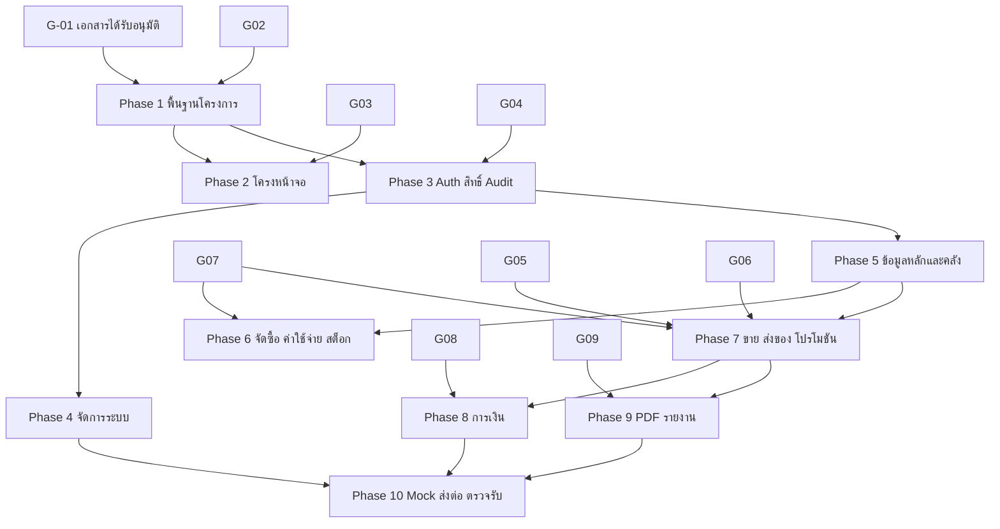

# ZUUGROUP — Project Plan

> **สถานะ: รุ่น 0.2 APPROVED — เจ้าของโครงการอนุมัติข้อแก้ไขเมื่อ 2026-09-24**
> แผนนี้ใช้เฉพาะข้อกำหนดที่ยืนยันใน `SPEC-PROJECT-001` รุ่น 0.3 และไม่เปลี่ยนประเด็น `OPEN` ให้เป็นกฎธุรกิจ
>
> รายการที่ขอให้ตรวจรอบนี้สรุปไว้ใน [ข้อแก้ไขสั้น — Sidebar และวิธีทำงาน](../specs/2026-09-24-sidebar-amendment.md)
> งานแยกหน้าเพิ่มรายการตัวอย่าง: [แผนย่อย TASK-038](2026-09-30-create-pages-plan.md); ไม่เปลี่ยนกฎธุรกิจที่ยัง OPEN
> งานจำกัดสิทธิ์ฟังก์ชัน RLS event trigger: [แผนย่อย TASK-039](2026-09-30-rls-function-execute-plan.md)
> แผนย้าย Mock เป็นข้อมูล DB ทดสอบจริง (2026-10-01): [แผน DB-first](2026-10-01-db-first-plan.md); งานแรก [ข้อมูลหลักสินค้า TASK-042](2026-10-01-product-master-plan.md) อยู่ระหว่างยืนยันรายละเอียดก่อน migration

| รายการ | ข้อมูล |
|---|---|
| รหัสเอกสาร | PLAN-PROJECT-001 |
| รุ่น | 0.2 |
| สร้างเมื่อ | 2026-09-23 16:35 น. — Asia/Bangkok |
| สถานะ | รุ่น 0.2 APPROVED |
| เจ้าของโครงการและผู้ตรวจรับ | ผู้ใช้ |
| ผู้จัดทำ | AI ผู้จัดทำ Project Plan |
| เอกสารต้นทาง | [SPEC-PROJECT-001 รุ่น 0.3](../specs/2026-09-23-1550-project-specs.md) |
| ขอบเขต | ลำดับการพัฒนาเว็บ, ฐานข้อมูล, เอกสาร และการส่งต่อสำหรับรุ่นแรก |
| สิ่งที่ทำในเอกสารนี้ | วาง Phase, งานย่อย, ผลลัพธ์, ไฟล์ที่คาดว่าจะสร้าง และรายการตรวจโดยผู้ใช้ |
| สิ่งที่ยังไม่ทำ | เขียนโค้ด, สร้างฐานข้อมูล, สร้าง Migration, Seed, Docker, PDF, Figma หรือ Push Git |

## 1. หลักการใช้แผน

1. เริ่มพัฒนาได้หลังผู้ใช้ตรวจและอนุมัติ Project Specs กับ Project Plan รุ่นที่อ้างอิงกัน
2. ทำตามลำดับ Phase และ Gate ที่ระบุ แต่ไม่ต้องรอ Phase ทั้งหมดหาก Task ย่อยไม่พึ่งข้อมูลที่ยังไม่สรุป
3. งานที่ติด `OPEN` หยุดเฉพาะคำสั่ง/กติกาที่ต้องใช้คำตอบนั้น ห้ามแทนด้วยกฎสมมติหรือ Mock Data
4. ทุก Task ระบุผู้รับผิดชอบ ไฟล์/ตาราง/API ที่กระทบ สถานะ และ Commit ตั้งต้นก่อนเริ่ม เพื่อป้องกัน AI หลายตัวแก้งานชนกัน
5. ผู้ใช้เป็นผู้ทดสอบพฤติกรรมของระบบ AI ตรวจ Build, Lint, Type/Schema และความครบถ้วนของเอกสารตามส่วนที่เปลี่ยน
6. สถานะ `READY_FOR_USER_TEST` หมายถึงพร้อมให้ตรวจ ยังไม่ใช่ `Done`; ย้าย `Main` เมื่อผู้ใช้ตรวจรับตามขอบเขตแล้ว
7. ใช้ Branch `AI`, `Dev`, `Main` เท่านั้น ห้ามสร้าง Branch ย่อยและห้าม Force Push

## 2. ขอบเขตที่แผนนี้ยึด

### 2.1 ข้อกำหนดที่นำมาวางแผน

- Next.js App Router ทำเว็บและ API ในโครงการเดียว พร้อม TypeScript, Tailwind CSS และ HeroUI
- Supabase PostgreSQL, Prisma, Supabase Auth แบบอีเมล/รหัสผ่าน และ Supabase Storage ผ่านชั้นบริการ
- Mock Data อยู่ในฐานข้อมูลจริง และต้องสร้างซ้ำได้โดยไม่ทับข้อมูลที่ผู้ใช้กรอก
- มี 4 Roles: Admin, Sales, Manager, Accounting & CFO; ไม่มี Role หรือบัญชี `Inventory`
- ผู้ตรวจนับนับของด้วยมือภายนอกระบบ Admin คีย์เพื่อเทียบยอดเท่านั้น โดยไม่ปรับยอดหรือสร้าง Ledger อัตโนมัติ
- สินค้าเป็นจำนวนเต็ม หน่วยประจำคงที่ ไม่มีการแปลงหน่วย; เงินใช้ Decimal และหน้าจอภาษาไทย/พ.ศ./Asia Bangkok
- คลังหลัก คลังการตลาด และคลังรอทำลายแยกยอดและ Ledger; สินค้าขายกับค่าใช้จ่ายแยกข้อมูล
- ลูกค้า เอกสารแนบ ใบเสนอราคา คำสั่งซื้อ/ส่งของ การเงิน/รับบางส่วน โปรโมชัน/ของแถม PDF 5 ชนิด และรายงานตาม Specs
- Audit ครอบคลุมตารางที่แอปดูแล, Soft Delete สำหรับข้อมูลหลัก, ยกเลิก/กลับรายการสำหรับธุรกรรม
- Admin แก้เลขเอกสารแบบแสดงข้อมูลเดิม/ใหม่และยืนยันบันทึก โดยไม่ต้องระบุเหตุผล
- รูปแบบ UI ใช้ Figma, Component, Icon, Logo และสีของผู้ใช้; Side Main → Topbar → Side Secondary เมื่อจำเป็น → Tabs → Filter → ข้อมูล

### 2.2 ขอบเขตที่ไม่เริ่มจากแผนนี้

- นำเข้าข้อมูลจริงจากเว็บเก่า, Deploy Production, แผนที่, หลายภาษา, ระบบแปลงหน่วย และเอกสารภาษีที่ยังไม่ระบุ
- กติกาจอง/ตัดสต็อก, เลือก Lot, ปรับยอดจากผลตรวจนับ, สูตรเงิน/ภาษี/ต้นทุน, เงื่อนไขอนุมัติ และรายละเอียด PDF ที่อยู่ใน `OPEN`
- การเลือก Asset, Component, สี หรือ Icon ใหม่เมื่อ Figma/ทรัพยากรเดิมไม่มี

## 3. Gate ก่อนเริ่มแต่ละกลุ่มงาน

| Gate | ต้องมีคำตอบ/สิ่งส่งมอบ | Phase ที่เริ่มได้เมื่อผ่าน |
|---|---|---|
| G-01 | ผู้ใช้อนุมัติ Specs และ Plan รุ่นที่ใช้งานกับ Task นั้น | ทุก Phase พัฒนา |
| G-02 | Repository/Remote, Package Manager, รุ่นเครื่องมือ และ Supabase Mock เป็น Cloud หรือ Local | Phase 1 ขึ้นไป |
| G-03 | Figma/Asset/Component ที่ใช้จริงพร้อมตำแหน่งเข้าถึง | Phase 2 และงาน UI รายหน้า |
| G-04 | วิธีสร้างบัญชี/ตั้งรหัสผ่าน, หนึ่ง Role ต่อคน, การป้องกัน Admin คนสุดท้าย และการกู้คืนโดยเจ้าของโครงการ | Phase 3 Auth/RBAC/ผู้ใช้งาน; ผ่านเมื่อ 2026-09-30 |
| G-05 | รูปแบบเลขเอกสารและสิ่งที่แก้ได้หลังเอกสารถูกปิด | Phase 7, 8 และ 9 PDF |
| G-06 | เกณฑ์ส่วนลดพิเศษ, ขอบเขต Manager/Admin และการอนุมัติรายการตนเอง | Phase 7 โปรโมชัน/อนุมัติ |
| G-07 | จังหวะจอง/ตัดสต็อก, Lot, สินค้าหมดอายุ, คืน/ทำลาย และปรับยอดจากตรวจนับ | Phase 6 งานที่เปลี่ยนยอด และ Phase 7 จัดส่ง |
| G-08 | สูตรภาษี/ส่วนลด/ปัดเศษ/ต้นทุน/เครดิต/อายุหนี้ | Phase 8 การเงินและกำไร |
| G-09 | แบบ PDF, ข้อความบริษัท, ลายเซ็น/ตรา และป้ายข้อมูลจำลอง | Phase 9 PDF |
| G-10 | กติกาไฟล์แนบ, อายุ Audit/Archive และข้อมูลเก่าเมื่อเริ่มย้าย | Phase 3 Storage/Audit ขั้นสุดท้าย และ Phase 10 |

**สถานะ Gate หลังได้รับคำตอบเบื้องต้น 2026-09-25:** G-04 และ G-10 ยังไม่ผ่าน; รายละเอียดที่ยังไม่ชัดและขอบเขตที่ห้ามอนุมานบันทึกใน [ข้อบันทึกเบื้องต้น OPEN-10/14](../specs/2026-09-25-open10-open14-preliminary-amendment.md). ใช้ [แผนย่อย TASK-026](2026-09-25-open10-open14-preliminary-plan.md) เพื่อซิงก์เอกสารเท่านั้น.

**สถานะ Gate ล่าสุด 2026-09-30:** G-04 ผ่านหลังยืนยันการจัดการบัญชี/Role, การป้องกัน Admin คนสุดท้าย และคู่มือกู้คืนโดยเจ้าของโครงการ; ดู [ข้อแก้ไขวงจร Admin](../specs/2026-09-30-admin-lifecycle-amendment.md), [คู่มือกู้คืน](../runbooks/admin-account-recovery.md) และ [TASK-036](../../tasks/TASK-036-admin-lifecycle-and-recovery.md). G-10 ยังไม่ผ่าน; จำกัดงาน Storage/Audit/Archive ที่พึ่งข้อกำหนดเหล่านั้น.

**ยืนยันเพิ่มเติม 2026-09-25:** Audit Log เก็บ 5 ปี; G-10 ยังไม่ผ่านเพราะรายละเอียดไฟล์แนบและ Archive อื่นยังเปิดอยู่. บันทึกเอกสารตาม [TASK-027](2026-09-25-audit-retention-confirmation-plan.md).

**คำตอบและข้อมูลค้นเพิ่มเติม 2026-09-25:** เลือกเพดาน 20 MiB ต่อไฟล์ตามที่มอบหมาย; 1 ผู้ใช้ต่อ 1 Role. มีข้อเสนอรายการเอกสารยา/ลูกค้าจากหน่วยงานทางการ แต่ยังไม่เป็นรายการบังคับ; ดู [ข้อบันทึก OPEN-10/14](../specs/2026-09-25-open10-open14-preliminary-amendment.md) และ [TASK-028](2026-09-25-document-requirements-research-plan.md). G-04/G-10 ยังคงไม่ผ่าน.

**แนวทางล่าสุด 2026-09-25:** เจ้าของโครงการอนุมัติให้ทำเว็บ Mock ครบทุกเมนูเพื่อนำเสนอไปก่อน แม้รายละเอียดจริงยังไม่ครบ; อนุญาตเฉพาะ UI และข้อมูลสมมุติ/การโต้ตอบสาธิต ไม่ผูก Auth, Database, Storage, Validation หรือ Permission จริง; Gate G-04/G-10 ยังคงเป็นข้อบังคับก่อนงานระบบจริง. รายละเอียดใน [Specs §22.4](../specs/2026-09-23-1550-project-specs.md) และ [TASK-029](../../tasks/TASK-029-users-management-mock.md).

**ปรับหน้าลูกค้า Mock 2026-09-25:** ถอด Sidebar ย่อยออกก่อน ให้รายการลูกค้าใช้พื้นที่หลักเต็ม; เก็บ route ย่อยเดิมไว้ชั่วคราวโดยไม่แสดงใน UI แล้วค่อยวางโครงสร้างใหม่เมื่อเจ้าของโครงการระบุ ตาม Specs §22.6 และแผนย่อย TASK-029.



## 4. ภาพรวม Phase

| Phase | หัวข้อ | ผลลัพธ์ปลาย Phase | สถานะเริ่มต้น |
|---|---|---|---|
| 0 | เตรียมงานและตัดสินใจ | เอกสารทำงาน, Task register, Gate ที่ต้องตอบ | รออนุมัติ |
| 1 | พื้นฐานโครงการ | โครง Next.js/Docker/Prisma/Supabase ที่เปิดซ้ำได้ | รอ G-01, G-02 |
| 2 | โครงหน้าจอและ Design foundation | Layout, Design tokens และ Component ตาม Figma | รอ G-03 |
| 3 | ความปลอดภัยและข้อมูลร่วม | Auth, RBAC, Audit, Soft Delete, Storage service | Auth/RBAC เริ่มได้หลัง G-04 ผ่าน; Storage/Audit รอ G-10 |
| 4 | จัดการระบบ | ผู้ใช้งาน, Audit Logs, ตั้งค่าระบบ | รอ Phase 3 |
| 5 | ข้อมูลหลักและคลัง | ลูกค้า, สินค้า, 3 คลัง, Lot, ตรวจนับ Manual | รอ Phase 3 |
| 6 | จัดซื้อ ค่าใช้จ่าย และสต็อก | ผู้ขาย, PO, รับเข้า, โอนคลัง, Ledger, ค่าใช้จ่าย | รอ G-07 ตามคำสั่ง |
| 7 | การขาย การส่งของ และโปรโมชัน | ใบเสนอราคา, อนุมัติ, Order, Delivery, ของแถม | รอ G-05 ถึง G-07 |
| 8 | การเงิน | ตั้งหนี้, วางบิล, รับชำระบางส่วน, Aging | รอ G-05, G-08 |
| 9 | PDF Dashboard รายงาน ส่งออก | PDF 5 ชนิด, Dashboard, รายงาน/Export ตามสิทธิ์ | รอ G-09 และข้อมูลจาก Phase ก่อนหน้า |
| 10 | Mock Data การส่งต่อ และตรวจรับ | Seed ซ้ำได้, เอกสารเริ่มงาน, UAT, สถานะส่งมอบ | รอ Phase ที่เกี่ยวข้อง |

## 5. Phase 0 — เตรียมงานและตัดสินใจ

### 5.1 งานย่อย

1. บันทึกการอนุมัติ Project Specs และ Project Plan พร้อมรุ่น/วันที่/ผู้ตรวจ
2. สร้างทะเบียน Task, สถานะงาน, ผู้ถือครองไฟล์ และกติกาแก้ไฟล์กลางสำหรับ AI หลายตัว
3. ย้าย OPEN-01 ถึง OPEN-15 เป็นรายการตัดสินใจที่เชื่อมกับ Gate และไม่เปิด Task เขียนโค้ดที่ต้องเดา
4. ยืนยันตำแหน่ง Repository, Remote, Branch เริ่มต้น, Package Manager, Supabase Mock และวิธีส่ง Asset
5. ระบุลำดับทำงานจากหน้า “จัดการระบบ” ก่อน ตามข้อตกลงเดิม: ผู้ใช้งาน → Audit Logs → ตั้งค่าระบบ

### 5.2 ผลลัพธ์

- เอกสารอนุมัติ/สถานะของ Specs และ Plan
- Task register ที่บอกผู้รับผิดชอบและขอบเขตไฟล์ก่อนเริ่ม
- Decision register สำหรับ OPEN พร้อม Gate ที่ถูกต้อง
- ข้อตกลงการใช้ `AI` / `Dev` / `Main` ที่ทุกผู้ทำอ่านจาก Repository เดียวกัน

### 5.3 ไฟล์ที่คาดว่าจะสร้าง

```text
AGENTS.md
README.md
docs/DECISIONS.md
docs/HANDOFF.md
tasks/ACTIVE.md
tasks/BLOCKED.md
tasks/COMPLETED.md
tasks/TASK-001-project-setup.md
skills/README.md
skills/plan.md
skills/code.md
skills/database.md
skills/handoff.md
```

### 5.4 ⚠️ ต้องทดสอบโดยคุณ

- ตรวจว่าเอกสารอ้าง Specs รุ่นล่าสุดที่อนุมัติ และไม่เปลี่ยน OPEN เป็นข้อสรุป
- ตรวจว่า Task หนึ่งมีผู้รับผิดชอบหลักคนหรือ AI เดียว และไม่เกิด Branch นอก `AI` / `Dev` / `Main`
- ตรวจว่าไฟล์ Handoff ระบุสิ่งที่คนใหม่ต้องอ่านก่อนเริ่มงานได้ครบ

## 6. Phase 1 — พื้นฐานโครงการ

### 6.1 งานย่อย

1. สร้างโครง Next.js App Router, TypeScript, Tailwind CSS และ HeroUI ตาม Code Style ที่ผู้ใช้ส่ง
2. ตั้งค่า Alias `@/`, Prettier, Lint, โครง Config, Error handling และชั้น `src/service/http.ts`
3. เตรียม Prisma Schema, Prisma Migration workflow และจุดเชื่อม Supabase PostgreSQL โดยยังไม่ใส่กฎธุรกิจที่เป็น OPEN
4. เตรียม Docker สำหรับการเปิดระบบซ้ำ, `.env.example`, และ README เริ่มงานโดยไม่เก็บ Secret
5. วางโครง API/service/repository ให้ Browser ไม่เข้าถึง Prisma หรือ Server Secret
6. บันทึกเวอร์ชันเครื่องมือที่เลือกจริง และวิธีใช้งาน Supabase Auth แบบ Server-side

### 6.2 ผลลัพธ์

- แอปเริ่มต้นได้จากขั้นตอนใน README
- โครงเว็บ, API, DB, Environment และ Docker แยกหน้าที่ชัดเจน
- ไม่มี Secret ใน Git/Client Bundle และไม่มี Mock Data ที่ฝังในหน้าจอ
- แพตเทิร์นสำหรับ Migration, Seed, Config และการจัดการ Error พร้อมใช้กับ Phase ต่อไป

### 6.3 ไฟล์ที่คาดว่าจะสร้าง

```text
package.json
next.config.*
tsconfig.json
tailwind.config.*
postcss.config.*
prettier.config.*
eslint.config.*
Dockerfile
docker-compose.yml
.env.example
prisma/schema.prisma
prisma/migrations/...
src/app/layout.tsx
src/app/page.tsx
src/config/app.ts
src/service/http.ts
src/server/...
src/lib/...
README.md
```

### 6.4 ⚠️ ต้องทดสอบโดยคุณ

- ทำตาม README บนเครื่องใหม่: ตั้งค่า Environment, เปิด Docker, เชื่อมฐานข้อมูลจำลอง และเปิดหน้าเว็บได้
- ตรวจว่าไม่มีค่า Secret ในไฟล์ที่ Commit และไม่มีค่า Server Key บน Browser
- ตรวจว่าโครงสร้างโฟลเดอร์อ่านแล้วรู้ตำแหน่งหน้าเว็บ, API, Server service, Prisma และเอกสาร

## 7. Phase 2 — โครงหน้าจอและ Design foundation

### 7.1 งานย่อย

1. นำ Design/Asset ที่ผู้ใช้ส่งมาใช้ตาม Figma โดยไม่เลือก Component, Icon, Logo หรือชุดสีใหม่เอง
2. สร้าง App Shell: Side Main สีน้ำเงิน `#1A58A7`, Topbar, พื้นที่ Side Secondary เมื่อจำเป็น, Tab bar, Filter bar และพื้นที่ข้อมูล
3. สร้าง Component มาตรฐานตามแบบ: Table, Filter, Search, Pagination, Export, Form field, Status, Empty/Error/Loading state, Confirm dialog และเอกสารแนบ
4. ทำ Header & Detail สำหรับเพิ่ม/แก้/ดู พร้อม Validation, เก็บข้อมูลกรอกเมื่อบันทึกไม่ผ่าน และป้องกันออกจากหน้าที่มีข้อมูลยังไม่บันทึก
5. ทำ Responsive ตาม Breakpoint ที่กำหนด และให้ตารางใช้ทางเลื่อนอย่างอ่านได้
6. วางมาตรฐาน Section name เช่น `Admin / จัดการระบบ / ผู้ใช้งาน` สำหรับทุก Specs รายหน้า

### 7.1.1 ลำดับย่อยสำหรับ Sidebar ตามข้อมูลที่ได้รับ 2026-09-24

ทุกครั้งที่เริ่มงานย่อยใน Phase 2 ให้ทำตามลำดับนี้ แม้ Task ใหญ่จะได้รับอนุมัติแล้ว:

1. แจ้งแก่เจ้าของโครงการว่าจะแก้ส่วนใด, ขอบเขต, ลำดับ, ผลลัพธ์, ไฟล์ที่คาดว่าจะแก้ และวิธีตรวจรับ
2. อ่าน `tasks/ACTIVE.md`; เพิ่ม/ปรับ Task และระบุไฟล์ที่เป็นขอบเขตเพื่อกันงานชน
3. ตรวจข้อมูลล่าสุดกับ Specs รุ่น 0.3 และ Plan; ถ้ามีข้อมูลใหม่หรือขัดกัน ให้บันทึก Specs และปรับ Plan ก่อนลงมือ
4. ใช้กลุ่ม/เมนู/SVG ตามตารางใน Specs §6.5; ห้ามเพิ่ม asset, โลโก้ หรือรายการ Sidebar ที่ไม่ได้รับ
5. เชื่อมเมนูที่ยืนยันแล้วกับ placeholder route ที่มีอยู่ โดยไม่เพิ่มพฤติกรรมหรือกฎธุรกิจ
6. เมื่องานพัฒนาได้รับอนุมัติแล้ว ให้ตรวจ lint/type-check/build และภาพ Sidebar ทั้งสถานะย่อ/ขยาย; รายงานผลและส่งรายการตรวจให้เจ้าของโครงการ

ไฟล์ขอบเขตปัจจุบันของงาน Sidebar: `public/icons/*.svg`, `src/config/navigation.ts`, `src/components/layout/sidebar.tsx` และ CSS ที่จำเป็นใน `src/app/globals.css`; แก้ไฟล์อื่นต้องบันทึกเหตุผลและปรับ Task ก่อน

### 7.1.2 Logo และโปรไฟล์ Sidebar

งานย่อย TASK-010 ใช้ [แผนสั้นสำหรับ Logo และโปรไฟล์ Sidebar](2026-09-24-sidebar-logo-plan.md) หลังข้อกำหนดที่เจ้าของโครงการส่งเมื่อ 2026-09-24

### 7.1.3 แถบสีเหนือพื้นที่เนื้อหา

งานย่อย TASK-011 ใช้ [แผนสั้นสำหรับแถบสีเหนือพื้นที่เนื้อหา](2026-09-24-top-accent-plan.md) ตามภาพที่เจ้าของโครงการส่งเมื่อ 2026-09-24

### 7.1.4 Typography ของ Sidebar

งานย่อย TASK-012 ใช้ [แผนสั้นสำหรับ Typography ของ Sidebar](2026-09-24-sidebar-typography-plan.md) ตามรูปแบบการเขียนที่เจ้าของโครงการระบุเมื่อ 2026-09-24

### 7.1.5 โลโก้ควบคุม Sidebar และชื่อเมนู

งานย่อย TASK-014 ใช้ [แผนสั้นสำหรับโลโก้และน้ำหนักเมนู](2026-09-24-sidebar-logo-toggle-regular-plan.md) ตามคำขอเจ้าของโครงการ 2026-09-24

### 7.1.6 ลำดับชั้นหน้าจอ

TASK-015 ใช้ [แผนสั้นสำหรับลำดับชั้นหน้าจอ](2026-09-24-navigation-hierarchy-plan.md) เพื่อเก็บคำอธิบาย Sidebar หลัก, Top bar, เมนูย่อยใน body, tab และ filter ก่อนออกแบบรายละเอียดรายหน้า

### 7.1.7 แก้การย่อ Sidebar หลัก

TASK-016 ใช้ [แผนสั้นแก้การย่อ Sidebar หลัก](2026-09-24-main-sidebar-collapse-fix-plan.md) และ [ข้อกำหนดลำดับชั้นหน้าจอ](../specs/2026-09-24-navigation-hierarchy.md)

### 7.2 ผลลัพธ์

- หน้าพื้นฐานตรงโครงที่ผู้ใช้สร้างไว้และพร้อมเปลี่ยนเนื้อหาตามโมดูล
- Filter/Tab/Side Secondary มีหน้าที่ต่างกัน ไม่ซ้ำซ้อน
- Component ซ้ำใช้ร่วมกันได้โดยยังแก้ให้ตรง Figma ได้

### 7.3 ไฟล์ที่คาดว่าจะสร้าง

```text
src/app/(backoffice)/layout.tsx
src/components/layout/SidebarComponent.tsx
src/components/layout/TopbarComponent.tsx
src/components/layout/SecondarySidebarComponent.tsx
src/components/common/DataTableComponent.tsx
src/components/common/FilterBarComponent.tsx
src/components/common/PageTabsComponent.tsx
src/components/common/FormFieldComponent.tsx
src/components/common/ConfirmDialogComponent.tsx
src/components/common/FileUploadComponent.tsx
src/app/globals.css
src/config/navigation.ts
docs/DESIGN-USAGE.md
```

### 7.4 ⚠️ ต้องทดสอบโดยคุณ

- เปิดบน Mobile, Tablet, Laptop และ Desktop แล้วตรวจ Side Main, Topbar, Tabs, Filter และตารางตาม Figma
- ตรวจว่าค้นหาอยู่ใน Filter ของ Tab นั้น และไม่มี Filter สถานะซ้ำกับ Tab
- เปิดหน้าเพิ่ม/แก้/ดูตัวอย่าง ตรวจปุ่มบันทึก/ยกเลิก, ข้อผิดพลาดในช่อง, Loading, Empty และ No permission

## 8. Phase 3 — ความปลอดภัยและข้อมูลร่วม

### 8.1 งานย่อย

1. เชื่อม Supabase Auth อีเมล/รหัสผ่านแบบ Server-side และแยก `auth_accounts` จาก `users` ในฐานข้อมูลธุรกิจ
2. สร้าง Role/Permission สำหรับ Admin, Sales, Manager และ Accounting & CFO; Server ตรวจทั้งสิทธิ์คำสั่งและขอบเขตข้อมูล
3. จำกัด Sales ด้วยผู้ดูแลลูกค้า/เจ้าของเอกสารทุกชั้น: หน้าเว็บ, API, Export, PDF และยอดรวม
4. สร้าง Soft Delete/Restore สำหรับข้อมูลหลัก และรูปแบบยกเลิก/กลับรายการสำหรับธุรกรรม โดยไม่ใช้ลบแถวธุรกรรมทิ้ง
5. สร้าง Audit แบบเพิ่มรายการสำหรับข้อมูลที่แอปดูแล เก็บผู้ทำ เวลา Request ID ค่าก่อน/หลังเฉพาะช่องที่เปลี่ยน และ Snapshot สำหรับเหตุการณ์สำคัญ
6. สร้าง Storage service, File metadata และการตรวจสิทธิ์ดาวน์โหลด โดยไม่เปิด Bucket/ลิงก์ไฟล์กว้างเกินสิทธิ์
7. สร้างกติกาแปลง UTC ↔ Asia/Bangkok, การแสดง พ.ศ., Decimal เงิน และจำนวนเต็มสินค้าแบบใช้ร่วมกัน

### 8.2 ผลลัพธ์

- การเข้าสู่ระบบและ Role ทำงานจากฐานข้อมูลธุรกิจ ไม่เชื่อสิทธิ์ที่ Browser ส่งมา
- Sales ไม่ได้รับข้อมูลต้นทุนแม้เรียก API โดยตรง
- การแก้ข้อมูลหลักและเหตุการณ์ธุรกิจมีประวัติอ่านย้อนหลังได้ โดยไม่บันทึก Password, Token หรือ Secret
- ไฟล์ลูกค้าอ่านได้เฉพาะผู้มีสิทธิ์

### 8.3 ไฟล์ที่คาดว่าจะสร้าง

```text
prisma/schema.prisma
prisma/migrations/...-auth-rbac-audit/
src/server/auth/...
src/server/permissions/...
src/server/audit/...
src/server/storage/...
src/server/database/...
src/lib/dateTime.ts
src/lib/money.ts
src/lib/quantity.ts
src/app/api/auth/...
src/app/api/files/...
src/app/api/.../route.ts
docs/PERMISSIONS.md
docs/DATABASE.md
docs/SECURITY.md
```

### 8.4 ⚠️ ต้องทดสอบโดยคุณ

- เข้าสู่ระบบด้วย 4 Roles และบัญชีระงับ: เห็นเฉพาะเมนู/ข้อมูล/คำสั่งที่สิทธิ์อนุญาต
- ใช้ Sales คนที่ 1 เปิด URL/API/Export ของ Sales คนที่ 2: ต้องไม่เห็นข้อมูลและต้นทุน
- แก้ข้อมูลและเปิด Audit: ต้องเห็นผู้ทำ เวลา ก่อน/หลังเฉพาะที่เปลี่ยน โดยไม่มีข้อมูลลับ
- เปิดไฟล์ลูกค้าด้วยผู้ไม่มีสิทธิ์: ต้องดาวน์โหลดหรืออ่านไม่ได้

## 9. Phase 4 — จัดการระบบ

### 9.1 งานย่อย

1. ทำโมดูล `Admin / จัดการระบบ / ผู้ใช้งาน`: รายการ, เพิ่ม, ดู, แก้, ระงับ, เปิดใช้งาน, เปลี่ยนสิทธิ์, กู้คืน และส่งออกตามสิทธิ์
2. ทำ Tab ทั้งหมด/ใช้งานอยู่/ระงับการใช้งาน และ Filter ค้นหาชื่อ รหัส อีเมล บทบาท รวมถึงทีม/เขตเมื่อมีข้อมูลใช้งานจริง
3. ทำโมดูล `Admin / จัดการระบบ / Audit Logs`: รายการ, Filter, ดูรายละเอียดก่อน/หลัง, Export และไม่มีปุ่มแก้/ลบ
4. ทำโมดูล `Admin / จัดการระบบ / ตั้งค่าระบบ`: บริษัท, เอกสาร, เงื่อนไขชำระเงิน, ข้อมูลอ้างอิง และการแจ้งเตือนแบบ typed settings
5. ทำกติกาค่าตั้งต้น/วันที่มีผล เพื่อไม่ให้การแก้ค่ากลางเปลี่ยนเอกสารเก่าโดยเงียบ ๆ

### 9.2 ผลลัพธ์

- หน้าจัดการระบบครบสามหน้าแรกตามลำดับที่ผู้ใช้ต้องการ
- ผู้ใช้จัดการบัญชีโดยไม่เห็น Password/Hash, ตรวจ Audit ได้ และแก้ค่าระบบผ่านฟอร์มที่ตรวจข้อมูล
- ไม่มีช่องกรอก Key/SQL/JSON อิสระบนหน้าตั้งค่า

### 9.3 ไฟล์ที่คาดว่าจะสร้าง

```text
src/app/(backoffice)/system/users/page.tsx
src/app/(backoffice)/system/users/[id]/page.tsx
src/app/(backoffice)/system/audit-logs/page.tsx
src/app/(backoffice)/system/audit-logs/[id]/page.tsx
src/app/(backoffice)/system/settings/page.tsx
src/features/users/...
src/features/auditLogs/...
src/features/systemSettings/...
src/app/api/users/...
src/app/api/audit-logs/...
src/app/api/system-settings/...
docs/specs/system/...
```

### 9.4 ⚠️ ต้องทดสอบโดยคุณ

- Admin เพิ่ม/ระงับ/เปิดใช้งานผู้ใช้ แล้วตรวจว่า Session เก่าถูกปฏิเสธตามกติกา
- ตรวจ Filter, Tab, Pagination และ Export ว่าไม่ส่งข้อมูลเกินสิทธิ์
- เปิด Audit Log และรายละเอียดก่อน/หลังจากการแก้ผู้ใช้/การตั้งค่า
- เปลี่ยนเงื่อนไขชำระเงินหรือค่ากลาง แล้วตรวจว่าเอกสารเก่าไม่เปลี่ยนย้อนหลัง

## 10. Phase 5 — ข้อมูลหลักและคลัง

### 10.1 งานย่อย

1. ทำลูกค้า: รหัสอัตโนมัติ, ข้อมูลบริษัท/ผู้ติดต่อ/ที่อยู่, เอกสารใบอนุญาต/หนังสือรับรอง, วันหมดอายุ, เงื่อนไขชำระเงิน และพนักงานขายผู้ดูแล
2. ทำประวัติการเปลี่ยนผู้ดูแลลูกค้า เพื่อไม่เขียนทับเจ้าของเอกสาร/ยอดเก่า
3. ทำสินค้า: รหัส, ชื่อ, หมวด, หน่วยประจำ, ราคาขาย, ต้นทุนตามสิทธิ์, รูป และสถานะ
4. ทำคลังหลัก/การตลาด/รอทำลาย, Lot, วันหมดอายุ, ยอดแยกคลัง และหน้าดู Stock Ledger
5. ทำการสร้างสินค้าโดยเลือกคลัง/ยอดเริ่มต้น; ยอดเริ่มต้นที่ยืนยันต้องสร้างรายการตั้งต้นและ Ledger
6. ทำคำสั่งโอนคลังในหน้าแก้สินค้าโดยใช้ Transaction เดียว ห้ามย้ายด้วยการแก้ `warehouse_id`
7. ทำแจ้งล็อตใกล้หมดอายุ 90 วันโดยยังไม่ย้ายคลังอัตโนมัติ
8. ทำรอบตรวจนับสินค้า Manual: Admin คีย์ยอดนับจริงแยกคลัง/Lot, ระบบแสดงยอดระบบและผลต่าง, ไม่มีผลต่อยอดหรือ Ledger

### 10.2 ผลลัพธ์

- ลูกค้าและเอกสารใช้กับการขาย/การเงินใน Phase ถัดไปได้
- สินค้าขายไม่ปะปนกับค่าใช้จ่ายและยอดสามคลังไม่ปะปนกัน
- การรับยอดเริ่มต้น/โอนคลังมีประวัติและป้องกันยอดติดลบ
- ผลตรวจนับเป็นเพียงรายงานเปรียบเทียบที่ Admin บันทึก ไม่มี Role Inventory

### 10.3 ไฟล์ที่คาดว่าจะสร้าง

```text
prisma/migrations/...-customers-products-inventory/
src/app/(backoffice)/customers/...
src/app/(backoffice)/products/...
src/app/(backoffice)/inventory/...
src/features/customers/...
src/features/products/...
src/features/inventory/...
src/app/api/customers/...
src/app/api/products/...
src/app/api/inventory/...
src/server/inventory/...
docs/specs/customers/...
docs/specs/inventory/...
```

### 10.4 ⚠️ ต้องทดสอบโดยคุณ

- เพิ่มลูกค้าพร้อมเอกสาร แล้วตรวจรหัสลูกค้า, วันหมดอายุเอกสาร และสิทธิ์ Sales ต่อข้อมูลลูกค้าตนเอง
- สร้างสินค้า/ยอดเริ่มต้น แล้วตรวจว่า Ledger เกิดเฉพาะเมื่อมีจำนวนเริ่มต้นจริง
- โอนบางส่วนระหว่างสามคลัง: ต้นทางลด ปลายทางเพิ่ม Lot เดิม และยอดรวมพร้อมขายไม่ปะปนกับคลังอื่น
- ลองจำนวน `1.5`, `0`, และค่าติดลบ: ระบบต้องไม่ยอมรับ
- Admin คีย์ผลตรวจนับที่ต่างจากยอดระบบ: ต้องเห็นผลต่าง แต่ยอดและ Ledger ห้ามเปลี่ยน

## 11. Phase 6 — จัดซื้อ ค่าใช้จ่าย และการเคลื่อนไหวสต็อก

### 11.1 งานย่อย

1. ทำผู้ขาย, ใบสั่งซื้อ, รายการสั่งซื้อ และรับสินค้าโดยเก็บคลังปลายทาง, Lot, วันหมดอายุ, จำนวนเต็ม และต้นทุนตามสิทธิ์
2. ทำสถานะร่าง/ยืนยันรับเข้า: ร่างไม่เพิ่มสต็อก; ยืนยันรับเข้าจึงบันทึกยอดและ Ledger ใน Transaction เดียว
3. ทำมุมมองยอดสั่ง/รับแล้ว/ค้างรับสำหรับการรับบางส่วน โดยไม่เปิดกรณีรับเกินหรือแก้หลังรับจนกว่าจะสรุป
4. ทำค่าใช้จ่ายบริษัทแยก `company_expenses`/หมวดค่าใช้จ่ายจากสินค้าและ Ledger อย่างเด็ดขาด
5. ทำ Filter ค้นหา ช่วงเวลา ผู้ขาย สถานะ คลัง และเอกสารอ้างอิงตามหน้าที่ใช้
6. ทำข้อจำกัดการเขียนยอดพร้อมกันและการกดยืนยันซ้ำในคำสั่งรับเข้า/โอนคลังที่กฎยืนยันแล้ว

### 11.2 ผลลัพธ์

- รับสินค้าและโอนคลังที่อยู่ในกฎยืนยันมี Ledger/Audit ครบและยอดไม่ติดลบ
- ค่าใช้จ่ายเพิ่ม/แก้/ค้นหา/แนบเอกสารได้โดยไม่สร้างสินค้าเทียมหรือเปลี่ยนสต็อก
- งานที่ต้องตัดสินเรื่อง Lot, จอง, รับเกิน, คืน และทำลายถูกกันไว้ตาม G-07

### 11.3 ไฟล์ที่คาดว่าจะสร้าง

```text
prisma/migrations/...-purchasing-expenses/
src/app/(backoffice)/purchases/...
src/app/(backoffice)/expenses/...
src/features/purchases/...
src/features/expenses/...
src/app/api/purchase-orders/...
src/app/api/goods-receipts/...
src/app/api/expenses/...
src/server/purchasing/...
src/server/expenses/...
docs/specs/purchasing/...
docs/specs/expenses/...
```

### 11.4 ⚠️ ต้องทดสอบโดยคุณ

- บันทึกร่างรับสินค้า: ยอดและ Ledger ต้องไม่เปลี่ยน; ยืนยันรับเข้า: ยอด/ล็อต/Ledger/Audit ต้องครบ
- รับบางส่วน: ยอดสั่ง, รับแล้ว และค้างรับต้องตรงกัน
- เพิ่มค่าใช้จ่ายพร้อมเอกสาร: ไม่ปรากฏเป็นสินค้าและไม่ทำให้ยอดคลังเปลี่ยน
- เปิดพร้อมกันสองหน้าต่างเพื่อรับ/โอน: ต้องไม่สร้างยอดติดลบหรือบันทึกซ้ำ

## 12. Phase 7 — ใบเสนอราคา คำสั่งซื้อ การส่งของ และโปรโมชัน

### 12.1 งานย่อย

1. ทำใบเสนอราคา: หัวเอกสาร, รายการสินค้า, จำนวน, ราคา, ส่วนลด, ภาษี, ของแถม, เงื่อนไขชำระเงิน, สถานะ และรุ่นข้อมูล
2. ทำ Workflow ส่วนลดพิเศษเฉพาะหลัง G-06: Sales ส่งขอ, Manager พิจารณา, เก็บผู้ขอ/ผู้พิจารณา/เวลา/ผล และยกเลิกผลเดิมเมื่อแก้ข้อมูลสำคัญ
3. ทำโปรโมชัน/ของแถมหลัง G-06: Manager กำหนดและอนุมัติ, Sales เลือกใช้เฉพาะที่อนุมัติ, ระบบเก็บรุ่นเงื่อนไขที่ใช้
4. ทำคำสั่งซื้อจากใบเสนอราคาหรือสร้างตามสิทธิ์, แยกรายการขาย/ของแถม, และเก็บยอดสั่ง/ส่งแล้ว/ค้างส่ง
5. ทำจัดส่งบางส่วน/ใบส่งของเมื่อ G-07 กำหนดจังหวะจ่ายและ Lot; การยืนยันจ่ายต้องอยู่ใน Transaction เดียวกับ Ledger/ยอด
6. แสดงของแถมเป็นชื่อ/จำนวน/หน่วย ไม่มีราคาในเอกสารลูกค้า และตัดสต็อกครั้งเดียว
7. แยกสถานะคำสั่งซื้อ, การส่ง และการชำระเงิน ไม่รวมในช่องเดียว
8. ทำคำสั่งยกเลิกเฉพาะเมื่อมีข้อตกลงผลต่อสต็อก/การเงินตามสถานะแล้ว

### 12.2 ผลลัพธ์

- Sales ทำงานเฉพาะลูกค้าในความรับผิดชอบ โดยไม่เห็นต้นทุน
- ส่วนลดพิเศษและโปรโมชันอ้างรุ่นข้อมูลจริงและป้องกันอนุมัติคนละข้อมูล
- Order/Delivery รองรับส่งบางส่วนและไม่ตัดสต็อกของแถมซ้ำ

### 12.3 ไฟล์ที่คาดว่าจะสร้าง

```text
prisma/migrations/...-quotations-orders-promotions/
src/app/(backoffice)/quotations/...
src/app/(backoffice)/orders/...
src/app/(backoffice)/promotions/...
src/features/quotations/...
src/features/orders/...
src/features/promotions/...
src/app/api/quotations/...
src/app/api/orders/...
src/app/api/deliveries/...
src/app/api/promotions/...
src/server/quotations/...
src/server/orders/...
src/server/promotions/...
docs/specs/quotations/...
docs/specs/orders/...
docs/specs/promotions/...
```

### 12.4 ⚠️ ต้องทดสอบโดยคุณ

- Sales สร้างใบเสนอราคาเฉพาะลูกค้าตนเองและไม่เห็นต้นทุนในหน้า/API/Export
- ส่งขอส่วนลด อนุมัติ แล้วแก้ราคา/จำนวน/ส่วนลด/เงื่อนไข: ผลอนุมัติเดิมต้องใช้ต่อไม่ได้
- Sales ใช้โปรโมชันแล้วพยายามเพิ่ม/แก้ของแถม: ต้องทำไม่ได้เกินเงื่อนไขที่อนุมัติ
- ส่งของบางส่วน: ยอดส่งและค้างส่งถูกต้อง; ของแถมตัดสต็อกครั้งเดียวและไม่มีราคาในใบส่งของ

## 13. Phase 8 — การเงิน

### 13.1 งานย่อย

1. ทำเอกสารตั้งหนี้และรายการหนี้แยกจากใบวางบิล เพื่อไม่สร้างหนี้ซ้ำจากการพิมพ์หรือรวมบิล
2. ทำใบวางบิลที่รวม Invoice และแสดงวันออก, ครบกำหนด, ยอดตั้งหนี้, รับแล้ว และคงค้าง
3. ทำรับชำระและ `payment_allocations` เพื่อรองรับรับบางส่วน หลายครั้ง และหนึ่งยอดรับตัดได้หลายบิล
4. ป้องกันยอดจัดสรรเกินยอดรับ/ยอดหนี้ และป้องกันการกดยืนยันรับเงินซ้ำ
5. ทำ Aging/แถบหรือ Tab สีแดงสำหรับหนี้เกินกำหนด 90/120 วัน หลัง G-08 กำหนดสูตรวันและการคำนวณยอด
6. ทำสิทธิ์ Accounting & CFO ต่อการเงิน/ต้นทุน และป้องกัน Sales อ่านต้นทุน/กำไร
7. ทำ Audit/การยกเลิกหรือกลับรายการการเงินตามกติกาที่ได้รับคำตอบแล้วเท่านั้น

### 13.2 ผลลัพธ์

- ยอดหนี้คำนวณจาก Invoice และการจัดสรรจริง ไม่กรอก Aging ด้วยมือ
- รองรับรับชำระบางส่วน/หลายบิลโดยไม่ทำยอดติดลบ
- ข้อมูลการเงินใช้ Decimal, ภาษาไทย, พ.ศ. และเวลา Asia/Bangkok ตามมาตรฐานกลาง

### 13.3 ไฟล์ที่คาดว่าจะสร้าง

```text
prisma/migrations/...-finance/
src/app/(backoffice)/finance/invoices/...
src/app/(backoffice)/finance/billing/...
src/app/(backoffice)/finance/payments/...
src/app/(backoffice)/finance/receivables/...
src/features/finance/...
src/app/api/invoices/...
src/app/api/billing-notes/...
src/app/api/payments/...
src/app/api/receivables/...
src/server/finance/...
docs/specs/finance/...
```

### 13.4 ⚠️ ต้องทดสอบโดยคุณ

- ตั้งหนี้และออกใบวางบิลจากหนี้เดิม: การพิมพ์/รวมบิลต้องไม่เพิ่มหนี้ซ้ำ
- รับ 400 จากหนี้ 1,000 แล้วรับ 600: ยอดคงค้างและสถานะต้องเปลี่ยนถูกต้อง
- รับเงินหนึ่งรายการตัดหลายบิล: ยอดจัดสรรรวมต้องไม่เกินยอดรับและไม่เกินหนี้
- ตรวจหนี้ที่ขอบเขต 90/120 วันตามสูตรที่ผู้ใช้อนุมัติ: แถบแดง/Tab/Filter และยอดต้องตรงกันทุกหน้า

## 14. Phase 9 — PDF Dashboard รายงาน และ Export

### 14.1 งานย่อย

1. ทำตัวสร้างเลขเอกสารกลาง, ID ภายในคงเดิม, เลขที่เอกสารแสดงแยก, ประวัติเลขที่ใช้แล้ว และการกันเลขซ้ำตาม G-05
2. ทำการแก้เลขเอกสารโดย Admin: กดบันทึก → แสดงเดิม/ใหม่และข้อมูลอ้างอิง → ยืนยันบันทึก → ตรวจสิทธิ์/เลขซ้ำ/รุ่นข้อมูลอีกครั้ง → Audit โดยไม่มีช่องเหตุผล
3. ทำ `document_versions` และ Snapshot ข้อมูล/Template เพื่อให้ PDF ที่ออกแล้วไม่เปลี่ยนย้อนหลัง
4. ทำ PDF 5 ชนิดหลัง G-09: ใบเสนอราคา, ใบยืนยันคำสั่งซื้อ, ใบส่งของ, ใบวางบิล, ใบรับชำระเงิน
5. ทำ Dashboard หลักตามสิทธิ์และข้อมูลที่มีแล้ว: Sales เห็นของตน, Manager ภาพรวมตามขอบเขตที่อนุมัติ, Accounting & CFO การเงิน/ต้นทุน, Admin รวมข้อมูลคลังและผลตรวจนับ
6. ทำรายงานยอดขาย, คลัง/ความเคลื่อนไหว และการเงิน พร้อมกำหนดแหล่งข้อมูล/วันตัดยอด/การจัดการรายการยกเลิก
7. ทำ Export ที่ใช้ Filter และสิทธิ์ชุดเดียวกับหน้าจอ ไม่หลุดยอดรวม/จำนวนรายการ/ต้นทุนข้าม Sales

### 14.2 ผลลัพธ์

- PDF มีข้อมูลตามรุ่นที่ออก, ภาษาไทย/พ.ศ., รองรับหลายหน้า และแสดงข้อมูลจำลองตามแบบที่อนุมัติ
- การแก้เลขเอกสารไม่กระทบ ID ภายในหรือ PDF เก่า และไม่สร้างเอกสาร/ประวัติซ้ำเมื่อกดยืนยันซ้ำ
- Dashboard/Report/Export เคารพสิทธิ์และแสดงนิยามข้อมูลที่ตรวจสอบได้

### 14.3 ไฟล์ที่คาดว่าจะสร้าง

```text
prisma/migrations/...-documents-reports/
src/app/(backoffice)/dashboard/page.tsx
src/app/(backoffice)/reports/...
src/features/documents/...
src/features/dashboard/...
src/features/reports/...
src/app/api/documents/...
src/app/api/reports/...
src/app/api/exports/...
src/server/documents/...
src/server/reports/...
src/server/exports/...
src/templates/pdf/...
docs/specs/documents/...
docs/specs/reports/...
```

### 14.4 ⚠️ ต้องทดสอบโดยคุณ

- Admin แก้เลขเอกสาร: ต้องเห็นเดิม/ใหม่ก่อนยืนยัน, ไม่มีช่องเหตุผล, เลขซ้ำหรือข้อมูลถูกแก้ระหว่างยืนยันต้องบันทึกไม่ได้
- เปิด PDF ทั้ง 5 ชนิดหลายหน้าและแก้ข้อมูลต้นทางภายหลัง: PDF รุ่นเก่าต้องไม่เปลี่ยน
- ตรวจของแถมใน PDF: มีชื่อ/จำนวน/หน่วย แต่ไม่มีราคา `0.00`
- เปรียบ Dashboard/Report/Export ของ Sales สองคน: ต้องเห็นเฉพาะขอบเขตตนและ Filter เดียวกับหน้าจอ

## 15. Phase 10 — Mock Data การส่งต่อ และตรวจรับ

### 15.1 งานย่อย

1. ออกแบบ Seed Data ที่สร้างซ้ำได้โดยไม่ลบข้อมูลผู้ใช้ และรองรับ 4 Roles, ลูกค้า, เอกสาร, สินค้า, Lot, สามคลัง, PO, Expense, Quote, Promotion, Order, Delivery, Invoice, Payment และ Audit
2. ใส่กรณีข้อมูลจำลองที่ใช้ตรวจ: ยอดเริ่มต้น, โอนคลัง, ใกล้หมดอายุ, ของแถม, ส่วนลดรออนุมัติ, ส่งบางส่วน, รับบางส่วน, หนี้เกิน 90/120 วัน, Soft Delete/Restore และตรวจนับที่เกิดผลต่าง
3. ทำเอกสารเริ่มงานและ Handoff: README, Database, Permissions, API/Module Specs, Migration/Seed, Environment, Docker และสถานะ Task ล่าสุด
4. ตรวจความครบถ้วนของทุก Task ต่อ Specs/Plan, รายงานสิ่งที่ยังไม่ทำและเหตุผล, เตรียมรายการ UAT ระดับ Task
5. จัดรอบให้ผู้ใช้ตรวจตาม Scenario โดยไม่รายงานว่า Done ก่อนผู้ใช้ตรวจรับ
6. เก็บข้อมูลสำหรับการนำเข้าระบบเก่าเป็น Mapping template เท่านั้น ไม่ย้ายข้อมูลจริงก่อน OPEN-13

### 15.2 ผลลัพธ์

- ระบบรุ่น Mock ใช้ทดสอบ Flow สำคัญได้ด้วยข้อมูลจริงในฐานข้อมูลจำลอง
- คนหรือ AI เครื่องใหม่ Clone แล้วอ่านเอกสารและเริ่มงานต่อได้
- สถานะงานแยกเสร็จทางเทคนิค, พร้อมให้ผู้ใช้ทดสอบ และ Done ชัดเจน

### 15.3 ไฟล์ที่คาดว่าจะสร้าง

```text
prisma/seed.ts
prisma/seed-data/...
docs/DATABASE.md
docs/PERMISSIONS.md
docs/API.md
docs/HANDOFF.md
docs/CHANGELOG.md
docs/sources/legacy-import-template.md
tasks/ACTIVE.md
tasks/COMPLETED.md
tasks/BLOCKED.md
tasks/TASK-xxx.md
```

### 15.4 ⚠️ ต้องทดสอบโดยคุณ

- Clone Repository ใหม่แล้วทำตาม README: เปิดระบบ, เตรียม Environment, Migration, Seed และเข้าใช้ด้วยบัญชี Mock ได้
- ตรวจ Scenario สำคัญที่ Phase 3–9 ส่งไว้ พร้อมบันทึกผลผ่าน/ติดปัญหาใน Task
- ตรวจว่า Mock Seed รันซ้ำแล้วไม่ลบ/ทับข้อมูลที่ผู้ใช้เพิ่งกรอก
- ตรวจว่าเอกสารบอกไฟล์ที่แก้, Commit ล่าสุด, งานค้าง, เหตุผล และรายการที่ต้องทำต่อได้จริง

## 16. แผนการจัดทำ Specs รายโมดูลก่อนเขียนงานเสี่ยง

| ลำดับ | Specs รายโมดูล | ต้องยืนยันก่อน | ใช้กับ Phase |
|---|---|---|---|
| 1 | ระบบ / ผู้ใช้งาน | G-04 ผ่าน; รออนุมัติ Specs รายโมดูลและ OPEN-17 | 3, 4 |
| 2 | ระบบ / Audit Logs และตั้งค่าระบบ | อายุ Audit/Archive และค่าตั้งต้นที่มีผล | 3, 4 |
| 3 | ลูกค้า | รหัส, เอกสารบังคับ, การเปลี่ยนผู้ดูแลต่อเอกสารเก่า | 5 |
| 4 | สินค้าและคลัง | OPEN-03, OPEN-06, OPEN-11, OPEN-15 | 5, 6, 7 |
| 5 | จัดซื้อและค่าใช้จ่าย | รับเกิน/แก้หลังรับ | 6 |
| 6 | ใบเสนอราคา/โปรโมชัน | OPEN-01, OPEN-02, OPEN-05 | 7 |
| 7 | คำสั่งซื้อและจัดส่ง | OPEN-02, OPEN-03, OPEN-11 | 7 |
| 8 | การเงิน | OPEN-04, OPEN-05, OPEN-06, OPEN-11 | 8 |
| 9 | PDF และเลขเอกสาร | OPEN-04, OPEN-07 | 9 |
| 10 | Dashboard/รายงาน/Export | นิยามยอดขาย, ต้นทุน, วันตัดยอด | 9 |

**แผน Auth/RBAC/ผู้ใช้ 2026-09-30:** G-04 ผ่าน; [Specs รายโมดูล](../specs/modules/2026-09-30-auth-rbac-user-management.md) และ [TASK-037](../../tasks/TASK-037-auth-rbac-user-management.md) รอเจ้าของโครงการอนุมัติและตัดสิน OPEN-17 ก่อนเริ่มโค้ด. งาน Storage/Audit/Archive แยกติด G-10.

## 17. กติกาการแตก Task หลังอนุมัติ Plan

ทุก Task ต้องมี:

- รหัส Task, Phase/หัวข้อย่อย, ผู้รับผิดชอบ, Specs/Plan รุ่นที่อ้าง และ Commit ตั้งต้น
- ขอบเขตที่ทำ/ไม่ทำ, ไฟล์/โฟลเดอร์, ตาราง, API, Component และ Asset ที่ได้รับผลกระทบ
- เงื่อนไข Gate/OPEN ที่ต้องผ่านก่อนเริ่ม และผลกระทบต่อ Task อื่น
- Definition of Ready, ผลลัพธ์ที่ต้องส่ง, การตรวจพื้นฐาน AI และหัวข้อ **⚠️ ต้องทดสอบโดยคุณ**
- สถานะ `NOT_STARTED`, `IN_PROGRESS`, `BLOCKED`, `READY_FOR_USER_TEST`, `DONE` พร้อมเหตุผลเมื่อ Blocked
- Commit ภาษาไทยรูปแบบ `เพิ่ม: [TASK-xxx] ...` หรือ `แก้ไข: [TASK-xxx] ...`

ตัวอย่างขนาด Task ที่เหมาะสม:

| Task | ขอบเขตที่ถือเป็นหนึ่งงาน |
|---|---|
| TASK-010 | โครงผู้ใช้งาน: schema, API, รายการ, form, permission และ UAT เฉพาะผู้ใช้งาน |
| TASK-020 | ลูกค้า: schema, API, list/detail/form, เอกสารแนบ, Sales scope และ UAT ลูกค้า |
| TASK-030 | โอนคลัง: service, transaction, ledger, UI ในหน้าสินค้า และ UAT โอน |
| TASK-040 | รับชำระบางส่วน: schema, allocation service, form/list และ UAT ยอดคงค้าง |

## 18. เกณฑ์ส่งมอบต่อ Phase

แต่ละ Phase ส่งได้เมื่อ:

1. งานย่อยใน Phase ที่ไม่ติด Gate เสร็จตาม Specs/Plan รุ่นที่อ้าง
2. ไม่มีการเพิ่มกฎธุรกิจนอก Specs; สิ่งที่ยังต้องตอบถูกใส่ใน `BLOCKED`/Decision register
3. AI ตรวจ Build, Lint, Type/Schema และ Migration/Seed ตามงานที่เปลี่ยน พร้อมรายงานสิ่งที่ไม่ได้ตรวจ
4. มีรายการ **⚠️ ต้องทดสอบโดยคุณ** พร้อมบัญชี Role, ข้อมูลตัวอย่าง, วิธีทำ และผลที่ต้องเห็น
5. ผู้ใช้ตรวจแล้วจึงเปลี่ยน Task เป็น `DONE`; ระหว่างรอผลใช้ `READY_FOR_USER_TEST`
6. อัปเดต Handoff, Task status และ Commit/Push ก่อนส่งต่อคนหรือ AI อื่น

## 19. รายการตรวจรับ Project Plan

- [ ] Phase ครอบคลุมระบบและฐานข้อมูลตาม `SPEC-PROJECT-001` รุ่นล่าสุดที่อนุมัติ
- [ ] ระบุ Admin, Sales, Manager, Accounting & CFO เท่านั้น ไม่มี Role Inventory
- [ ] ระบุว่าผลตรวจนับ Manual ไม่ปรับยอด/สร้าง Ledger อัตโนมัติ
- [ ] แยกงานที่ต้องรอ OPEN ออกจากงานที่ทำได้โดยไม่เดากฎ
- [ ] ทุก Phase มีงานย่อย ผลลัพธ์ ไฟล์ที่คาดว่าจะสร้าง และรายการให้ผู้ใช้ทดสอบ
- [ ] ไม่มีการเริ่มโค้ด/DB/Seed/Docker/PDF/Figma ในการจัดทำแผนนี้
- [ ] Git ใช้ `AI` / `Dev` / `Main` เท่านั้น และ Task ป้องกันงานชนกัน
- [ ] ผู้ใช้ตรวจ Specs/Plan ก่อนเริ่มพัฒนา และผู้ใช้ตรวจพฤติกรรมก่อนสถานะ Done

## 20. ประวัติเอกสาร

| รุ่น | วันที่ | รายละเอียด |
|---|---|---|
| 0.1 | 2026-09-23 | จัดทำ Project Plan จากข้อกำหนดที่ยืนยันใน SPEC-PROJECT-001 รุ่น 0.2; ไม่มีการเริ่มพัฒนา |
| 0.2 | 2026-09-24 | อ้าง Specs รุ่น 0.3; เพิ่มขั้นตอนย่อยบังคับสำหรับงาน Sidebar และกำหนดให้ทุกงานย่อยต้องแจ้งแผน, ตรวจ ACTIVE, อัปเดต Specs/Plan ก่อนแก้โค้ด |

**การตัดสินใจของผู้ตรวจ:** อนุมัติรุ่น 0.2
**วันที่อนุมัติ:** 2026-09-24
**ขั้นตอนหลังอนุมัติ:** ลงทะเบียน Task ของ Phase 0 และตอบ Gate ที่ต้องใช้กับงานแรก

**งาน UI เพิ่มเติม 2026-09-24:** [แผนย้ายสไตล์ component ไป Tailwind `className`](2026-09-24-ui-inline-utilities-plan.md) (TASK-013)

**งาน Responsive UI 2026-09-25:** [แผนย่อยตรวจ Responsive ของ App Shell](2026-09-25-responsive-shell-plan.md) (TASK-025); จำกัดการปรับตาม responsive patterns ปัจจุบัน ระหว่างที่รูปแบบ Responsive เพิ่มเติมยังเป็น OPEN-08.

**บันทึกคำตอบเบื้องต้น 2026-09-25:** [OPEN-10/OPEN-14](../specs/2026-09-25-open10-open14-preliminary-amendment.md), [TASK-026](2026-09-25-open10-open14-preliminary-plan.md), [TASK-027](2026-09-25-audit-retention-confirmation-plan.md) และการค้นเอกสารตาม [TASK-028](2026-09-25-document-requirements-research-plan.md); 20 MiB/ไฟล์เหมาะกับข้อจำกัด Supabase ที่ตรวจ ณ วันดังกล่าว; รายการเอกสารยังเป็นข้อเสนอรอเจ้าของ/ผู้เชี่ยวชาญทบทวน. ไม่ถือว่า Gate G-04/G-10 ผ่านและไม่อนุญาตเริ่มโค้ดที่พึ่งคำตอบเหล่านี้.

**คำยืนยันเรื่องรหัสผ่าน 2026-09-30 (ก่อนปิด G-04):** Admin ตั้งรหัสผ่านเริ่มต้นและรหัสใหม่เอง; ไม่ส่งอีเมลหรือลิงก์เชิญ/รีเซ็ต. วงจรบัญชี Admin และการกู้คืนสรุปภายหลังตาม [TASK-036](../../tasks/TASK-036-admin-lifecycle-and-recovery.md); G-04 ผ่าน.

**งาน UI เพิ่มเติม 2026-09-25:** [TASK-030 จัดหน้าใน App และปรับขนาดเนื้อหา](2026-09-25-page-structure-and-sizing-plan.md) ตาม Specs §22.9; งานนี้ต่อยอด Mock สำหรับนำเสนอและคงสี/พฤติกรรมเดิม.

**งาน UI ปรับระยะ 2026-09-25:** [TASK-031 ปรับ padding กรอบเนื้อหาหลัก](2026-09-25-main-content-padding-plan.md) ตาม Specs §22.10.

**งาน UI ตาราง 2026-09-25:** [TASK-032 ลบเส้นแนวตั้งของตาราง](2026-09-25-table-horizontal-lines-plan.md) ตาม Specs §22.11.

**งาน UI ข้อความตาราง 2026-09-25:** [TASK-033 แสดงข้อมูลเต็มในตาราง](2026-09-25-table-full-text-plan.md) ตาม Specs §22.12.
